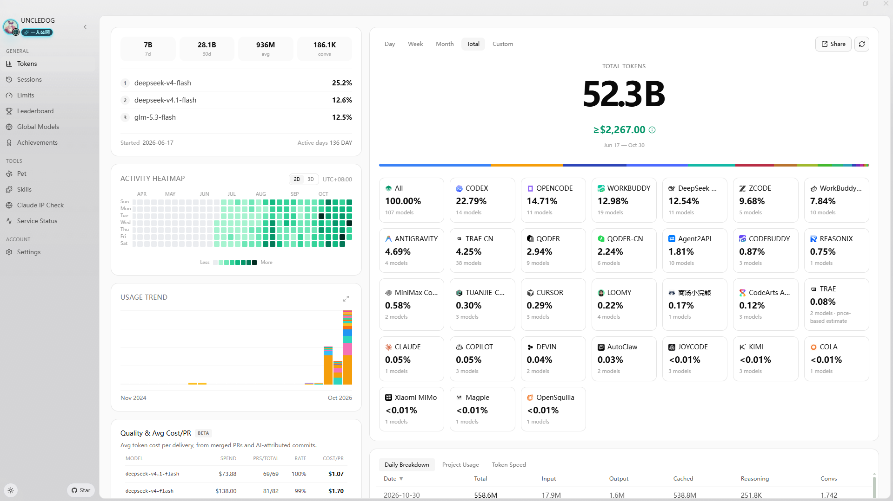
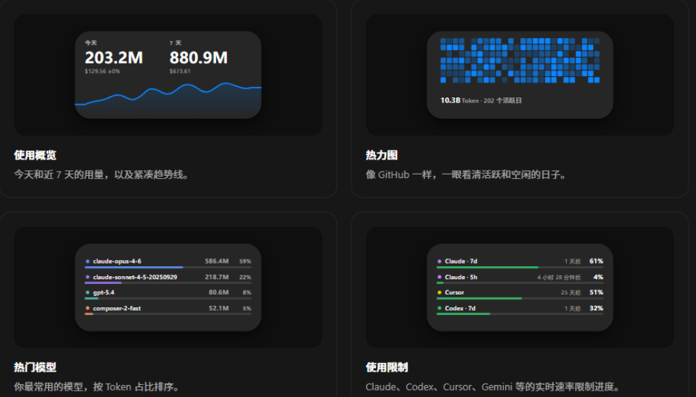
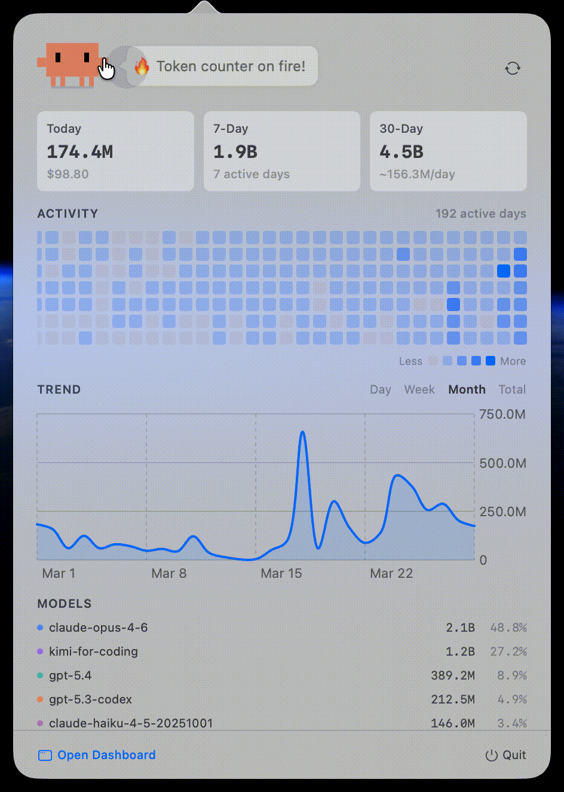
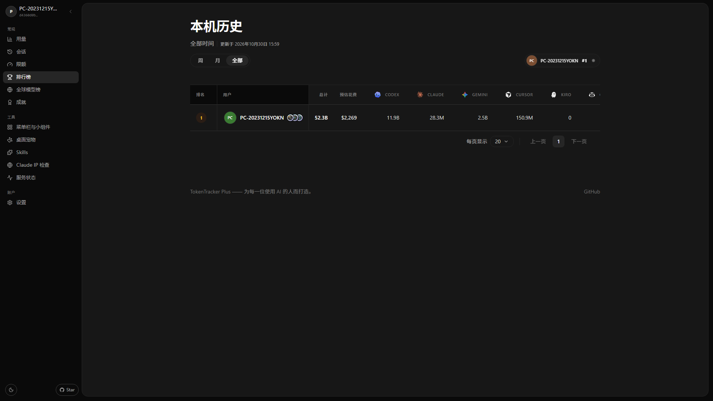
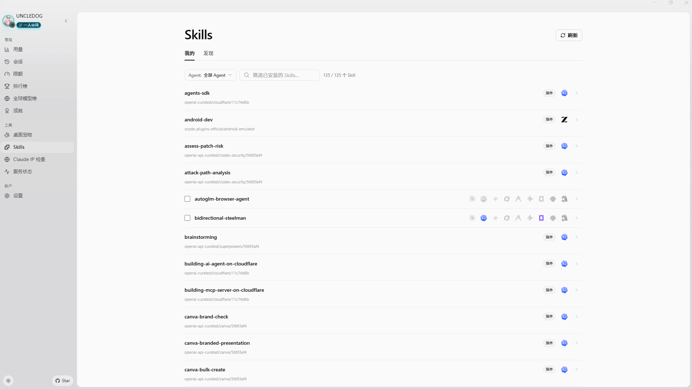
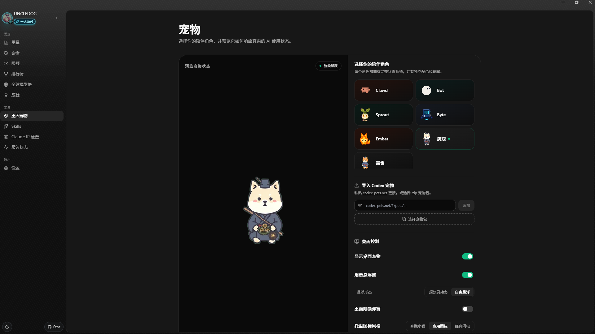
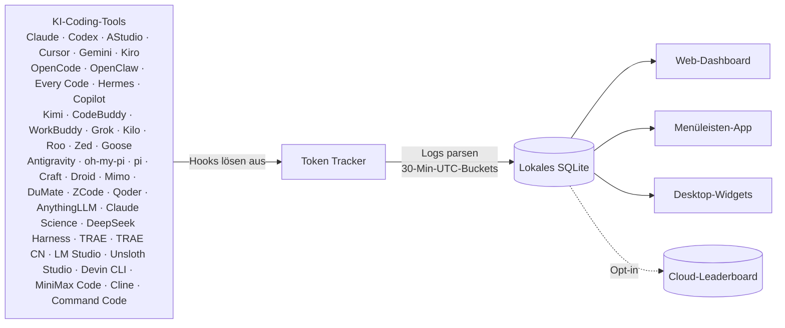

> **Dieses Repository ist ein persönlicher Fork („TT-plus“)** und nicht die
> Upstream-Distribution von TokenTracker: Er läuft gegen ein **selbst gehostetes**
> Backend (ein kleiner Node-+-PGlite-Server auf eigener Hardware), kommt **ohne die
> Bezahl-Oberfläche für Mitgliedschaften** (Leaderboard und Erfolge bleiben) und ist
> auf ein einzelnes privates Konto ausgelegt. Upstream-Projekt und vollständige
> Credits: [xiufengsun/TokenTracker](https://github.com/xiufengsun/TokenTracker) (MIT).

---

<div align="center">

# Token Tracker — TT-plus fork

[English](./README.md) · [简体中文](./README.zh-CN.md) · [日本語](./README.ja.md) · [한국어](./README.ko.md) · **Deutsch**

### Sieh genau, was du für KI ausgibst – über jedes CLI hinweg

Sammle automatisch Token-Zahlen von **50 KI-Coding-Tools**, aggregiere sie lokal und sieh echte Kostentrends in einem schönen Dashboard. Kein Cloud-Konto, keine API-Keys, kein Setup – nur ein Befehl.

[](https://opensource.org/licenses/MIT)
[](https://github.com/xiufengsun/TokenTracker/releases/latest)
[](https://github.com/xiufengsun/TokenTracker/releases/latest)

<br/>

<br/><br/>


<br/>


</div>

---

## ⚡ Schnellstart

> **This fork is not published to npm — run it from source.** Full instructions
> in the [English](./README.md#-quick-start) or [简体中文](./README.zh-CN.md#-快速开始) Quick Start.

```bash
git clone https://github.com/01UNCLEDOG01/TokenTracker-plus.git
cd TokenTracker-plus
npm install
node bin/tracker.js      # opens the dashboard at http://localhost:7680
```

---

## ✨ Features

- 🔌 **50 KI-Tools out of the box** — Claude Code, Codex CLI, AStudio, Cursor, Gemini CLI, Antigravity, Kiro, OpenCode, OpenClaw, Loomy, AutoClaw, Cola, Every Code, Hermes Agent, GitHub Copilot, Kimi Code, CodeBuddy, WorkBuddy, WorkBuddy AI, Grok Build, oh-my-pi, OmO, pi, Dots, Prime Agent, Craft Agents, Reasonix, Kilo CLI, Kilo Code, Roo Code, Zed Agent, Goose, Droid, Mimo Code, DuMate, ZCode, Qoder, AnythingLLM Desktop, Claude Science, DeepSeek Harness, TRAE CN, LM Studio, Unsloth Studio, Devin CLI, Cline, MiniMax Code, Command Code, TRAE, Tuanjie Cowork, Agent2API
- 🏠 **Local-First** — Läuft auf deinem Rechner. Parst Logs lokal, ohne Konto oder API-Keys.
- 🚀 **Zero Config** — Hooks installieren sich beim ersten Start automatisch. Von null zum Dashboard in 30 Sekunden.
- 📊 **Schönes Dashboard** — Nutzungstrends, Kostenaufschlüsselung nach Modell, GitHub-ähnliche Aktivitäts-Heatmap, Projektzuordnung
- 🖥️ **Native Desktop-App** — macOS Menüleiste (+ Widgets) und Windows System Tray, jeweils mit eingebautem Server und Dashboard in einer nativen WebView
- 🎨 **4 Desktop-Widgets** — Nutzung / Aktivitäts-Heatmap / Top-Modelle / Nutzungslimits auf dem Schreibtisch
- 📈 **Echtzeit-Nutzungslimits** — Limits für Claude / Codex / Cursor / Gemini / Kimi / Kiro / Grok / Copilot / Antigravity / ZCode / OpenCode Go / Qoder / Qoder CN / Command Code / Ark Coding Plan / Ark Agent Plan / Devin; ein Last-Good-Cache bleibt erhalten, wenn eine lokale Provider-App vorübergehend beendet wird
- 🟢 **Service-Statusseite** — Live-Betriebs- und Störungsstatus von 8 offiziellen Provider-Statusseiten
- 💰 **Kosten-Engine** — 2.200+ Modelle bepreist via [LiteLLM](https://github.com/BerriAI/litellm/blob/main/model_prices_and_context_window.json) (täglich aktualisiert) + kuratierte Overrides für Nischen-Tools; 24h-Disk-Cache + Offline-Snapshot für genaue USD-Angaben ohne Internetverbindung. Modelle ohne veröffentlichte Preise (z. B. Tencent hy3-preview) werden nach Token erfasst, zeigen aber 0 $ Kosten bis der Anbieter einen Preis veröffentlicht.
- 🌐 **Optionales Leaderboard** — Vergleiche dich mit Entwicklern weltweit; Spalten per Drag-and-Drop neu anordnen (Opt-in, Anmeldung erforderlich)
- 🧩 **Optionaler Skills-Tab** — 250+ öffentliche Skills von `anthropics/skills`, `ComposioHQ/awesome-claude-skills`, `skills.sh` und jedem GitHub-Repo durchsuchen; mit einem Klick über Claude / Codex / Grok / Antigravity / Gemini / OpenCode / Hermes synchronisieren
- 🔒 **Privacy-First** — Nur lokale Nutzungsmetriken (Token-Zahlen, Zeitstempel und Modellnamen). Prompts, Antworten und Code verlassen deinen Rechner nie.

---

## 🖼️ Vorschau

<table>
<tr>
<td width="50%">

**Dashboard** — Nutzungstrends, Modellaufschlüsselung, Kostenanalyse



</td>
<td width="50%">

**Desktop-Widgets** — Nutzung auf dem Schreibtisch



</td>
</tr>
<tr>
<td width="50%">

**Menüleisten-App** — Animierter Clawd-Begleiter + native Panels



</td>
<td width="50%">

**Globales Leaderboard** — Vergleich mit Entwicklern weltweit



</td>
</tr>
<tr>
<td colspan="2">

**Skills-Manager** — 250+ öffentliche Skills von GitHub & `skills.sh` durchsuchen, einmal installieren, mit Claude / Codex / Grok / Antigravity / Gemini / OpenCode / Hermes synchronisieren. Ein-/Ausschalten pro Tool, Undo mit einem Klick.



</td>
</tr>
<tr>
<td colspan="2">

**Desktop-Pet** — ein Pixel-Begleiter, der auf dem Desktop schwebt und auf den echten Token-Verbrauch reagiert: Er codet mit, feiert Streaks und schläft in Pausen. Community-Pets per [codex-pets.net](https://codex-pets.net)-Link oder `.codex-pet.zip` importieren — V2-Pets folgen dem Cursor mit dem Blick in 16 Richtungen. macOS, Windows und Web.



</td>
</tr>
</table>

---

## 🔌 Unterstützte KI-Tools

| Tool | Erkennung | Methode |
|---|---|---|
| **Claude Code** | ✅ Auto | SessionEnd-Hook in `settings.json` |
| **Codex CLI** | ✅ Auto | TOML-Notify-Hook in `config.toml` |
| **AStudio** | ✅ Auto | TOML-Notify-Hook in `config.toml` |
| **Cursor** | ✅ Auto | API + SQLite-Auth-Token |
| **Kiro** | ✅ Auto | SQLite + JSONL hybrid |
| **Gemini CLI** | ✅ Auto | SessionEnd-Hook |
| **OpenCode** | ✅ Auto | Plugin-System + SQLite |
| **OpenClaw** | ✅ Auto | Session-Plugin |
| **Every Code** | ✅ Auto | TOML-Notify-Hook |
| **Hermes Agent** | ✅ Auto | SQLite Sessions-Tabelle (`~/.hermes/state.db`) |
| **GitHub Copilot App / CLI** | ✅ Auto | Vereinheitlichte SQLite-Nutzung pro Anfrage (`~/.copilot/session-store.db`); App-DB als Legacy-Baseline |
| **GitHub Copilot Chat-Erweiterung / ältere CLI** | ✅ Auto | OpenTelemetry-Datei-Exporter (`COPILOT_OTEL_FILE_EXPORTER_PATH`) |
| **Kimi Code** | ✅ Auto | Passiver `wire.jsonl`-Reader (`~/.kimi/sessions/**/wire.jsonl`) |
| **oh-my-pi (Pi Coding Agent)** | ✅ Auto | Passiver Reader (`~/.omp/agent/sessions/**/*.jsonl`) |
| **CodeBuddy** (Tencent) | ✅ Auto | SessionEnd-Hook in `~/.codebuddy/settings.json` (Claude-Code-Fork) |
| **WorkBuddy** (Tencent) | ✅ Auto | SessionEnd-Hook in `~/.workbuddy/settings.json` (Claude-Code-Fork) + passiver `projects/**/*.jsonl`-Scan |
| **Grok Build** (xAI) | ✅ Auto | SessionEnd-Hook + passiver `updates.jsonl` / `signals.json`-Scan (`~/.grok/sessions/**/`) |
| **Kilo CLI** (kilo.ai) | ✅ Auto | Passiver SQLite-Reader (`~/.local/share/kilo/kilo.db`, OpenCode-Fork-Schema) |
| **Kilo Code** (VS Code Extension) | ✅ Auto | Passiver `ui_messages.json`-Reader (Cursor/Code/CodeBuddy/Windsurf globalStorage) |
| **Antigravity** | ✅ Auto | Passiver Transcript-Reader (`~/.gemini/{antigravity,antigravity-ide,antigravity-cli}/brain/**/transcript.jsonl`) |
| **pi** (`@mariozechner/pi-coding-agent`) | ✅ Auto | Passiver Reader (`~/.pi/agent/sessions/**/*.jsonl`) |
| **Dots** | ✅ Auto | Über pis Provider-Split geroutet (`pi-dots` source, derselbe passive Reader) — kein eigener Hook |
| **Prime Agent** | ✅ Auto | Metadatenbasierter passiver Usage-Reader (`~/.prime/agent/sessions/*.jsonl`) |
| **Craft Agents** | ✅ Auto | Passiver Session-Reader (`~/.craft-agent` + Workspace-Session-Logs) |
| **Reasonix** | ✅ Auto | Passiver Telemetrie-Reader (`~/.reasonix/**/*.jsonl.telemetry.json`) |
| **Roo Code** (VS Code Extension) | ✅ Auto | Passiver `ui_messages.json`-Reader (`rooveterinaryinc.roo-cline`) |
| **Zed Agent** | ✅ Auto | Passiver SQLite-Reader (`threads.db`, nur `zed.dev`-Modelle) |
| **Goose** (Block) | ✅ Auto | Passiver SQLite-Reader (`sessions.db`, kumulative Deltas) |
| **Droid** (Factory) | ✅ Auto | Passiver Session-Reader (`~/.factory/sessions/**/settings.json`, kumulative Deltas) |
| **Mimo Code** (mimocode) | ✅ Auto | Passiver SQLite-Reader (`~/.local/share/mimocode/mimocode.db`, OpenCode-Fork-Schema; zählt nur mimo-native Turns – gespiegelte Claude/claude-mem-Verläufe werden ausgeschlossen) |
| **DuMate** (Baidu) | Auto | Passiver OpenCode-SQLite-Reader (`%APPDATA%/qianfan-desktop-app/qianfan_desk_xdg/*/data/opencode/opencode.db`); eigene Quelle `dumate` mit Deduplizierung von Neuinstallationskopien. Override: `TOKENTRACKER_DUMATE_HOME`. [Details](docs/dumate.md) |
| **ZCode** (Z.ai) | ✅ Auto | Passiver SQLite-Reader (`~/.zcode/cli/db/db.sqlite`, OpenCode-Fork-Schema; zählt nur Z.ai/BigModel-GLM-Turns – gebündelte Claude/Codex/Gemini-Sub-Agenten werden ausgeschlossen) |
| **Qoder** | ✅ Auto | Passiver SQLite-Reader (`Qoder/SharedClientCache/cache/db/local.db`; liest nur assistant-`token_info`, trennt Cache-Eingaben und liest keine Prompts oder Antworten) sowie Plan Credits und Ultimate-Gratisaufrufe aus der lokalen Qoder-Sitzung |
| **LM Studio** | ✅ Auto | Passiver rekursiver Reader für `~/.lmstudio/server-logs/**/*.log`; liest aus finalen Chat-Completions- und Responses-API-Datensätzen nur ID, Modell, Zeitstempel und skalare `usage`-Zähler und dedupliziert gespiegelte Antwort-IDs. Prompt- und Antworttexte werden nicht gespeichert. Diese Daten decken lokale Inferenz und LM Link mit $0 API-Grenzkosten ab, nicht die Bionic-Secure-Cloud-Abrechnung. |
| **Unsloth Studio** | ✅ Auto | Passiver SQLite-Reader für `$UNSLOTH_STUDIO_HOME/studio.db` (Standard `~/.unsloth/studio/studio.db`). Liest nur skalare `contextUsage`-Metadaten und inhaltsfreie `api_usage_events`; Prompts, Antworten, Anhänge, API-Subjects, Zugangsdaten und Trainingsmetriken bleiben ausgeschlossen. Lokale Routen bleiben bei $0, bekannte kostenpflichtige Provider werden anhand des tatsächlich antwortenden Modells geschätzt. |
| **AnythingLLM Desktop** | ✅ Auto | Passiver SQLite-Reader (`anythingllm-desktop/storage/anythingllm.db`, nur Token-Metriken pro Nachricht) |
| **Devin CLI** (Cognition) | ✅ Auto | Passiver SQLite-Reader (`$XDG_DATA_HOME/devin/cli/sessions.db`, Standard `~/.local/share/devin/cli/sessions.db`). Liest Usage-Metriken pro Anfrage, dedupliziert nach `request_id` — Replay-/Fork-/Compaction-Kopien werden nicht doppelt gezählt — und verwendet das aufgezeichnete Generation-Modell; niemals Prompts, Antworten oder `cogs_json`. Für Devin-Modelle (`swe-2`, `swe-2-high`, `compactor`) gibt es derzeit keine Preisdaten: Token-Zahlen werden erfasst, aber nicht in Dollar-Schätzungen einbezogen — ein $0-Wert bedeutet keine kostenlose Nutzung. Kein bekanntes natives Windows-Datenverzeichnis; eine WSL-Installation wird über `\\wsl$` gelesen. |
| **Cline** (CLI v3 / Desktop-App) | ✅ Auto | Passiver Reader (`~/.cline/data/sessions/<id>/*.messages.json`). Die `metrics` jedes Turns sind Usage-Deltas, in denen `inputTokens` bereits Cache-Lesen+Schreiben und `outputTokens` bereits Reasoning enthalten — der Cache-Präfix wird abgezogen und Reasoning nie doppelt abgerechnet; Clines eigener gemeldeter `cost` hat Vorrang. `cline-free/*`- und `cline-pass/*`-Gateway-Modelle kosten $0. Der globalStorage der VS-Code-Erweiterung wird nicht gelesen. Pfad-Overrides: `TOKENTRACKER_CLINE_SESSIONS_DIR`, `TOKENTRACKER_CLINE_DATA_DIR`, `TOKENTRACKER_CLINE_HOME`, `CLINE_SESSION_DATA_DIR`, `CLINE_DATA_DIR` oder `CLINE_DIR` |
| **MiniMax Code** | ✅ Auto | Passiver Reader (`~/.minimax/v2/sessions/YYYY/MM/DD/<session>/messages.jsonl`). Dedupliziert nach `message_id`, erfasst das geroutete Upstream-Modell pro Nachricht und ignoriert das stets leere `usage.cost` zugunsten der normalen Preise. Verzeichnis per `TOKENTRACKER_MINIMAX_HOME` überschreibbar |
| **Command Code** | ✅ Auto | Passiver Session-Log-Reader (`~/.commandcode/projects/<cwd-slug>/<session-id>.jsonl`; `*.checkpoints.jsonl`-Snapshots und `.prompts.`-Begleitdateien werden übersprungen). Scannt Transkripte lokal und extrahiert ausgewählte Nutzungsmetadaten wie Token-Zähler und den CLI-Anzeigeschätzwert `costUsd`. Token Tracker schätzt die Kosten stattdessen anhand seiner gemeinsamen Modellpreistabelle. Zieht Cache-Lese- und Cache-Schreib-Tokens vom cache-inklusiven Input ab, um Doppelzählungen zu vermeiden. Prompt-, Antwort- und Code-Inhalte werden von Token Tracker weder gespeichert noch hochgeladen. Verzeichnis per `TOKENTRACKER_COMMANDCODE_HOME` überschreibbar |
| **Claude Science** | ✅ Auto | Passiver SQLite-Reader (`~/.claude-science/operon-cli.db`, nur die Token-Zähler der `frames`-Tabelle; keine Prompts, Artefakte oder Forschungsinhalte). Kein natives Windows-Build — unter Windows läuft die App in WSL und wird von dort gelesen. |
| **DeepSeek Harness** | ✅ Auto | Passiver Session-Reader (`~/.dsh/sessions/**/session.jsonl[.zstd]`; liest Session-Header und Assistant-Ereignisse, unterstützt Zstandard mit mehreren Frames) |
| **TRAE (international)** | ✅ Auto | Lokale SQLCipher-Nutzungsdaten aus TRAE / TRAE SOLO mit dem gemeinsamen Anwendungsschlüssel als Standard; optionaler Override über `TOKENTRACKER_TRAE_SQLCIPHER_KEY`. Keine Anbieter-API-Aufrufe. [Einrichtung und Grenzen](docs/trae.md). |
| **TRAE CN** | ✅ Auto | **Erfordert eine ausdrückliche Zustimmung: `TOKENTRACKER_TRAE_CN_USAGE=1` setzen.** Das Lesen der Nutzung überträgt die lokal gespeicherte Anmeldeautorisierung an die interne API von TRAE, daher wird nichts gesendet, bevor du es aktivierst. Danach: liest bei vorhandener lokaler TRAE CN-Anmeldung während eines zulässigen Syncs außerhalb des Hintergrundbetriebs unter macOS die Session-Token-Nutzung der angemeldeten App; die interne API kann sich ändern |

> **Muss ich Plugins oder Hooks manuell installieren?** Nein. `tokentracker` (oder `tokentracker init`) erledigt alles beim ersten Start:
> - **Hook-basiert** (Claude Code, Codex, AStudio, Gemini, Every Code, CodeBuddy, WorkBuddy, WorkBuddy AI, Grok Build) — wir schreiben einen SessionEnd-Hook oder TOML-Notify-Eintrag in die Konfiguration des Tools.
> - **Plugin-basiert** (OpenCode, OpenClaw) — das Plugin ist im npm-Paket enthalten (`~/.tokentracker/app/openclaw-plugin/`). Wir verlinken es per CLI (`openclaw plugins install --link …` + `enable`). Kein Download, kein Drag-and-Drop.
> - **Passive Reader** (Cursor, Kiro, Hermes, Kimi Code, Copilot, Grok Build, oh-my-pi, pi, Craft Agents, Reasonix, Kilo CLI, Kilo Code, Roo Code, Antigravity, Zed Agent, Goose, Droid, Mimo Code, DuMate, ZCode, LM Studio, Unsloth Studio, AnythingLLM Desktop, Devin CLI, MiniMax Code, Claude Science, DeepSeek Harness, Cline) — wir installieren nichts in diesen Tools. Wir lesen nur Dateien, die sie bereits produzieren (SQLite-DB, JSONL, OTEL-Export, Session-Logs). Die Nutzung von Copilot App / CLI wird pro Anfrage aus `~/.copilot/session-store.db` gelesen; `data.db` liefert einmalig die Legacy-Migrationsbasis und bleibt nach der kanonischen Übernahme des Stores schreibgeschützt im Beobachtungsmodus, während Chat-Erweiterung und ältere CLI-Versionen weiterhin OTEL verwenden. TokenTracker koordiniert diese Quellen, damit überlappende Anfragen nur einmal gezählt werden. Gemischte App/CLI-Historie vor der Übernahme bleibt als `github-copilot-legacy`-Aggregat erhalten, statt einem geratenen Anfrage-Modell zugeordnet zu werden.
>
> Führe `tokentracker status` aus, um den Status jeder Integration zu prüfen. Zeigt ein Tool `skipped`, erklärt die `detail`-Spalte warum.
>
> Tiefergehend: [OpenClaw-Integration & Troubleshooting](docs/openclaw-integration.md).

Fehlt dein Tool? [Erstelle ein Issue](https://github.com/xiufengsun/TokenTracker/issues/new) — neue Provider sind meist nur eine Parser-Datei entfernt.

---

## 🆚 Warum TokenTracker? <a id="ccusage-alternative"></a>

> **Suchst du ein Desktop-orientiertes Tracking-Tool mit Widgets und visuellem Dashboard?** TokenTracker kombiniert Local-First-Parsing für zahlreiche KI-Coding-Tools mit nativen Desktop-Apps, Desktop-Widgets, Provider-übergreifendem Quota-Monitoring und optionalem Cloud-Sync.

| Funktion | **[TokenTracker](https://github.com/xiufengsun/TokenTracker)** | **[ccusage](https://github.com/ccusage/ccusage)** | **[Tokscale](https://github.com/junhoyeo/tokscale)** |
|---|:---:|:---:|:---:|
| **Unterstützte KI-Tools** | **50** | Multi-Agent | Multi-Agent |
| **Primäre Benutzeroberfläche** | Native Desktop-Apps & Web-Dashboard | Terminal-CLI | Terminal-TUI & CLI |
| **Local-First-Analyse** | ✅ | ✅ | ✅ |
| **Native Desktop-Apps** | ✅ macOS, Windows, Linux | ❌ | ❌ |
| **Desktop-Widgets** | ✅ 4 Widgets | ❌ | ❌ |
| **Rate-Limit-Tracking** | ✅ 17 Provider | Eingeschränkt (Claude-Blocks) | Mehrere Provider |
| **Terminal-Analytics** | Basis-CLI (`status`, `--json`) | Starkes CLI-Reporting | Umfangreiche interaktive TUI & CLI |
| **JSON-Export** | ✅ | ✅ | ✅ |
| **Öffentliches Leaderboard** | Optional (Opt-in) | ❌ | Optional (`submit`) |

---

## 🏗️ Wie es funktioniert



1. KI-CLI-Tools erzeugen Logs während der normalen Nutzung
2. Leichtgewichtige Hooks erkennen Änderungen und lösen Sync aus (Cursor nutzt API statt Hooks)
3. Token-Zahlen und Metadaten werden lokal geparst – Prompt- und Response-Inhalte werden nie gespeichert oder hochgeladen
4. In 30-Minuten-UTC-Buckets aggregiert
5. Dashboard, Menüleisten-App und Widgets lesen vom gleichen lokalen Snapshot

---

## 🛡️ Datenschutz

> 📄 **[Vollständige Datenschutzerklärung](docs/PRIVACY.md)** (englisch) — jede Netzwerkanfrage, die die App stellen kann, was dabei gesendet wird und wie man sie abschaltet.

TokenTracker verarbeitet deine Nutzungsdaten lokal. Prompts, Code oder Modellantworten werden niemals erfasst oder hochgeladen.

| Schutz | Beschreibung |
|---|---|
| **Keine Erfassung von Code oder Prompts** | TokenTracker parst lokale Protokolldateien nach Token-Zahlen und Zeitstempeln. Prompts, Modellantworten, Code und Konversationsinhalte werden nie gespeichert oder hochgeladen. |
| **Standardmäßig Local-First** | Die Nutzungserfassung läuft vollständig auf deinem Rechner. Kein Account, kein Login und keine API-Keys erforderlich. Cloud-Sync und das öffentliche Leaderboard sind rein optional (Opt-in). |
| **Überprüfbar** | Open Source. Sieh selbst in [`src/lib/rollout.js`](src/lib/rollout.js) – es werden nur Zahlen, Zeitstempel und Modellnamen extrahiert. |
| **Transparente Netzwerkaktivität** | Vollständig in der [Datenschutzerklärung](docs/PRIVACY.md) dokumentiert. Standardanfragen beschränken sich auf direkte Provider-Quota-Abfragen (mit bereits lokal vorhandenen Zugangsdaten), GitHub-Star-Counts, Versionsprüfungen, Aktualisierungen der Preisdaten (`raw.githubusercontent.com`) sowie anonyme Telemetrie (täglicher Heartbeat + PostHog-Aufrufe, beide deaktivierbar via `TOKENTRACKER_NO_TELEMETRY=1` oder `DO_NOT_TRACK=1`). Telemetrie enthält niemals Tokens, Modelle, Prompts oder Code. |

---

## 📦 Konfiguration

Die meisten Nutzer brauchen das nie – die Standardwerte sind sinnvoll. Für fortgeschrittene Setups:

| Variable | Beschreibung | Standard |
|---|---|---|
| `TOKENTRACKER_DEBUG` | Debug-Ausgabe aktivieren (`1` zum Aktivieren) | — |
| `TOKENTRACKER_NO_TELEMETRY` | Alle anonyme Telemetrie deaktivieren — täglicher Heartbeat und Dashboard-Analytics (`1` zum Deaktivieren; der `DO_NOT_TRACK`-Standard wird ebenfalls respektiert) | — |
| `TOKENTRACKER_HTTP_TIMEOUT_MS` | HTTP-Timeout in Millisekunden | `20000` |
| `TOKENTRACKER_DISABLE_GIT_ATTRIBUTION` | Git-Commit-Zuordnung deaktivieren (`1` zum Deaktivieren). Die Zuordnung führt `git log` im Arbeitsverzeichnis jeder jüngeren Sitzung aus. Deaktiviert bleibt TokenTracker vollständig aus deinen Projektverzeichnissen heraus (Outcomes zeigt dann nur manuell erfasste Ergebnisse) | — |
| `TOKENTRACKER_GIT_ATTRIBUTION_PROTECTED_DIRS` | Der Git-Zuordnung Zugriff auf TCC-geschützte macOS-Orte erlauben (`1` zum Erlauben). Standardmäßig werden Sitzungen unter `~/Documents`, `~/Downloads`, `~/Desktop`, `~/Library`, den Medienordnern und `/Volumes` übersprungen, weil macOS für jeden Ort einen eigenen Zugriffsdialog anzeigt. Nur aktivieren, wenn du dort Repositories liegen hast und den Zugriff gewähren möchtest | — |
| `TOKENTRACKER_WSL_MODE` | WSL-Installations-Auflösungsverhalten unter Windows (zur Aggregation von nativen und WSL-Installationen). `wsl-first` (bevorzugt WSL), `native-first`, `wsl-only`, `native-only`, `both` (aggregiert beide Installationen) | `wsl-first` |
| `CODEX_HOME` | Codex CLI-Verzeichnis überschreiben | `~/.codex` |
| `TOKENTRACKER_ACODE_HOME` | AStudio-Verzeichnis überschreiben | `~/.acode` |
| `GEMINI_HOME` | Gemini CLI-Verzeichnis überschreiben | `~/.gemini` |
| `TOKENTRACKER_GROK_HOME` | Grok Build-Verzeichnis für Grok-Integration und Skills-Manager | `~/.grok` |
| `GROK_HOME` | Legacy-Grok-Build-Verzeichnis, falls `TOKENTRACKER_GROK_HOME` nicht gesetzt | `~/.grok` |
| `TOKENTRACKER_ANTIGRAVITY_HOME` | Einzelnes Antigravity-Skills-Verzeichnis erzwingen (sonst Auto-Erkennung von `~/.gemini/antigravity` + `~/.gemini/antigravity-ide`) | auto |

### 🐧 WSL-Erkennung unter Windows (WSL Auto-Discovery)

Wenn du KI-Coding-Agents unter Windows in WSL verwendest, kann TokenTracker deine Windows- und WSL-Installationen automatisch erkennen und die Token-Nutzung zusammenrechnen.

Konfiguriere dieses Verhalten über die Umgebungsvariable `TOKENTRACKER_WSL_MODE`:
* `both` (Empfohlen): Liest und addiert die Daten aus beiden Umgebungen (Windows und WSL).
* `wsl-first` (Standard): Bevorzugt WSL. Wenn Daten in WSL vorliegen, werden diese genutzt, andernfalls die von Windows.
* `native-first`: Bevorzugt Windows. Wenn Daten unter Windows vorliegen, werden diese genutzt, andernfalls die von WSL.
* `wsl-only`: Liest ausschließlich die Daten aus der WSL-Umgebung.
* `native-only`: Liest ausschließlich die Daten aus der nativen Windows-Umgebung.

> [!NOTE]
> **Präferenz (`-first`) vs. Isolierung (`-only`):** Präferenzmodi bevorzugen deine Auswahl, weichen aber automatisch auf die andere Umgebung aus, falls das Tool dort fehlt. Isolierungsmodi beschränken den Scan strikt auf eine Umgebung und ignorieren die andere komplett.

Unterstützte Provider für WSL-Erkennung und Zusammenführung (Aggregation):
* **Zusammenführung bei paralleler Installation (`both`-Modus):**
  * **Dateibasiert (Logs & Transkripte):** Every Code, Kimi (legacy & Code), Gemini CLI, Antigravity, OpenCode (JSON), Codex CLI, CodeBuddy, WorkBuddy, WorkBuddy AI, oh-my-pi (omp), pi, GitHub Copilot (OTEL), Roo Code, Craft, Kilo Code, Droid.
  * **Datenbankbasiert (SQLite):** Hermes, Zed Agent, Goose, OpenCode (`opencode.db`), Kilo CLI, Mimo Code, DuMate, ZCode, GitHub Copilot (App DB).
* **WSL-Erkennung (nur Präferenz/Isolierung, keine Zusammenführung):**
  * Grok Build (wählt dynamisch entweder die native oder WSL-Umgebung je nach Modus, führt aber im `both`-Modus nicht beide zusammen).
  * Devin CLI (kein bekanntes natives Windows-Datenverzeichnis — die automatische Erkennung findet daher nur eine WSL-Installation; im `native-only`-Modus wird nichts gefunden und `both` aggregiert niemals eine native Kopie). Das `TOKENTRACKER_DEVIN_DB`-Override verweist weiterhin auf eine explizite Datenbankdatei.

---

## 🛠️ Entwicklung

```bash
git clone https://github.com/01UNCLEDOG01/TokenTracker-plus.git
cd TokenTracker
npm install

# Dashboard bauen + CLI ausführen
cd dashboard && npm install && npm run build && cd ..
node bin/tracker.js

# Tests
npm test
```

### macOS-App bauen

```bash
cd TokenTrackerBar
npm run dashboard:build              # Dashboard-Bundle bauen
./scripts/bundle-node.sh             # Node.js + tokentracker-Quellen bündeln
xcodegen generate                    # Xcode-Projekt generieren
ruby scripts/patch-pbxproj-icon.rb   # Icon-Composer-Asset einspielen
xcodebuild -scheme TokenTrackerBar -configuration Release clean build
./scripts/create-dmg.sh              # .app in DMG verpacken
```

Erfordert **Xcode 16+** und [XcodeGen](https://github.com/yonaskolb/XcodeGen).

---

## 🔧 Fehlerbehebung

### CLI

<details>
<summary><b>Fehler „engines.node" oder nicht unterstützte Node-Version</b></summary>

<br/>

TokenTracker benötigt **Node 20+**. Prüfe deine Version:

```bash
node --version
```

Falls niedriger, aktualisiere via [nvm](https://github.com/nvm-sh/nvm), [fnm](https://github.com/Schniz/fnm) oder deinem Paketmanager (`brew upgrade node`, `apt install nodejs`).

</details>

<details>
<summary><b>Port 7680 bereits belegt</b></summary>

<br/>

Der Dashboard-Server wählt automatisch den nächsten freien Port (`7681`, `7682`, …), wenn `7680` belegt ist. Der tatsächliche Port wird beim Start ausgegeben. Um einen bestimmten Port zu erzwingen:

```bash
PORT=7700 tokentracker serve
```

Herausfinden, was `7680` blockiert:

```bash
lsof -i :7680
```

</details>

<details>
<summary><b>Ein Provider wird nicht erkannt</b></summary>

<br/>

Integrationsstatus prüfen:

```bash
tokentracker status
```

Für einen tiefergehenden Health Check:

```bash
tokentracker doctor
```

Zeigt ein Provider `not configured`, obwohl du ihn nutzt, versuche `tokentracker activate-if-needed`. Falls immer noch fehlend, [erstelle ein Issue](https://github.com/xiufengsun/TokenTracker/issues/new) mit der `doctor`-Ausgabe.

</details>

<details>
<summary><b>Hooks deinstallieren und Konfiguration löschen</b></summary>

<br/>

```bash
tokentracker uninstall
```

Entfernt alle von TokenTracker installierten Hooks sowie die lokale Konfiguration und Daten. Kann bedenkenlos wiederholt werden.

</details>

### macOS-App

<details>
<summary><b>„TokenTrackerBar kann nicht geöffnet werden" – nicht verifizierter Entwickler</b></summary>

<br/>

TokenTrackerBar ist **ad-hoc signiert** (nicht notariell beglaubigt mit einer Apple Developer ID – das erfordert ein kostenpflichtiges Developer-Konto). Gatekeeper blockiert sie beim ersten Start.

1. **Systemeinstellungen → Datenschutz & Sicherheit** öffnen
2. Zum Bereich **Sicherheit** scrollen – dort steht *„TokenTrackerBar wurde blockiert, um deinen Mac zu schützen."*
3. **Trotzdem öffnen** klicken
4. Mit **Öffnen** im Folgedialog bestätigen (Authentifizierung erforderlich)

Nur einmal nötig. Alternative unter älterem macOS: Rechtsklick auf die App im Finder → **Öffnen** → **Öffnen** im Bestätigungsdialog.

</details>

<details>
<summary><b>„TokenTrackerBar ist beschädigt und kann nicht geöffnet werden"</b></summary>

<br/>

Das ist Gatekeeper, das auf das `com.apple.quarantine`-Attribut reagiert – kein echtes Problem. Einmalig beheben mit:

```bash
xattr -cr /Applications/TokenTracker.app
```

Danach öffnet die App normal.

</details>

<details>
<summary><b>„TokenTrackerBar möchte auf Daten anderer Apps zugreifen"</b></summary>

<br/>

Das wird für die **Cursor**- und **Kiro**-Integration benötigt. Sie speichern Auth-Tokens / Nutzungsdaten in eigenen `~/Library/Application Support/`-Ordnern, die macOS mit der App-Management-Berechtigung schützt.

- ✅ **Erlauben** klicken, wenn du Cursor oder Kiro nutzt
- ❌ **Nicht erlauben** klicken, wenn nicht – diese Provider werden übersprungen, alles andere funktioniert

Nach einmaliger Gewährung wird die Berechtigung gemerkt. Ad-hoc-signierte Builds fragen nach jedem Update erneut, da jeder Build eine neue Signatur hat.

</details>

---

## Der gehostete Badge-Dienst des Upstream-Projekts ist in diesem Fork nicht verfügbar (selbst gehostetes Backend, authentifizierter Endpunkt). Details in der englischen README.
---


---

## 🤝 Beitragen & Support

- **Bugs / Feature-Wünsche**: [Issue erstellen](https://github.com/xiufengsun/TokenTracker/issues/new)
- **Sicherheit**: Siehe [SECURITY.md](SECURITY.md) – bitte keine öffentlichen Issues für Sicherheitsmeldungen
- **Pull Requests**: Siehe [CONTRIBUTING.md](CONTRIBUTING.md) für Setup, Tests und das Hinzufügen neuer KI-Tool-Integrationen
- **Fragen / Vorstellungen**: [GitHub Discussions](https://github.com/xiufengsun/TokenTracker/discussions)

## 🙏 Danksagungen

Die Morphing-Engine des `bot`-Begleiters ist [bloub](https://github.com/jeremy-prt/bloub) von Jérémy Perret (MIT).

Das Clawd-Charakterdesign gehört Anthropic. Dies ist ein Community-Projekt ohne offizielle Verbindung zu Anthropic.


## Lizenz

[MIT](LICENSE)

---

<div align="center">

**Token Tracker (TT-plus fork)** — Quantify your AI output, on your own hardware.

<a href="https://github.com/01UNCLEDOG01/TokenTracker-plus">this fork</a>  ·  <a href="https://github.com/xiufengsun/TokenTracker">upstream project</a>

</div>
