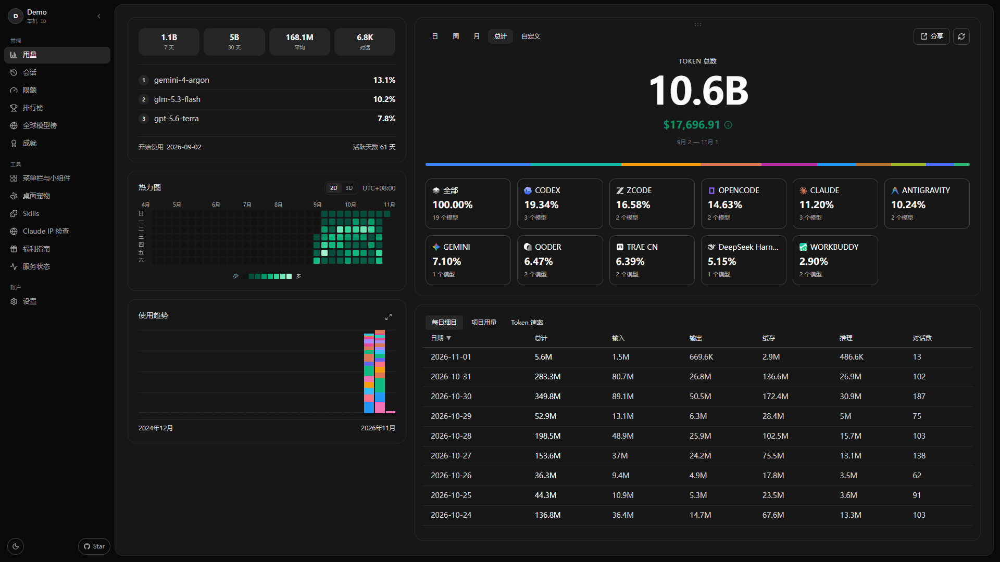
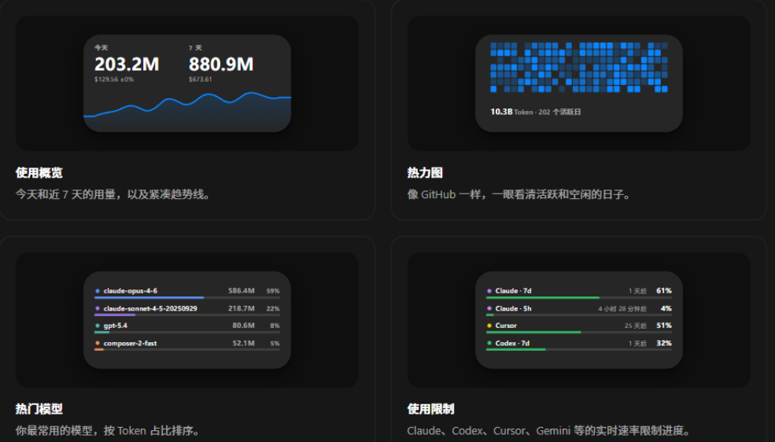
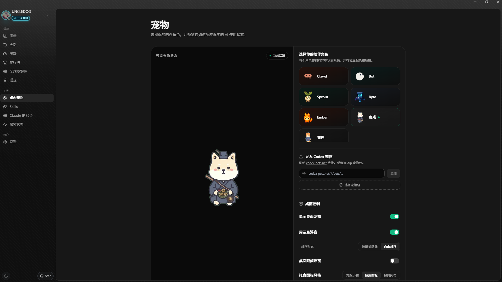
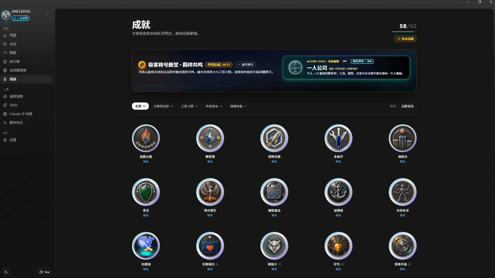
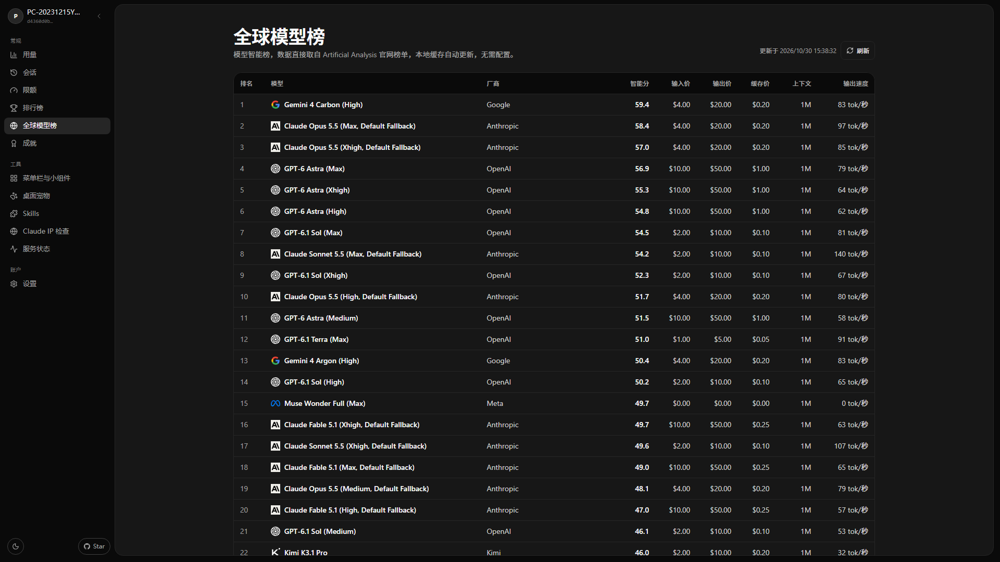
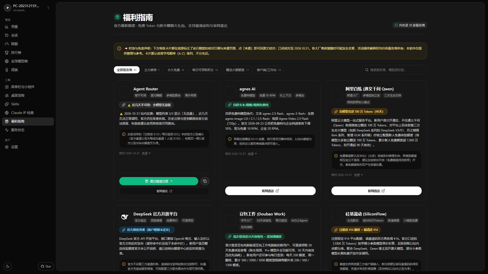
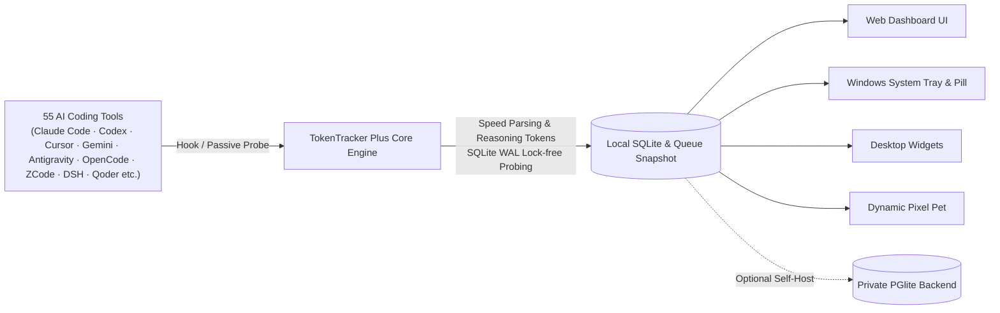

<div align="center">
  
  <h1>TokenTracker Plus (TT-plus)</h1>
  <p><strong>Track real AI token costs, session topologies, and real-time generation speeds across 55 AI coding tools & IDEs</strong></p>
  <p>
    <a href="./README.md">简体中文</a> · <a href="./README.zh-TW.md">繁體中文</a> · <b>English</b> · <a href="./README.ja.md">日本語</a> · <a href="./README.ko.md">한국어</a> · <a href="./README.pt-BR.md">Português (BR)</a>
  </p>
  <p>
    <a href="./LICENSE"></a>
    <a href="#-supported-ai-tools-55"></a>
    <a href="#-quick-start"></a>
    <a href="#-data--privacy"></a>
    <a href="#-key-features"></a>
    <a href="#-heatmap-tiers--data-analytics"></a>
    <a href="https://github.com/01UNCLEDOG01/TokenTracker-Plus"></a>
  </p>
</div>

> 💡 **About this repository**: TT-plus is an enhanced standalone fork based on the original open-source project [xiufengsun/TokenTracker](https://github.com/xiufengsun/TokenTracker) (MIT License). Its core objectives are **100% local-first privacy**, **strict true-value billing**, **deep agent session topologies**, and **full-pipeline real-time token speed capture**. All original upstream design and copyrights belong to the upstream author. This fork is also open-sourced under the MIT License and is not officially supported or endorsed by the upstream project.

[✨ Key Features](#-key-features) · [🔌 Supported Tools](#-supported-ai-tools-55) · [⚡ Quick Start](#-quick-start) · [💰 Billing & Heatmap](#-billing--heatmap-standards) · [🖼️ Preview](#-preview) · [🆚 Comparison](#-why-choose-tokentracker-plus) · [🔒 Privacy](#-data--privacy) · [📜 Beginner's Guide](./docs/getting-started.zh-CN.md) · [❤️ Support](./SPONSOR.md)

---

## ⚡ Quick Start

> **Prerequisites**: running from source requires Node.js **20+**. The Windows installer bundles Node and the .NET runtime; users need Windows 10/11 and WebView2 Runtime. The .NET 8 SDK is required only to build the desktop app.

**Windows users — no build needed**: download `TokenTracker-Setup.exe` from [Releases](https://github.com/01UNCLEDOG01/TokenTracker-Plus/releases) and install. The setup bundles its own Node runtime — no account, no API key, no cloud service. New to the tool? Start with the [beginner's guide](./docs/getting-started.zh-CN.md) (Chinese).

> 💡 **About the Windows SmartScreen prompt**: This is an individual open-source project without a paid code-signing certificate, so Windows SmartScreen may show an "Unknown publisher" warning on first install. This is normal — click "More info" → "Run anyway" to proceed. The code is 100% open source and all data stays on your machine.

```bash
# 1. Clone the repository and install dependencies
git clone https://github.com/01UNCLEDOG01/TokenTracker-Plus.git
cd TokenTracker-Plus
npm install

# 2. First launch: automatically installs hooks, synchronizes local usage, and opens Dashboard
node bin/tracker.js

# Daily operations
node bin/tracker.js sync       # Trigger incremental sync
node bin/tracker.js status     # Inspect hook / parser status for all 55 tools
node bin/tracker.js status --json  # Machine-readable JSON output for AI pipelines
node bin/tracker.js doctor     # System diagnostics and health check
```

**What you can see in 30 seconds:**
- 📊 **Local Dashboard** (Windows desktop defaults to `http://localhost:17680`; the CLI `node bin/tracker.js serve` defaults to `7680`) — Total spend, daily trends, model breakdown, project attribution, and session trees.
- ⚡ **Millisecond Token Speed Stream** — Real-time generation speed (`tok/s`) across Antigravity, DeepSeek Harness, ZCode, OpenCode, and Kimi Code.
- 🔌 **Zero-Config Auto Detection** — Automatically discovers and hooks 55 AI tools on your machine without cloud account lock-in or API key risks. (Optional: a few limit cards read local credentials you refresh yourself, e.g. the Qoder quota cards use the repository's `Qoder-*-刷新Cookie` scripts — core usage tracking needs none of that.)
- 🏆 **65 Offline Achievements** — 100% evaluated from your local queue without connecting to any public leaderboard.

> **Looking for native desktop apps?**
> - **Windows** — Run `TokenTrackerWin` (C# .NET 8 + WebView2 system tray app), bundled with desktop pets, quota cards, and an always-on-top usage pill. See [TokenTrackerWin/README.md](./TokenTrackerWin/README.md).
> - **Other Platforms** — Run from source (`git clone` then `node bin/tracker.js`); no installers and no compatibility guarantee; the desktop application is currently Windows-only.

---

## ✨ Key Features

- 🔌 **Built for Multi-Platform Power Users (55 Tools)** — Designed specifically for developers juggling multiple AI tools. Aggregates fragmented logs across CLIs, VS Code / Cursor extensions, and IDEs into one unified ledger without switching between 10+ dashboards.
- 💰 **Exclusive True Valuation for Free Models** — Strictly rejects upstream zeroing of `-free` routes! Free tokens are valued at standard provider list prices, giving you exact metrics on how much compute value you saved (or "freeloaded"), plus unlocking the "Frugal Architect" badge and "Frugal Archmage" synergy title.
- ⚡ **Multi-source Token Generation Speed Capture** — Multi-source parser and lock-free SQLite WAL probing; millisecond-level chunk duration extraction, separate reasoning token accounting, and precise session `tok/s`.
- 🏠 **Local-first usage collection** — Parses on-device logs and databases without saving prompt, response or code bodies. Provider credentials are used only for the corresponding optional integrations; no first-party cloud service is bundled.
- 📊 **Lv0~Lv7 8-Tier Heatmap (Featuring Lv7 Singularity · 3B+ Tokens)** — Beyond previous ceilings! Exclusively unlocking the Lv7 "Singularity" tier for single-day bursts exceeding 3 Billion tokens with towering 3D voxel heights. With at least 8 active sample days, reaching P98.5 while exceeding P95 also qualifies for Lv7.
- 🌲 **Deep Session Topology & Agent Breakdown** — Drill down into primary sessions, tool calls, and subagent trees to pinpoint expensive operations; Trae CN merges both legacy Trae Work and modern Trae CN session databases.
- 🏆 **65 Offline Achievements & 17 3D Synergy Title Crests (Steam Stacked Toasts)** — 100% local offline unlocking; authentic Steam unlock audio, concurrent multi-toast vertical stacking (up to 3 toasts with hover-pause), bespoke 3D relief crest medallions with real-time UI/Leaderboard equip display, and Canvas battle report export.
- 🔄 **Continuous High-Frequency Maintenance** — The maintainer and community actively track new AI coding tools, promptly shipping parsers and quota monitor cards as new tools emerge.
- 🐱 **Desktop Pet & Widgets** — Floating pixel pets (multiple action cycles and cursor tracking), 4 desktop widgets, and always-on-top quota cards.
- 🌍 **Two global model leaderboards** — Switch between Artificial Analysis intelligence rankings and AIHOT overall rankings to compare scores, input/output/cache prices, context and output speed. Each has its own cache and labeled snapshot fallback. Missing metrics show “—”; measured zero values remain zero.
- 🎁 **Provider Perks Guide** — 53 providers and clients, with starter credits, daily/monthly benefits, standing free tiers and check-in credits. Active invite programs get invite links; every card has an official link, verification date and source. All cards use one A–Z order, choosing the earlier full Chinese pinyin or English brand name, with categories, search and claim markers. Claim reminders reset at Beijing midnight daily or on the first of each month. Cards with both cycles have separate marks; one-time marks remain. Open pages update across midnight or after sleep, and legacy dates migrate automatically.
- **Quota resilience and service status** — Cursor falls back to valid same-account quota caches during transient failures, while expired credentials still prompt sign-in. OpenCode shows official service status. WorkBuddy China and international editions keep separate plan and reward balances; the existing hover details show the earliest Beijing expiry day and the credits expiring that day, preserving fractions.
- **Codex speed-tier breakdown** — Expand models to see observed Standard / Fast / Ultrafast tokens and full tier costs, including cached and long-context usage. Provider cards and the all-models view share the same breakdown; total-cost calculation stays consistent.
- **Usage scope and read-only comparison** — A badge identifies local or account data; local data is the default. A temporary comparison is available only with an explicitly configured cloud instance, sign-in, enabled sync and working cloud reads. It does not change upload preferences and resets on account changes or when sync is disabled.
- **Session retention and local backup** — Drill into local Qoder editions, MiniMax, Devin and other sessions. Lightweight gzip snapshots retain only previously collected session statistics after source files are deleted; they cannot recover uncollected conversations. Export `.ttbackup` in Settings; imports on another machine preview changes and add missing data only.

- **Loading and dark-mode readability** — Local session responses use negotiated gzip and reuse list results during rebuilds. Disk snapshots use asynchronous I/O, a versioned format and a maximum age of 24 hours; legacy formats rebuild automatically. The page shows snapshot time and attempts background updates. Perks text, control borders and keyboard focus have stronger contrast. Startup serves the page before runtime copying and integration repair; shared JS/CSS assets are precompressed for transport.

---

## 🖼️ Preview

<table>
<tr>
<td width="50%">

**Web Dashboard** — Trends, model breakdown, cost analytics



</td>
<td width="50%">

**Desktop Widgets** — Live previews of usage overview, heatmap, top models and quota cards



</td>
</tr>
<tr>
<td width="50%">

**Desktop Pet** — 7 companion characters (2 more than upstream) reacting to token flow



</td>
<td width="50%">

**Offline Achievements** — 65 offline achievements, 17 synergy titles & Steam popups



</td>
</tr>
<tr>
<td colspan="2">

**Two Global Model Leaderboards** — Artificial Analysis and AIHOT in one page, with comparable metrics and prices, separate caches and “—” for missing values.



</td>
</tr>
<tr>
<td colspan="2">

**Provider Perks Guide** — free credits and starter grants across 53 providers, invite links on cards with active invite programs, official links on every card



</td>
</tr>
</table>

---

## 🆚 Why Choose TokenTracker Plus?

> **Looking for a tool that pairs comprehensive macro ledgers with real-time token speeds and deep topology?** Here is an objective comparison between TokenTracker Plus, the original TokenTracker, and Token Monitor:

| Feature Dimension | ⚡ **TokenTracker Plus (This Fork)** | 📦 **Original TokenTracker (Upstream)** | 🪟 **Token Monitor (TM)** |
|:---|:---:|:---:|:---:|
| **Architecture & Focus** | **Macro Ledger + Deep Topology + Real-Time Speed** | General All-in-One Dashboard (optional hosted cloud) | Minimalist Desktop Floating Widget |
| **AI tools supported** | **55** | 47 Tools | ~15 Tools (Mainstream model APIs & common CLIs) |
| **Rate-limit tracking** | **✅ 29 quota/balance sources** (Real-time quota windows & reset timers) | 10 providers | ⚠️ Basic quota display |
| **Primary Interaction** | **Windows Tray + Web Dashboard + Widgets + CLI** | macOS Menu Bar + Web Dashboard + Widgets + CLI | Minimal Desktop Floating Widget |
| **Data Privacy & Storage** | **100% Local-First** (Zero cloud requirement, WAL-aware) | Local SQLite + Optional official cloud sync | Local SQLite WAL (No macro historical reporting) |
| **Token Speed (tok/s)** | **✅ Native Support** (Source timing measurements, reasoning tokens) | ❌ Only totals and spend; no speed metrics | ✅ Supported (Key highlight of floating widget) |
| **Agent Topologies** | **✅ Deep Topology** (Primary/subagent drill-down, tool calls) | ⚠️ Basic flat session listing | ❌ Flat request stream only; no hierarchy |
| **Activity Heatmap** | **✅ 8 Tiers (Lv0~Lv7)** (Features Lv7 Singularity for 3B+ single-day bursts) | ⚠️ Traditional 4 tiers (Lv0~Lv4, saturated early) | ❌ No heatmap feature |
| **Cost Valuation Truth** | **✅ Strict List Pricing** (Rejects `-free` zeroing; WorkBuddy points) | ⚠️ Forces `-free` routes to $0; points unrefined | ⚠️ Basic pricing config with limited scope |
| **Achievements** | **✅ 65 Offline Achievements** (Local queue & debut catalog, 17 synergy titles) | ⚠️ Depends on official cloud server & leaderboard | ❌ No achievement system |
| **Desktop Companion** | **✅ Desktop Pet + Quota Pill + Floating Cards** | ✅ macOS menu bar mascot / Basic widgets | ⚠️ Basic floating window |
| **Open Source & Transparency** | **✅ 100% Open Source** (Fully auditable, MIT) | ✅ Open Source (MIT) | ⚠️ Packaged Electron asar binary |

---

## 🔌 Supported AI Tools (55)

The repo supports **55 AI coding tools** (from `SUPPORTED_PROVIDERS` in `src/commands/init.js`): **47 come from the TT original** (upstream ships 47), **8 are new in this fork** (AutoClaw, Cola, Tuanjie Cowork, Agent2API, Loomy, CodeArts Agent, Magpie, SenseTime Raccoon), and Xiaomi MiMo is the original Mimo renamed. TT's own capabilities first; the fork's additions and enhancements are listed separately.

### TT Original Support (47)

| Tool | Detection | Integration Mechanism (TT original) |
|---|:---:|---|
| **Claude Code** | ✅ Auto | SessionEnd hook in `settings.json` |
| **Codex CLI** | ✅ Auto | TOML notify hook in `config.toml` |
| **AStudio** | ✅ Auto | TOML notify hook in `config.toml`; directory override via `TOKENTRACKER_ACODE_HOME` |
| **Cursor** | ✅ Auto | API + Auth token in local SQLite |
| **Kiro** | ✅ Auto | Hybrid SQLite + JSONL reader |
| **Gemini CLI** | ✅ Auto | SessionEnd hook |
| **OpenSquilla** | ✅ Auto | Passive SQLite reader for finalized model usage from Desktop (`%APPDATA%\@opensquilla\desktop-electron\opensquilla\state\sessions.db`) or CLI (`~/.opensquilla/state/sessions.db`); reads timestamps, model IDs, and token counters only. Override with `TOKENTRACKER_OPENSQUILLA_DB` |
| **OpenClaw** | ✅ Auto | Session plugin (`openclaw-session-sync`) |
| **Every Code** | ✅ Auto | TOML notify hook |
| **Hermes Agent** | ✅ Auto | Passive SQLite reader (`~/.hermes/state.db`) |
| **CodeBuddy** (Tencent) | ✅ Auto | SessionEnd hook in `~/.codebuddy/settings.json` |
| **Grok Build** (xAI) | ✅ Auto | Hook + passive scan on `updates.jsonl` |
| **oh-my-pi** | ✅ Auto | Passive session logs + managed notify extension |
| **OmO** | ✅ Auto | Passive session logs reader |
| **pi** | ✅ Auto | Passive reader (`~/.pi/agent/sessions/**/*.jsonl`) |
| **Dots** | ✅ Auto | Routed via pi provider split |
| **Prime Agent** | ✅ Auto | Metadata-only passive reader |
| **Craft Agents** | ✅ Auto | Passive session logs reader |
| **Reasonix** | ✅ Auto | Passive telemetry reader |
| **Muse Code** | ✅ Auto | Passive session logs (`session.jsonl`); override via `TOKENTRACKER_MUSE_HOME` |
| **Kilo CLI** | ✅ Auto | Passive SQLite reader (`kilo.db`) |
| **Kilo Code** | ✅ Auto | Passive reader on `ui_messages.json` |
| **Roo Code** | ✅ Auto | Passive reader on `ui_messages.json` |
| **Zed Agent** | ✅ Auto | Passive SQLite reader (`threads.db`) |
| **Goose** | ✅ Auto | Passive session logs scanner |
| **Droid** (Factory) | ✅ Auto | Passive trajectory & event reader |
| **DuMate** (Baidu) | ✅ Auto | Passive session logs reader; override via `TOKENTRACKER_DUMATE_HOME` |
| **AnythingLLM Desktop** | ✅ Auto | Passive local SQLite reader |
| **Claude Science** | ✅ Auto | Passive SQLite reader (`operon-cli.db`) |
| **LM Studio** | ✅ Auto | Passive logs & activity state; override via `TOKENTRACKER_LMSTUDIO_HOME` |
| **Unsloth Studio** | ✅ Auto | Passive SQLite reader (`unsloth.db`); override via `TOKENTRACKER_UNSLOTH_DB` |
| **Devin CLI** | ✅ Auto | Passive local Devin DB reader; override via `TOKENTRACKER_DEVIN_DB` |
| **Cline** | ✅ Auto | Passive VS Code storage reader |
| **MiniMax Code** | ✅ Auto | Passive local session logs |
| **Command Code** | ✅ Auto | Passive session snapshot & logs |

### Fork Enhancements (This Fork)

**New sources (8):**

| Tool | Integration Mechanism | Notes |
|---|:---:|---|
| **Loomy** | ✅ Auto | Plugin system + session logs |
| **CodeArts Agent** | ✅ Auto | Passive Huawei CodeArts session reader |
| **AutoClaw** | ✅ Auto | Automated agent workflow log integration |
| **Cola** | ✅ Auto | Collaborative agent logs integration |
| **Tuanjie Cowork** | ✅ Auto | Team workflow logs integration |
| **Agent2API** | ✅ Auto | Local gateway & agent mapping integration |
| **Magpie** | Passive local gateway usage ledger (`~/.config/magpie/usage.jsonl`) | Counts gateway round trips only, never client sessions |
| **SenseTime Raccoon** | Reads the desktop agent trace (`~/.office-raccoon/agent/log/sessions`) | Usage from `llm.response` only; agent2api untouched |

**Enhancements to original sources:**

| Tool | Fork Enhancement (this fork) |
|---|---|
| **Antigravity** | Real tok/s extraction with reasoning token support |
| **OpenCode** | reasoning_output_tokens speed denominator fix |
| **GitHub Copilot** | Reconciles multi-source data to avoid double-counting |
| **Kimi Code** | Live chunk speed and output tok/s metrics |
| **WorkBuddy** (Tencent) | Separate China account and usage; quota card reads the desktop app over IPC (plan + reward pool), requires the client running |
| **WorkBuddy AI** (Tencent) | Separate international account and credit audit; quota card also via desktop IPC (the intl client may bill through the CN domain — auto-compat) |
| **Xiaomi MiMo** | Third-party models count too (direct-vendor blocklist detection); renamed from the original Mimo |
| **ZCode** | Session drill-down with millisecond tok/s capture; per-request gateway reconciliation restores the input side for self-added providers |
| **Qoder** | Model refinement & credit balance reconciliation |
| **DeepSeek Harness** | Multi-frame zstd decompression & live tok/s |
| **TRAE CN** | Supports unified merged architecture & session drill-down |
| **TRAE** (Intl) | Session layer added; early-step costs inferred at list price |

---

## 🏗️ How It Works



1. **Use AI Tools Naturally**: Chat and code across your preferred CLIs and IDEs. They write local logs, update SQLite tables, or invoke hooks.
2. **Lightweight Sensing & Speed Extraction**: The TT-plus engine detects changes in milliseconds, extracts input, cached, output, and reasoning tokens, and computes accurate chunk durations and `tok/s`.
3. **100% Local Accounting**: Prompts and code are never stored or transmitted; only token metadata is persisted into local storage.
4. **Multi-Surface Display**: Web Dashboard, Windows Tray, desktop pets, and widgets consume the exact same local snapshot simultaneously.

---

## 💰 Billing & Heatmap Standards

### Cost Formula
$$\text{Cost} = \text{Input} \times P_{\text{in}} + \text{Cached} \times P_{\text{cached}} + \text{CacheWrite} \times P_{\text{cw}} + \text{Output} \times P_{\text{out}} + \text{Reasoning} \times P_{\text{reason}}$$

- **Strict Rejection of Upstream `-free` Rule**: Upstream forces all `-free` models to $0. This fork permanently rejects that behavior, valuing all tokens at true vendor list prices to reflect actual productivity investment.
- **Pricing Sources**: Aggregates LiteLLM official rate sheets and local curated overrides (`src/lib/pricing/curated-overrides.json`). Unpriced models record token quantities without fabricating fictitious currency.
- **WorkBuddy edition and credit separation**: China and international accounts, usage and quotas stay separate; subscription and reward pools are reported separately rather than merged across accounts.
- **Gateway (relay) attribution**: Local gateways (Agent2API / Magpie) keep only the requests their clients cannot self-certify. A caller this tracker already parses (DSH, Codex, …) is skipped; a client whose own ledger misses the input side (Claude Code, ZCode) gets the gateway row credited onto **its** card — ZCode receives input + cache only, Claude Code keeps the completion. The gateway card therefore holds unattributable traffic alone and never double-counts a client card.

### Heatmap Tiers & Data Analytics (Lv0 ~ Lv7 8-Tier Scale)
The activity heatmap uses an **8-tier scale**: 6 dynamic quantiles (`P30`, `P55`, `P75`, `P88`, `P95`, `P98.5`) plus the Lv7 Singularity tier:
- **Level 0**: 0 tokens (No activity)
- **Level 1**: `0 < tokens ≤ P30` (Light coding)
- **Level 2**: `P30 < tokens ≤ P55` (Regular development)
- **Level 3**: `P55 < tokens ≤ P75` (Deep coding)
- **Level 4**: `P75 < tokens ≤ P88` (Intensive output)
- **Level 5**: `P88 < tokens ≤ P95` (Extreme burst, emerald enhancement)
- **Level 6**: `> P95` without meeting the Lv7 rule (Peak production with the glowing night tier)
- **Level 7 · Singularity**: `tokens ≥ 3,000,000,000` in a single day — 3D voxels break past the nominal ceiling (up to $1.25 \times H_{\text{max}}$) with an emerald glow ring. With at least 8 active sample days, reaching P98.5 while exceeding P95 also qualifies for Lv7.

Both 2D flat calendar and 3D voxel heatmaps (voxel heights scale with the level; Lv7 rises above the ceiling) are fully synchronized.

---

## 🔒 Data & Privacy

- **Optional network features**: local usage collection needs no account or cloud. Quota and balance cards contact their respective providers; model leaderboards and service status use public sources. Self-hosted cloud sync requires explicit configuration. See the [privacy policy](./docs/PRIVACY.md).
- **100% Local-First**: All data parsing, speed computation, and report rollups happen strictly on your local machine.
- **Metadata Only**: Only logs token counts, timestamps, model identifiers, and calculated currency amounts. **Prompts, responses, and code are never saved or uploaded.**
- **Local Credential Isolation**: Cookies, API keys, and local credentials reside exclusively in user home folders or `.env.local`. They are never committed or exposed in web bundles.

---

## 🛠️ Local Configuration & Self-Hosting (Optional)

```bash
cp .env.example .env.local
```

Common variables: `OPENROUTER_API_KEY`, `TOKENTRACKER_DEVICE_TOKEN`, `VITE_INSFORGE_BASE_URL`. Put local overrides in `.env.local` (gitignored). **Do not create `.dev.vars`**.

### Private Backend (Preview)
If you have multiple devices and want an aggregated view, deploy `scripts/self-host/` onto your private Docker host:
- See [docs/self-hosting.md](./docs/self-hosting.md).
- *Note*: The early internal Docker test host was decommissioned; the project defaults to 100% standalone offline operation.

---

## 📄 License & Acknowledgements

- **License**: Released under the [MIT License](./LICENSE).
- **Upstream Project**: Grateful acknowledgement to [xiufengsun/TokenTracker](https://github.com/xiufengsun/TokenTracker) for the foundational architecture and open-source contributions.
- **Third-Party Notices**: See [THIRD_PARTY_NOTICES.md](./THIRD_PARTY_NOTICES.md). Clawd mascot design is copyright Anthropic; this project has no official affiliation with Anthropic.
- **Trademark Disclaimer**: All product names, trademarks, and brand marks mentioned in this project (including the brand icons in `dashboard/public/brand-logos/`) are property of their respective owners; they are used for identification and compatibility reference only and do not imply any sponsorship, affiliation, or endorsement.
- **Original Pet Assets**: The Yeacat and Gengxu pet characters are the author's proprietary brand assets and are NOT licensed under the MIT license — in-app use as shipped is fine, but extraction, redistribution or derivative works require written permission. See [LICENSE-ASSETS.md](./LICENSE-ASSETS.md).
