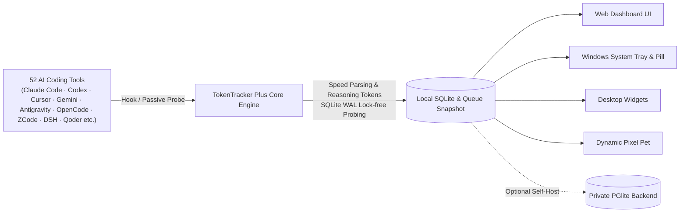

<div align="center">
  
  <h1>TokenTracker Plus (TT-plus)</h1>
  <p><strong>Track real AI token costs, session topologies, and real-time generation speeds across 52 AI tools & IDEs</strong></p>
  <p>
    <a href="./README.zh-CN.md">简体中文</a> · <a href="./README.zh-TW.md">繁體中文</a> · <b>English</b>
  </p>
  <p>
    <a href="./LICENSE"></a>
    <a href="#-supported-ai-tools-52"></a>
    <a href="#-quick-start"></a>
    <a href="#-data--privacy"></a>
    <a href="#-key-features"></a>
    <a href="#-heatmap-tiers--data-analytics"></a>
    <a href="https://github.com/01UNCLEDOG01/TokenTracker-plus"></a>
  </p>
</div>

> 💡 **About this repository**: TT-plus is an enhanced standalone fork based on the original open-source project [xiufengsun/TokenTracker](https://github.com/xiufengsun/TokenTracker) (MIT License). Its core objectives are **100% local-first privacy**, **strict true-value billing**, **deep agent session topologies**, and **full-pipeline real-time token speed capture**. All original upstream design and copyrights belong to the upstream author. This fork is also open-sourced under the MIT License and is not officially supported or endorsed by the upstream project.

---

## ⚡ Quick Start

> **Prerequisites**: Node.js **20+** (CLI supports Windows / macOS / Linux; Windows desktop app requires .NET 8 SDK and WebView2 Runtime).

```bash
# 1. Clone the repository and install dependencies
git clone https://github.com/01UNCLEDOG01/TokenTracker-plus.git
cd TokenTracker-plus
npm install

# 2. First launch: automatically installs hooks, synchronizes local usage, and opens Dashboard
node bin/tracker.js

# Daily operations
node bin/tracker.js sync       # Trigger incremental sync
node bin/tracker.js status     # Inspect hook / parser status for all 52 tools
node bin/tracker.js status --json  # Machine-readable JSON output for AI pipelines
node bin/tracker.js doctor     # System diagnostics and health check
```

**What you can see in 30 seconds:**
- 📊 **Local Dashboard** (default: `http://localhost:7680`) — Total spend, daily trends, model breakdown, project attribution, and session trees.
- ⚡ **Millisecond Token Speed Stream** — Real-time generation speed (`tok/s`) across Antigravity, DeepSeek Harness, ZCode, OpenCode, and Kimi Code.
- 🔌 **Zero-Config Auto Detection** — Automatically discovers and hooks 52 AI tools on your machine without cloud account lock-in or API key risks.
- 🏆 **31 Offline Achievements** — 100% evaluated from your local queue without connecting to any public leaderboard.

> **Looking for native desktop apps?**
> - **Windows** — Run `TokenTrackerWin` (C# .NET 8 + WebView2 system tray app), bundled with desktop pets, quota cards, and an always-on-top usage pill. See [TokenTrackerWin/README.md](./TokenTrackerWin/README.md).
> - **macOS** — Run `TokenTrackerBar` (menu bar status item + native WKWebView dashboard).
> - **Linux** — Run `TokenTrackerLinux` (Tauri / AppImage tray app).

---

## ✨ Key Features

- 🔌 **Out-of-the-Box Support for 52 AI Tools** — Broad coverage across CLIs, IDEs, and local clients (Claude Code, Codex CLI, Cursor, Gemini CLI, Antigravity, OpenCode, DeepSeek Harness, ZCode, WorkBuddy dual editions, TRAE CN local DB, Kimi desktop, etc.).
- ⚡ **Nanosecond Token Generation Speed Capture** — Multi-source parser and lock-free SQLite WAL probing; millisecond-level chunk duration extraction, separate reasoning token accounting, and precise session `tok/s`.
- 🏠 **100% Local-First & Private** — Runs locally. Parses on-device logs and databases; code snippets and prompts never leave your computer.
- 📊 **Lv0~Lv6 7-Tier Heatmap** — Replaced the old Lv4 ceiling! Brand-new 5-quantile distribution (`P35`, `P60`, `P80`, `P92`, `P97`) supporting bursts of billions of tokens per day, rendered in both 2D and 3D voxel heatmaps.
- 🌲 **Deep Session Topology & Agent Breakdown** — Drill down into primary sessions, tool calls, and subagent trees to pinpoint expensive operations.
- 💰 **Auditable True-Cost Billing** — Strictly calculates `Σ(tokens × price)`; **permanently rejects the upstream `-free` zero-price rule** by valuing free routes at list price; accurately reconciles WorkBuddy consumption credits.
- 🏆 **31 Offline Achievements** — 100% unlocked from the local queue; `trendsetter` compares early usage against a local curated model debut catalog.
- 🐱 **Desktop Pet & Widgets** — Floating pixel pets (multiple action cycles and cursor tracking), 4 desktop widgets, and always-on-top quota cards.

---

## 🖼️ Preview

<table>
<tr>
<td width="50%">

**Web Dashboard** — Trends, model breakdown, cost analytics


</td>
<td width="50%">

**Desktop Widgets** — Usage & limits on your desktop


</td>
</tr>
<tr>
<td width="50%">

**Desktop Pet** — Responsive companion reacting to token flow


</td>
<td width="50%">

**Offline Achievements** — 31 achievements unlocked locally


</td>
</tr>
</table>

---

## 🆚 Why Choose TokenTracker Plus?

> **Looking for a tool that pairs comprehensive macro ledgers with real-time token speeds and deep topology?** Here is an objective comparison between TokenTracker Plus, the original TokenTracker, and Token Monitor:

| Feature Dimension | ⚡ **TokenTracker Plus (This Fork)** | 📦 **Original TokenTracker (Upstream)** | 🪟 **Token Monitor (TM)** |
|:---|:---:|:---:|:---:|
| **Architecture & Focus** | **Macro Ledger + Deep Topology + Real-Time Speed** | General All-in-One Dashboard (optional hosted cloud) | Minimalist Desktop Floating Widget |
| **Supported AI Tools** | **52 Tools** (Comprehensive CLI, IDE, and local clients) | 46 Tools | ~15 Tools (Mainstream model APIs & common CLIs) |
| **Primary Interaction** | **Windows Tray + Web Dashboard + Widgets + CLI** | macOS Menu Bar + Web Dashboard + Widgets + CLI | Minimal Desktop Floating Widget |
| **Data Privacy & Storage** | **100% Local-First** (Zero cloud requirement, WAL-aware) | Local SQLite + Optional official cloud sync | Local SQLite WAL (No macro historical reporting) |
| **Token Speed (tok/s)** | **✅ Native Support** (Nanosecond duration, reasoning tokens) | ❌ Only totals and spend; no speed metrics | ✅ Supported (Key highlight of floating widget) |
| **Agent Topologies** | **✅ Deep Topology** (Primary/subagent drill-down, tool calls) | ⚠️ Basic flat session listing | ❌ Flat request stream only; no hierarchy |
| **Activity Heatmap** | **✅ 7 Tiers (Lv0~Lv6)** (5 quantiles, handles 4B+ tokens) | ⚠️ Traditional 4 tiers (Lv0~Lv4, saturated early) | ❌ No heatmap feature |
| **Cost Valuation Truth** | **✅ Strict List Pricing** (Rejects `-free` zeroing; WorkBuddy points) | ⚠️ Forces `-free` routes to $0; points unrefined | ⚠️ Basic pricing config with limited scope |
| **Achievements** | **✅ 31 Offline Achievements** (Local queue & debut catalog) | ⚠️ Depends on official cloud server & leaderboard | ❌ No achievement system |
| **Desktop Companion** | **✅ Desktop Pet + Quota Pill + Floating Cards** | ✅ macOS menu bar mascot / Basic widgets | ⚠️ Basic floating window |
| **Open Source & Transparency** | **✅ 100% Open Source** (Fully auditable, MIT) | ✅ Open Source (MIT) | ⚠️ Packaged Electron asar binary |

---

## 🔌 Supported AI Tools (52)

Canonical list of the **52 supported AI coding tools** (from `SUPPORTED_PROVIDERS` in `src/commands/init.js`):

| Tool | Detection | Integration Mechanism | Fork Enhancements |
|---|:---:|---|---|
| **Claude Code** | ✅ Auto | SessionEnd hook in `settings.json` | Native subagent tree & project attribution |
| **Codex CLI** | ✅ Auto | TOML notify hook in `config.toml` | Local workspace project metadata binding |
| **AStudio** | ✅ Auto | TOML notify hook in `config.toml` | Supported via `TOKENTRACKER_ACODE_HOME` |
| **Cursor** | ✅ Auto | API + Auth token in local SQLite | Deduplicated hourly snapshots |
| **Kiro** | ✅ Auto | Hybrid SQLite + JSONL reader | Full event stream extraction |
| **Gemini CLI** | ✅ Auto | SessionEnd hook | Input/output token extraction |
| **Antigravity** | ✅ Auto | Passive `transcript.jsonl` reader + speed probe | **Real tok/s extraction with reasoning token support** |
| **OpenCode** | ✅ Auto | Plugin system + SQLite database | **reasoning_output_tokens speed denominator fix** |
| **OpenClaw** | ✅ Auto | Session plugin (`openclaw-session-sync`) | Independent process safe sync |
| **Loomy** | ✅ Auto | Plugin system + session logs | Full OpenCode architectural parity |
| **Every Code** | ✅ Auto | TOML notify hook | Session-level usage sync |
| **Hermes Agent** | ✅ Auto | Passive SQLite reader (`~/.hermes/state.db`) | Automated sessions table extraction |
| **GitHub Copilot** | ✅ Auto | Per-request SQLite reader (`session-store.db`) | Reconciles multi-source data to avoid double-counting |
| **Kimi Code** | ✅ Auto | Passive `wire.jsonl` reader + speed stream | **Live chunk speed and output tok/s metrics** |
| **CodeBuddy** (Tencent) | ✅ Auto | SessionEnd hook in `~/.codebuddy/settings.json` | Tencent Cloud coding assistant support |
| **WorkBuddy** (Tencent) | ✅ Auto | Hook + passive scanner in `projects/**/*.jsonl` | **Dual-source split: Standard Edition** |
| **WorkBuddy AI** (Tencent) | ✅ Auto | Hook + passive scanner | **Dual-source split: High-Flyer Edition & points audit** |
| **Grok Build** (xAI) | ✅ Auto | Hook + passive scan on `updates.jsonl` | Shared quota cards with product breakdown |
| **oh-my-pi** | ✅ Auto | Passive session logs + managed notify extension | Near real-time change synchronization |
| **OmO** | ✅ Auto | Passive session logs reader | Fine-grained model mappings |
| **pi** | ✅ Auto | Passive reader (`~/.pi/agent/sessions/**/*.jsonl`) | Zero-intrusion passive parsing |
| **Dots** | ✅ Auto | Routed via pi provider split | Zero additional hooks required |
| **Prime Agent** | ✅ Auto | Metadata-only passive reader | Never reads prompts or assistant output |
| **Craft Agents** | ✅ Auto | Passive session logs reader | Multi-workspace aggregation |
| **Reasonix** | ✅ Auto | Passive telemetry reader | Session metadata tracking |
| **Muse Code** | ✅ Auto | Passive session logs (`session.jsonl`) | Supported via `TOKENTRACKER_MUSE_HOME` |
| **Kilo CLI** | ✅ Auto | Passive SQLite reader (`kilo.db`) | OpenCode-fork schema adaptation |
| **Kilo Code** | ✅ Auto | Passive reader on `ui_messages.json` | VS Code extension global storage parsing |
| **Roo Code** | ✅ Auto | Passive reader on `ui_messages.json` | Model & token extraction |
| **Zed Agent** | ✅ Auto | Passive SQLite reader (`threads.db`) | Tallies hosted zed.dev models only |
| **Goose** | ✅ Auto | Passive session logs scanner | Compatible with open-source Goose format |
| **Droid** (Factory) | ✅ Auto | Passive trajectory & event reader | Token and model extraction |
| **Mimo** | ✅ Auto | Passive SQLite parser | Local database extraction |
| **DuMate** (Baidu) | ✅ Auto | Passive session logs reader | Supported via `TOKENTRACKER_DUMATE_HOME` |
| **ZCode** | ✅ Auto | Passive session logs + speed probe | **Session drill-down & millisecond tok/s stream** |
| **Qoder** | ✅ Auto | Passive `~/.qoder[-cn]/projects/**/*.jsonl` | **Model refinement & credit balance reconciliation** |
| **AnythingLLM Desktop** | ✅ Auto | Passive local SQLite reader | Desktop workspace usage aggregation |
| **Claude Science** | ✅ Auto | Passive SQLite reader (`operon-cli.db`) | Frame token extraction |
| **DeepSeek Harness** | ✅ Auto | Passive session logs (`.jsonl[.zstd]`) + probe | **Multi-frame zstd decompression & live tok/s** |
| **TRAE CN** | ✅ Auto | Passive local database & workspace parser | **Supports local database mode & session drill-down** |
| **TRAE** (Intl) | ✅ Auto | Reads local SQLCipher with shared key | Secure local parsing without vendor API calls |
| **LM Studio** | ✅ Auto | Passive logs & activity state | Supported via `TOKENTRACKER_LMSTUDIO_HOME` |
| **Unsloth Studio** | ✅ Auto | Passive SQLite reader (`unsloth.db`) | Supported via `TOKENTRACKER_UNSLOTH_DB` |
| **Devin CLI** | ✅ Auto | Passive local Devin DB reader | Supported via `TOKENTRACKER_DEVIN_DB` |
| **Cline** | ✅ Auto | Passive VS Code storage reader | Task-level usage extraction |
| **MiniMax Code** | ✅ Auto | Passive local session logs | Model & token counters |
| **CodeArts Agent** | ✅ Auto | Passive Huawei CodeArts session reader | Huawei Cloud coding assistant support |
| **Command Code** | ✅ Auto | Passive session snapshot & logs | Unified model price estimate |
| **AutoClaw** | ✅ Auto | Automated agent workflow log integration | Task-level usage collection |
| **Cola** | ✅ Auto | Collaborative agent logs integration | Secure local sync |
| **Tuanjie Cowork** | ✅ Auto | Team workflow logs integration | Team-level local usage parsing |
| **Agent2API** | ✅ Auto | Local gateway & agent mapping integration | Multi-model routing usage |

---

## 🏗️ How It Works



1. **Use AI Tools Naturally**: Chat and code across your preferred CLIs and IDEs. They write local logs, update SQLite tables, or invoke hooks.
2. **Lightweight Sensing & Speed Extraction**: The TT-plus engine detects changes in milliseconds, extracts input, cached, output, and reasoning tokens, and computes accurate chunk durations and `tok/s`.
3. **100% Local Accounting**: Prompts and code are never stored or transmitted; only token metadata is persisted into local storage.
4. **Multi-Surface Display**: Web Dashboard, Windows Tray, desktop pets, and widgets consume the exact same local snapshot simultaneously.

---

## 💰 Billing & Heatmap Standards

### Cost Formula
$$\text{Cost} = \text{Input} \times P_{\text{in}} + \text{Cached} \times P_{\text{cached}} + \text{CacheWrite} \times P_{\text{cw}} + \text{Output} \times P_{\text{out}} + \text{Reasoning} \times P_{\text{reason}}$$

- **Strict Rejection of Upstream `-free` Rule**: Upstream forces all `-free` models to $0. This fork permanently rejects that behavior, valuing all tokens at true vendor list prices to reflect actual productivity investment.
- **Pricing Sources**: Aggregates LiteLLM official rate sheets and local curated overrides (`src/lib/pricing/curated-overrides.json`). Unpriced models record token quantities without fabricating fictitious currency.
- **WorkBuddy Credits Reconciliation**: Dual-track accounting separating Standard and High-Flyer editions, reconciling consumption points against tokens.

### Heatmap Tiers & Data Analytics (Lv0 ~ Lv6 7-Tier Scale)
The activity heatmap uses an upgraded **7-tier scale** determined dynamically by 5 key quantiles (`P35`, `P60`, `P80`, `P92`, `P97`):
- **Level 0**: 0 tokens (No activity)
- **Level 1**: `0 < tokens ≤ P35` (Light coding)
- **Level 2**: `P35 < tokens ≤ P60` (Regular development)
- **Level 3**: `P60 < tokens ≤ P80` (Deep coding)
- **Level 4**: `P80 < tokens ≤ P92` (Intensive output)
- **Level 5**: `P92 < tokens ≤ P97` (Extreme burst, 2.2B~2.85B tokens emerald enhancement)
- **Level 6**: `> P97` (Peak production, supporting 2.85B to 55.5B+ tokens extreme load with glowing night tier)

Both 2D flat calendar and 3D voxel heatmaps (with voxel heights scaled to $\frac{\text{level}}{6} \times H_{\text{max}}$) are fully synchronized.

---

## 🔒 Data & Privacy

- **100% Local-First**: All data parsing, speed computation, and report rollups happen strictly on your local machine.
- **Metadata Only**: Only logs token counts, timestamps, model identifiers, and calculated currency amounts. **Prompts, responses, and code are never saved or uploaded.**
- **Local Credential Isolation**: Cookies, API keys, and local credentials reside exclusively in user home folders or `.env.local`. They are never committed or exposed in web bundles.

---

## 🛠️ Local Configuration & Self-Hosting (Optional)

```bash
cp .env.example .env.local
```

Common variables: `OPENROUTER_API_KEY`, `TOKENTRACKER_DEVICE_TOKEN`, `VITE_INSFORGE_BASE_URL`. Put local overrides in `.env.local` (gitignored). **Do not create `.dev.vars`**.

### Private Backend (Preview)
If you have multiple devices and want an aggregated view, deploy `scripts/self-host/` onto your private Docker host:
- See [docs/self-hosting.md](./docs/self-hosting.md).
- *Note*: The early internal Docker test host was officially decommissioned on 2026-10-23; the project defaults to 100% standalone offline operation.

---

## 📄 License & Acknowledgements

- **License**: Released under the [MIT License](./LICENSE).
- **Upstream Project**: Grateful acknowledgement to [xiufengsun/TokenTracker](https://github.com/xiufengsun/TokenTracker) for the foundational architecture and open-source contributions.
- **Third-Party Notices**: See [THIRD_PARTY_NOTICES.md](./THIRD_PARTY_NOTICES.md). Clawd mascot design is copyright Anthropic; this project has no official affiliation with Anthropic.
