> **This repository is a personal fork (“TT-plus”).** It is not the upstream
> TokenTracker distribution: it runs against a **self-hosted** backend (a small
> Node + PGlite server on the owner’s own hardware), ships **without the
> membership payment UI** (the leaderboard and achievements stay), and is tuned
> for a single private account. Upstream project and full credit:
> [xiufengsun/TokenTracker](https://github.com/xiufengsun/TokenTracker) (MIT).

---

<div align="center">

# Token Tracker — TT-plus fork

**English** · [简体中文](./README.zh-CN.md) · [日本語](./README.ja.md) · [한국어](./README.ko.md) · [Deutsch](./README.de.md)

### Track every AI token — then bring your usage to life

A personal fork of the local-first token usage and cost dashboard for **52 AI coding tools** — desktop pet, **4 native widgets**, **15 achievement tracks** — extended with a **self-hosted backend**, extra usage **providers** (Agent2API, APIGOTO, AgentRouter), and a **floating usage pill** on Windows.

[](https://opensource.org/licenses/MIT)
[](https://github.com/xiufengsun/TokenTracker)
[](scripts/self-host/)
[](#-quick-start)

<table>
<tr>
<td width="58%">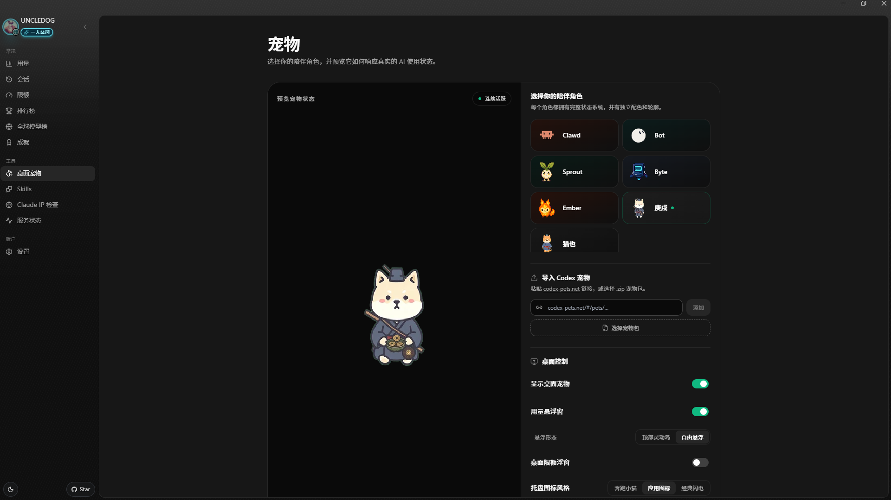</td>
<td width="42%">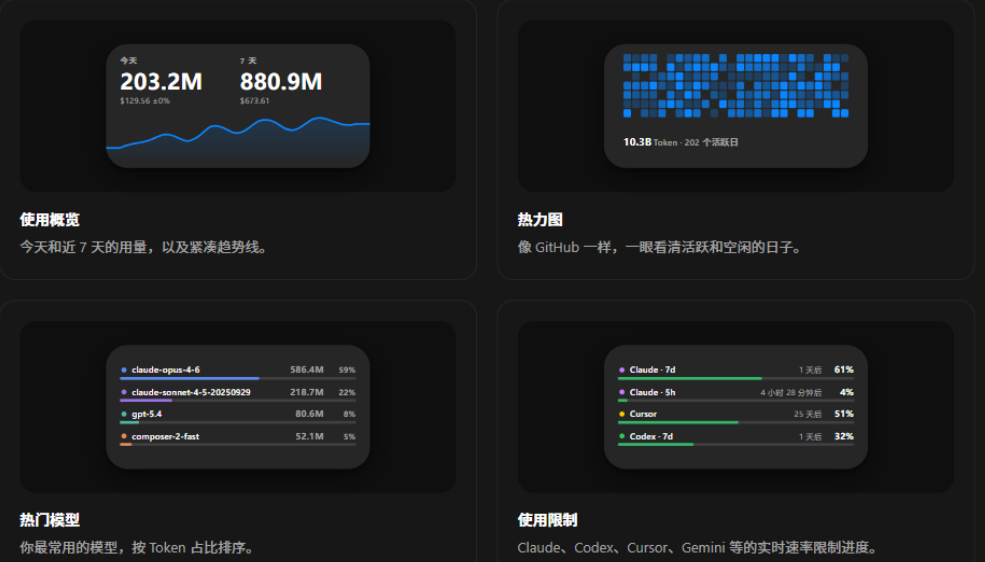</td>
</tr>
<tr>
<td><strong>🐾 A living desktop companion</strong><br/>Codes, celebrates streaks, follows your cursor, and rests when you do.</td>
<td><strong>🧩 Four native widgets</strong><br/>Usage, activity heatmap, top models, and rate limits at a glance.</td>
</tr>
</table>

<p>
  
  
  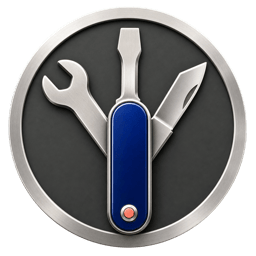
  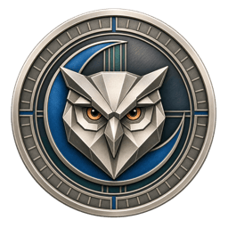
  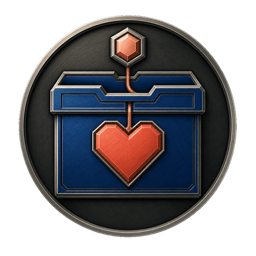
</p>

<strong>🏆 Unlock achievements from the way you actually code.</strong>

</div>

---

## 🌿 What this fork changes

Everything the upstream tracker does locally still works the same. On top of it, this fork:

- **Self-hosts the cloud features.** The leaderboard, profiles, achievements and cross-device sync run against a private Node + PGlite backend deployed with [`scripts/self-host/`](scripts/self-host/) (`internal-deploy.sh`, `internal-backup.sh`) — no third-party hosted service, no membership/payment UI.
- **Adds usage providers**: [Agent2API](src/lib/agent2api-limits.js) (local gateway DB), **APIGOTO** and **AgentRouter** (self-hosted panels of commercial relays) join the provider limits page, the desktop-pet hover card, and the floating pill.
- **Adds a floating usage pill on Windows** (`TokenTrackerWin`): a tiny always-on-top native pill showing today's tokens + cost, draggable, pet-character-aware.
- **Extends session coverage**: antigravity (transcript-based, with per-step model attribution), autoclaw, cola, tuanjie-cowork, workbuddy, dsh and qoder estimations feed both the session browser and the usage totals.
- **Keeps the identity local**: single private account, GitHub avatar/name owned by the deployer, public-profile toggle still available.

---

## ⚡ Quick Start

> **Requirements**: Node.js **20+** (CLI runs on macOS / Linux / Windows; native desktop app ships for macOS (menu bar), Windows (system tray) and Linux (AppImage, tray). Cursor token reading uses the system `sqlite3` CLI when available and falls back to `node:sqlite` on supported Node releases).

This fork is not published to npm — run it **from source**:

```bash
git clone https://github.com/01UNCLEDOG01/TokenTracker-plus.git
cd TokenTracker-plus
npm install

node bin/tracker.js          # Open the dashboard (installs hooks on first run)
node bin/tracker.js sync     # Manual sync
node bin/tracker.js status   # Check hook status
node bin/tracker.js status --json   # Machine-readable summary (pipe to jq)
node bin/tracker.js doctor   # Health check
```

First run installs hooks, syncs your data, and opens the dashboard at `http://localhost:7680`.

**What you get in 30 seconds:**
- 📊 A local dashboard at `localhost:7680` with usage trends, model breakdown, cost analysis
- 🔌 Auto-detected hooks for every supported AI tool you have installed
- 🏠 Local-first — parses logs on your machine; no account or API keys required
- 🧩 *Optional:* a Skills tab that browses 250+ public skills and syncs them across Claude · Codex · Grok · Antigravity · Gemini · OpenCode · Hermes

> **Native desktop apps are built from source in this fork** (no releases are published):
> - **Windows** — `dotnet build -c Release` in [`TokenTrackerWin/`](TokenTrackerWin/) (SDK 9 targets net8.0-windows): a system-tray app with the dashboard in WebView2, plus the desktop pet, the four widgets and the floating usage pill. The built dashboard must be served with `TOKENTRACKER_BUILD_PET=1 npm --prefix dashboard run build` so the pet/quota pages are emitted.
> - **macOS** — open [`TokenTrackerBar/`](TokenTrackerBar/) in Xcode (menu bar app + widgets, WKWebView).
> - **Linux** — Tauri app under [`TokenTrackerLinux/`](TokenTrackerLinux/).

> **Self-hosted backend** — the leaderboard/sync surface runs on your own hardware: see [`scripts/self-host/`](scripts/self-host/) for the one-command deploy (`internal-deploy.sh`) and the nightly backup (`internal-backup.sh`). Point the dashboard at it via the runtime config (`/api/auth/public-config` carries the anon key).

---


## ✨ Features

- 🔌 **52 AI tools out of the box** — Claude Code, Codex CLI, AStudio, Cursor, Gemini CLI, Antigravity, Kiro, OpenCode, OpenClaw, Loomy, AutoClaw, Cola, Every Code, Hermes Agent, GitHub Copilot, Kimi Code, CodeBuddy, WorkBuddy, WorkBuddy AI, Grok Build, oh-my-pi, OmO, pi, Dots, Prime Agent, Craft Agents, Reasonix, Muse Code, Kilo CLI, Kilo Code, Roo Code, Zed Agent, Goose, Droid, Mimo Code, DuMate, ZCode, Qoder, AnythingLLM Desktop, Claude Science, DeepSeek Harness, TRAE CN, LM Studio, Unsloth Studio, Devin CLI, Cline, CodeArts Agent, MiniMax Code, Command Code, TRAE, Tuanjie Cowork, Agent2API
- 🏠 **Local-first** — Runs on your machine. Parses logs locally with no account or API keys needed.
- 🚀 **Zero config** — Hooks auto-install on first run. From zero to dashboard in 30 seconds.
- 📊 **Beautiful dashboard** — Usage trends, cost breakdowns by model, GitHub-style activity heatmap, project attribution
- 🖥️ **Native desktop app** — macOS menu bar (+ widgets) and Windows system tray, each with an embedded server and the dashboard in a native webview
- 🐾 **Desktop pet** — A pixel companion powered by real coding activity: it works when you work, celebrates streaks, and sleeps when you rest
- 🎨 **4 desktop widgets** — Pin Usage / Activity Heatmap / Top Models / Usage Limits to your desktop
- 🏆 **15 achievement tracks** — Turn daily usage, streaks, tools, models, and milestones into collectible badges worth sharing
- 📈 **Real-time usage limits** — Claude / Codex / Cursor / Gemini / Kimi / Kiro / Grok / Copilot / Antigravity / ZCode / OpenCode Go / Qoder / Qoder CN / Command Code / Ark Coding Plan / Ark Agent Plan / Devin quota windows, with last-good caching when a local provider app is temporarily closed
- 🟢 **Service Status page** — live operational and incident status from 8 official provider status pages
- 💰 **Cost engine** — 2,200+ models priced via [LiteLLM](https://github.com/BerriAI/litellm/blob/main/model_prices_and_context_window.json) (auto-refreshed daily) + curated overrides for niche tools (Kiro, Cursor Composer, Kimi, CodeBuddy hy3); 24h disk cache + bundled offline snapshot mean accurate USD without an internet connection. Models without published vendor pricing (e.g. Tencent hy3-preview) are tracked by tokens but show $0 cost until the vendor publishes a rate.
- 🌐 **Optional leaderboard** — Compare with developers worldwide; drag-to-reorder columns to focus on the providers you care about (opt-in, sign in to participate)
- 🔄 **Cross-device account view** — Optional cloud sync merges usage across your machines (laptop, desktop, server) into one view. Off by default; local tracking stays independent.
- 🧩 **Optional Skills tab** — browse 250+ public skills from `anthropics/skills`, `ComposioHQ/awesome-claude-skills`, `skills.sh` and any GitHub repo you add; sync them across Claude / Codex / Grok / Antigravity / Gemini / OpenCode / Hermes with named targets and one-click Undo
- 🔒 **Privacy-first** — Local usage metrics only (token counts, timestamps, and model names). Prompts, completions, and code never leave your machine.

---

## 🖼️ Showcase

<table>
<tr>
<td width="50%">

**Dashboard** — usage trends, model breakdown, cost analysis

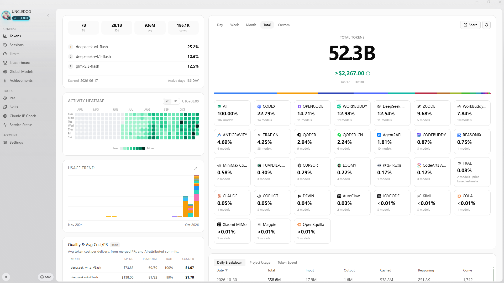

</td>
<td width="50%">

**Desktop Widgets** — pin usage to your desktop


</td>
</tr>
<tr>
<td width="50%">

**Menu Bar App** — animated Clawd companion + native panels

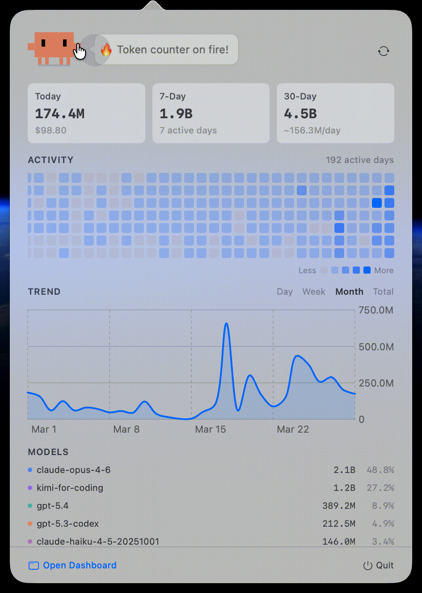

</td>
<td width="50%">

**Global Leaderboard** — compare with developers worldwide

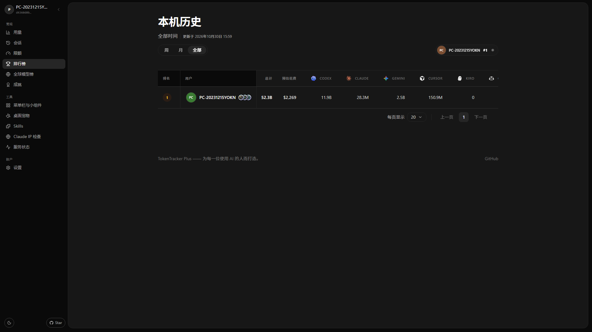

</td>
</tr>
<tr>
<td colspan="2">

**Skills Manager** — browse 250+ public skills from GitHub & `skills.sh`, install once, sync to Claude / Codex / AStudio / Grok / Antigravity / Gemini / OpenCode / Hermes. Per-target toggles, one-click Undo, no manual file copying.

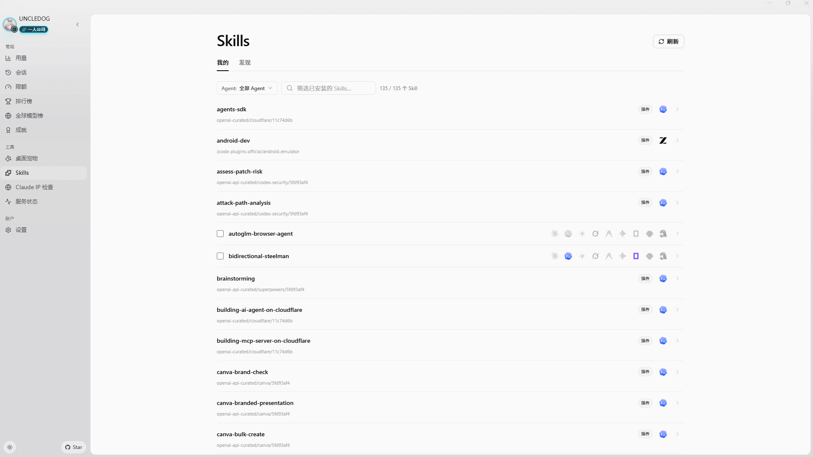

</td>
</tr>
<tr>
<td colspan="2">

**Desktop Pet** — a pixel companion that floats on your desktop and reacts to your real token burn: it codes when you code, celebrates streaks, and sleeps when you rest. Import community pets from [codex-pets.net](https://codex-pets.net) with a link or a `.codex-pet.zip` — V2 pets even turn their head to follow your cursor in 16 directions. macOS, Windows, and web.


</td>
</tr>
<tr>
<td colspan="2">

**Achievements** — 15 tracks turn usage milestones, streaks, tools, and models into collectible badges — with progress visible before each unlock.

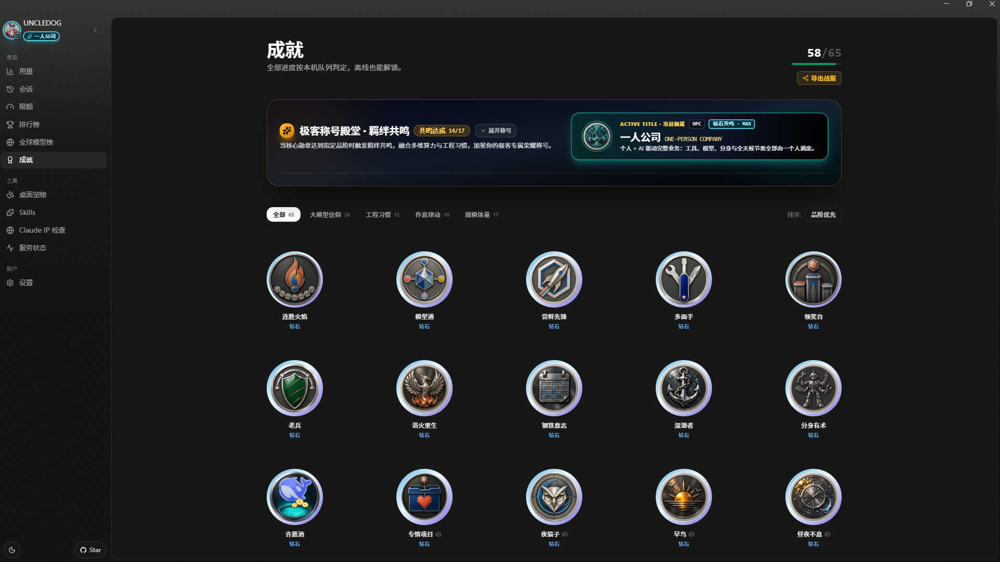

</td>
</tr>
</table>

---

## 🔌 Supported AI Tools

| Tool | Detection | Method |
|---|---|---|
| **Claude Code** | ✅ Auto | SessionEnd hook in `settings.json` |
| **Codex CLI** | ✅ Auto | TOML notify hook in `config.toml` |
| **AStudio** | ✅ Auto | TOML notify hook in `config.toml` |
| **Cursor** | ✅ Auto | API + SQLite auth token |
| **Kiro** | ✅ Auto | SQLite + JSONL hybrid |
| **Gemini CLI** | ✅ Auto | SessionEnd hook |
| **OpenCode** | ✅ Auto | Plugin system + SQLite |
| **OpenClaw** | ✅ Auto | Session plugin |
| **Every Code** | ✅ Auto | TOML notify hook |
| **Hermes Agent** | ✅ Auto | SQLite sessions table (`~/.hermes/state.db`) |
| **GitHub Copilot App / CLI** | ✅ Auto | Unified per-request SQLite usage (`~/.copilot/session-store.db`); App DB legacy baseline |
| **GitHub Copilot Chat extension / legacy CLI** | ✅ Auto | OpenTelemetry file exporter (`COPILOT_OTEL_FILE_EXPORTER_PATH`) |
| **Kimi Code** | ✅ Auto | Passive `wire.jsonl` reader (`~/.kimi/sessions/**/wire.jsonl`) |
| **oh-my-pi (Pi Coding Agent)** | ✅ Auto | Passive reader (`~/.omp/agent/sessions/**/*.jsonl`) + managed notify extension written by `tokentracker init` to `~/.omp/agent/extensions/tokentracker-notify.ts` for near-real-time sync (skipped if a same-named unmanaged file already exists; removed by `tokentracker uninstall` when still managed) |
| **CodeBuddy** (Tencent) | ✅ Auto | SessionEnd hook in `~/.codebuddy/settings.json` (Claude-Code fork) |
| **WorkBuddy** (Tencent) | ✅ Auto | SessionEnd hook in `~/.workbuddy/settings.json` (Claude-Code fork) + passive `projects/**/*.jsonl` scan |
| **WorkBuddy AI** | ✅ Auto | International build: hooks and passive usage under `~/.workbuddy-ai`; override with `WORKBUDDY_AI_HOME` |
| **Grok Build** (xAI) | ✅ Auto | SessionEnd hook + passive `updates.jsonl` / `signals.json` scan (`~/.grok/sessions/**/`) |
| **Kilo CLI** (kilo.ai) | ✅ Auto | Passive SQLite reader (`~/.local/share/kilo/kilo.db`, OpenCode-fork schema) |
| **Kilo Code** (VS Code extension) | ✅ Auto | Passive `ui_messages.json` reader (Cursor/Code/CodeBuddy/Windsurf globalStorage) |
| **Antigravity** | ✅ Auto | Passive transcript reader (`~/.gemini/{antigravity,antigravity-ide,antigravity-cli}/brain/**/transcript.jsonl`); see [quota credentials and Linux keyring setup](docs/antigravity-limits.md). Disable quota lookup with `TOKENTRACKER_DISABLE_ANTIGRAVITY_QUOTA=1` |
| **OmO** | ✅ Auto | Passive reader (`~/.omo/agent/sessions/**/*.jsonl`, subagent transcripts included). Same session format as oh-my-pi but a separate install root, cursor namespace and source label, so both can be tracked side by side. Reasoning tokens are reported as a subset of output (Codex convention) and are never billed twice |
| **pi** (`@mariozechner/pi-coding-agent`) | ✅ Auto | Passive reader (`~/.pi/agent/sessions/**/*.jsonl`) |
| **Dots** | ✅ Auto | Routed through pi's provider split (`pi-dots` source, same passive reader) — no separate hook |
| **Prime Agent** | ✅ Auto | Metadata-only passive usage reader (`~/.prime/agent/sessions/*.jsonl`; reads usage/model/provider/timestamp, never prompts or responses) |
| **Craft Agents** | ✅ Auto | Passive session reader (`~/.craft-agent` + workspace session logs) |
| **Reasonix** | ✅ Auto | Passive telemetry reader (`~/.reasonix/**/*.jsonl.telemetry.json`) |
| **Muse Code** | ✅ Auto | Passive session reader (`~/.local/share/muse/sessions/**/session.jsonl`; override with `TOKENTRACKER_MUSE_HOME`) |
| **Roo Code** (VS Code extension) | ✅ Auto | Passive `ui_messages.json` reader (`rooveterinaryinc.roo-cline`) |
| **Zed Agent** | ✅ Auto | Passive SQLite reader (`threads.db`, all providers — hosted `zed.dev` + bring-your-own) |
| **Goose** (Block) | ✅ Auto | Passive SQLite reader (`sessions.db`, cumulative deltas) |
| **Droid** (Factory) | ✅ Auto | Passive session reader (`~/.factory/sessions/**/settings.json`, cumulative deltas) |
| **Mimo Code** (mimocode) | ✅ Auto | Passive SQLite reader (`~/.local/share/mimocode/mimocode.db`, OpenCode-fork schema; counts only mimo-native turns — mirrored Claude/claude-mem history is excluded) |
| **DuMate** (Baidu) | Auto | Passive OpenCode SQLite reader (`%APPDATA%/qianfan-desktop-app/qianfan_desk_xdg/*/data/opencode/opencode.db`); independent `dumate` source with reinstall-copy deduplication. Override with `TOKENTRACKER_DUMATE_HOME`. See [DuMate collection](docs/dumate.md) |
| **ZCode** (Z.ai) | ✅ Auto | Passive SQLite reader (`~/.zcode/cli/db/db.sqlite`, OpenCode-fork schema; counts only Z.ai/BigModel GLM turns — bundled Claude/Codex/Gemini sub-agents are excluded) |
| **Qoder** | ✅ Auto | Passive SQLite reader (`Qoder/SharedClientCache/cache/db/local.db`; reads assistant `token_info`, separates cached input, and never reads prompt or response text), plus Plan Credits and Ultimate Free Calls limits from Qoder's local session. Qoder CN (国内版, `QoderCN/SharedClientCache/cache/db/local.db`) is tracked as its own source with quota from `qoder.com.cn`. |
| **LM Studio** | ✅ Auto | Passive recursive reader for `~/.lmstudio/server-logs/**/*.log`; reads only final-response IDs, models, timestamps, and scalar `usage` counters from Chat Completions and Responses API records. Mirrored response IDs are deduplicated; prompt and response bodies are never retained. These developer-server records cover local inference and LM Link at zero marginal API cost, not Bionic Secure Cloud billing. |
| **Unsloth Studio** | ✅ Auto | Passive SQLite reader for `$UNSLOTH_STUDIO_HOME/studio.db` (default `~/.unsloth/studio/studio.db`). Reads scalar `contextUsage` metadata and content-free `api_usage_events` only; prompts, replies, attachments, API subjects, credentials, and training metrics are excluded. Local routes stay zero-cost, while known paid provider routes use the model that actually answered for estimated token cost. |
| **AnythingLLM Desktop** | ✅ Auto | Passive SQLite reader (`anythingllm-desktop/storage/anythingllm.db`; reads per-message token metrics only, never prompts or responses) |
| **Devin CLI** (Cognition) | ✅ Auto | Passive SQLite reader (`$XDG_DATA_HOME/devin/cli/sessions.db`, default `~/.local/share/devin/cli/sessions.db`; reads per-request usage metrics deduplicated by `request_id` — replay/fork/compaction copies never double-count — using the recorded generation model, never prompts, responses, or `cogs_json`). Devin models (`swe-2`, `swe-2-high`, `compactor`) currently have no pricing data, so their token counts are reported but excluded from dollar estimates — a $0 figure does not mean free usage. No native Windows data dir is known; a WSL install is read via `\\wsl$`. |
| **Cline** (CLI v3 / desktop app) | ✅ Auto | Passive reader (`~/.cline/data/sessions/<id>/*.messages.json`). Per-turn `metrics` are usage deltas where `inputTokens` already includes cache read+write and `outputTokens` already includes reasoning, so the cached prefix is subtracted and reasoning is never billed twice; Cline's own per-call `cost` is trusted when reported. `cline-free/*` and `cline-pass/*` gateway models are priced at $0. The VS Code extension's globalStorage layout is not read. Path overrides: `TOKENTRACKER_CLINE_SESSIONS_DIR`, `TOKENTRACKER_CLINE_DATA_DIR`, `TOKENTRACKER_CLINE_HOME`, `CLINE_SESSION_DATA_DIR`, `CLINE_DATA_DIR`, or `CLINE_DIR` |
| **CodeArts Agent, MiniMax Code** | ✅ Auto | Passive reader (`~/.minimax/v2/sessions/YYYY/MM/DD/<session>/messages.jsonl`). Dedupes on `message_id`, records the routed upstream model per message, and ignores the always-zero `usage.cost` in favor of normal pricing. Override the directory with `TOKENTRACKER_MINIMAX_HOME` |
| **Command Code** | ✅ Auto | Passive session reader (`~/.commandcode/projects/<cwd-slug>/<session-id>.jsonl`; `*.checkpoints.jsonl` snapshots and `.prompts.` sidecars are skipped). Scans transcripts locally and extracts selected usage metadata, including token counts and the CLI's `costUsd` display estimate. Token Tracker estimates cost with its shared model price table instead. Subtracts both cache reads and writes from cache-inclusive input to avoid double counting. Token Tracker does not persist or upload prompt, reply or code bodies. Override the directory with `TOKENTRACKER_COMMANDCODE_HOME` |
| **Claude Science** | ✅ Auto | Passive SQLite reader (`~/.claude-science/operon-cli.db`; reads the `frames` table's token counters only, never prompts, artifacts or research content). No native Windows build — on Windows the app runs inside WSL and is read from there. |
| **DeepSeek Harness** | ✅ Auto | Passive session reader (`~/.dsh/sessions/**/session.jsonl[.zstd]`; parses session header and assistant events, handles multi-frame zstd decompression) |
| **TRAE (international)** | ✅ Auto | Local TRAE / TRAE SOLO SQLCipher usage metadata with the shared application key by default; optional `TOKENTRACKER_TRAE_SQLCIPHER_KEY` override. No vendor API calls. See [setup and limitations](docs/trae.md). |
| **TRAE CN** | ✅ Auto | **Requires an explicit opt-in: set `TOKENTRACKER_TRAE_CN_USAGE=1`.** Reading usage transmits the locally stored sign-in authorization to TRAE's internal API, so nothing is sent until you turn it on. Once opted in: during eligible non-background sync when local TRAE CN auth exists, reads session-token usage from the locally signed-in macOS / Windows app; its internal API may change |

> **Do I need to install any plugin or hook manually?** No. `tokentracker` (or `tokentracker init`) handles everything on first run:
> - **Hook-based** tools (Claude Code, Codex, AStudio, Gemini, Every Code, **CodeBuddy**, **WorkBuddy**, **Grok Build**) — we write a SessionEnd hook or TOML notify entry into the tool's own config.
> - **Plugin-based** tools (OpenCode, **OpenClaw**) — plugins ship inside the npm package. OpenClaw's session plugin lives at `~/.tokentracker/tracker/openclaw-plugin/openclaw-session-sync/`; we link and enable it via OpenClaw's own CLI, then set `hooks.allowConversationAccess=true` so OpenClaw permits the session-finished event that triggers sync. No download, no drag-and-drop.
> - **oh-my-pi** — passive session scan is always the billing/token source of truth (`~/.omp/agent/sessions/**/*.jsonl`). When OMP is detected, `tokentracker init` also writes a managed notify extension to `~/.omp/agent/extensions/tokentracker-notify.ts` so turns can trigger near-real-time sync. That file is owned only when it carries TokenTracker's managed marker: a same-named user-authored extension is never overwritten or deleted. `tokentracker uninstall` removes the extension only while it is still managed.
> - **OmO** — passive session scan only (`~/.omo/agent/sessions/**/*.jsonl`, including nested subagent transcripts). No plugin or hook is installed. Path overrides, in precedence order: `TOKENTRACKER_OMO_AGENT_DIR`, then `TOKENTRACKER_OMO_HOME` / `OMO_HOME` (appended with `/agent`). `PI_CONFIG_DIR` and `PI_CODING_AGENT_DIR` are not honored: those belong to pi/omp.
> - **Cline** — passive session scan only (`~/.cline/data/sessions/<id>/*.messages.json`, Cline CLI v3 / desktop app; the VS Code extension's globalStorage is a separate, older install and is not read). No hook is installed. Per-turn `metrics` are usage deltas where `inputTokens` already contains cache read+write, so only the non-cached remainder is billed. Path overrides, in precedence order: `TOKENTRACKER_CLINE_SESSIONS_DIR`, `TOKENTRACKER_CLINE_DATA_DIR`, `TOKENTRACKER_CLINE_HOME`, then Cline's own `CLINE_SESSION_DATA_DIR`, `CLINE_DATA_DIR`, `CLINE_DIR`.
> - **Passive readers** (Cursor, Kiro, Hermes, Kimi Code, Copilot, **Grok Build**, **OmO**, **pi**, **Craft Agents**, **Reasonix**, **Muse Code**, **Kilo CLI**, **Kilo Code**, **Roo Code**, **Antigravity**, **Zed Agent**, **Goose**, **Droid**, **Mimo Code**, **DuMate**, **ZCode**, **Qoder**, **LM Studio**, **Unsloth Studio**, **AnythingLLM Desktop**, **Devin CLI**, **CodeArts Agent, MiniMax Code**, **Claude Science**, **DeepSeek Harness**, **Cline**) — nothing is installed into those tools. We only read files they already produce (SQLite DB, JSONL, OTEL export, session logs). Copilot App / CLI usage is read per request from `~/.copilot/session-store.db`; `data.db` provides the one-time legacy adoption baseline and stays observe-only after the store becomes canonical, while the Chat extension and legacy CLI continue using OTEL. TokenTracker coordinates the sources so overlapping requests are counted once. Mixed App/CLI usage that predates adoption is retained as a `github-copilot-legacy` aggregate rather than assigned to a guessed request model.
> - **Grok Build estimate** — current local telemetry exposes cumulative `updates.jsonl` `totalTokens`, but not a stable prompt/output/cache split; `signals.json` remains a fallback with `contextTokensUsed` snapshots. TokenTracker estimates Grok cost until per-call usage details are available.
> - **Grok product shares** — the Grok limits card keeps the shared weekly or monthly pool as the headline bar, then lists each product's share of that same pool (Grok Build, Cursor, Grok Bot, Imagine, and any later product the billing API reports). Those rows are shares of one cap, not separate quotas. Remaining mode flips the headline to percent left and leaves each product row as the used share.
>
> Run `tokentracker status` anytime to verify every integration's state. If something shows `skipped`, the `detail` column explains why (e.g. tool CLI not on `PATH`, config unreadable).
>
> Deeper dives: [OpenClaw integration & troubleshooting](docs/openclaw-integration.md).

Missing your tool? [Open an issue](https://github.com/xiufengsun/TokenTracker/issues/new) — adding new providers is usually one parser file away.

---

## 🆚 Why TokenTracker? <a id="ccusage-alternative"></a>

> **Looking for a desktop app with widgets and a visual dashboard?** TokenTracker pairs local log parsing across AI coding tools with native desktop apps, desktop widgets, provider quota tracking, and optional cloud sync.

| Capability | **[TokenTracker](https://github.com/xiufengsun/TokenTracker)** | **[ccusage](https://github.com/ccusage/ccusage)** | **[Tokscale](https://github.com/junhoyeo/tokscale)** |
|---|:---:|:---:|:---:|
| **AI tools supported** | **52** | Multi-agent | Multi-agent |
| **Primary interface** | Desktop apps & web dashboard | Terminal CLI | Terminal TUI & CLI |
| **Local analysis** | ✅ | ✅ | ✅ |
| **Native desktop apps** | ✅ macOS, Windows, Linux | ❌ | ❌ |
| **Desktop widgets** | ✅ 4 widgets | ❌ | ❌ |
| **Rate-limit tracking** | ✅ 17 providers | Limited (Claude blocks) | Multiple providers |
| **Terminal analytics** | Basic CLI (`status`, `--json`) | Strong CLI reporting | Interactive TUI & CLI |
| **JSON export** | ✅ | ✅ | ✅ |
| **Public leaderboard** | Optional (opt-in) | ❌ | Optional (`submit`) |

---

## 🏗️ How It Works

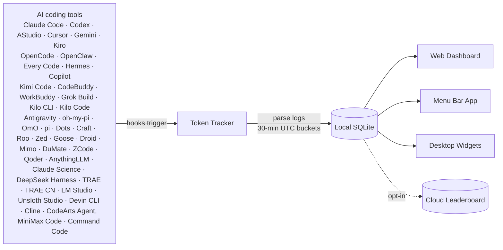

1. AI CLI tools generate logs during normal use
2. Lightweight hooks detect changes and trigger sync (Cursor uses API instead of hooks)
3. Token counts parsed locally — prompts, responses, and code are never saved or uploaded
4. Aggregated into 30-minute UTC buckets
5. Dashboard, menu bar app, and widgets all read from the same local snapshot

---

In this fork the cross-device features are **self-hosted**: the leaderboard, achievements and account sync run on the owner's own Node + PGlite backend (see [`scripts/self-host/`](scripts/self-host/)). There is no hosted service to sign up for and no paid tier — the upstream project's [Cloud offering](https://(removed)/cloud) and [self-hosting docs](docs/self-hosting.md) describe the same capabilities from the upstream side.

## 🛡️ Privacy

> 📄 **[Full Privacy Policy](docs/PRIVACY.md)** — every network request the app can make, what each one sends, and how to switch it off.

TokenTracker processes your usage data locally. It never collects or uploads prompts, code, or model responses.

| Protection | Description |
|---|---|
| **No code or prompt collection** | TokenTracker parses local log files for token counts and timestamps. Prompts, completions, code, and conversation bodies are never saved or uploaded. |
| **Local-first by default** | Usage tracking runs entirely on your machine. No account, login, or API keys required. Cloud sync and the public leaderboard are strictly opt-in. |
| **Auditable** | Open source. Check [`src/lib/rollout.js`](src/lib/rollout.js) — only numbers, timestamps, and model names are extracted. |
| **Transparent network activity** | Fully documented in the [Privacy Policy](docs/PRIVACY.md). Default requests are limited to direct provider quota checks (using credentials already on your machine), GitHub star counts, update checks, pricing data refreshes (`raw.githubusercontent.com`), and anonymous telemetry (daily heartbeat + PostHog pageviews, both disabled with `TOKENTRACKER_NO_TELEMETRY=1` or `DO_NOT_TRACK=1`). Telemetry never includes tokens, models, prompts, or code. |

---

## 📦 Configuration

Most users never need this — defaults are sensible. For advanced setups:

| Variable | Description | Default |
|---|---|---|
| `TOKENTRACKER_DEBUG` | Enable debug output (`1` to enable) | — |
| `TOKENTRACKER_NO_TELEMETRY` | Disable all anonymous telemetry — daily heartbeat and dashboard analytics (`1` to disable; the `DO_NOT_TRACK` standard is also respected) | — |
| `TOKENTRACKER_HTTP_TIMEOUT_MS` | HTTP timeout in milliseconds | `20000` |
| `TOKENTRACKER_DISABLE_GIT_ATTRIBUTION` | Skip Git commit attribution (`1` to disable). Attribution runs `git log` inside the working directory of each recent session. Disabling keeps TokenTracker out of your project directories entirely — the Outcomes view then shows only manually recorded outcomes | — |
| `TOKENTRACKER_GIT_ATTRIBUTION_PROTECTED_DIRS` | Let Git attribution enter macOS TCC-protected locations (`1` to allow). By default sessions under `~/Documents`, `~/Downloads`, `~/Desktop`, `~/Library`, the media folders and `/Volumes` are skipped, because macOS raises a separate folder-access prompt for each one. Enable this only if you keep repositories there and don't mind granting access | — |
| `TOKENTRACKER_WSL_MODE` | WSL install resolution behavior on Windows (for aggregating native and WSL installations). `wsl-first` (prefer WSL), `native-first`, `wsl-only`, `native-only`, `both` (aggregate both installs) | `wsl-first` |
| `CODEX_HOME` | Override Codex CLI directory | `~/.codex` |
| `TOKENTRACKER_ACODE_HOME` | Override AStudio directory | `~/.acode` |
| `GEMINI_HOME` | Override Gemini CLI directory | `~/.gemini` |
| `TOKENTRACKER_GROK_HOME` | Override Grok Build directory for the Grok integration and Skills Manager | `~/.grok` |
| `GROK_HOME` | Legacy Grok Build directory override, used when `TOKENTRACKER_GROK_HOME` is unset | `~/.grok` |
| `TOKENTRACKER_ANTIGRAVITY_HOME` | Force a single Antigravity Skills directory (auto-detects `~/.gemini/antigravity` + `~/.gemini/antigravity-ide` otherwise) | auto |
| `TOKENTRACKER_DISABLE_ANTIGRAVITY_QUOTA` | Set to `1` to skip all Antigravity credential reads and remote quota lookups | unset |
| `TOKENTRACKER_LMSTUDIO_HOME` | Override the LM Studio data directory used by the passive server-log reader | `~/.lmstudio` |
| `TOKENTRACKER_UNSLOTH_DB` | Override the Unsloth Studio database file used by the passive usage reader | `$UNSLOTH_STUDIO_HOME/studio.db` |
| `TOKENTRACKER_DEVIN_DB` | Override the Devin CLI database file used by the passive usage reader | `$XDG_DATA_HOME/devin/cli/sessions.db` |
| `TOKENTRACKER_MINIMAX_HOME` | Override the CodeArts Agent, MiniMax Code data directory used by the passive usage reader | `~/.minimax` |
| `TOKENTRACKER_COMMANDCODE_HOME` | Override the Command Code (`cmd`) data directory used by the passive session reader | `~/.commandcode` |

### 🐧 Windows Subsystem for Linux (WSL) Auto-Discovery

If you run AI coding agents inside WSL on Windows, TokenTracker can auto-discover and aggregate metrics from both native Windows and WSL installations.

Configure this behavior using the `TOKENTRACKER_WSL_MODE` environment variable:
* `both` (Recommended): Scans and aggregates metrics from both native Windows and WSL.
* `wsl-first` (Default): Checks WSL first; if found, uses WSL metrics, otherwise falls back to Windows.
* `native-first`: Checks native Windows first; if found, uses Windows metrics, otherwise falls back to WSL.
* `wsl-only`: Scans WSL environment only.
* `native-only`: Scans native Windows environment only.

> [!NOTE]
> **Preference (`-first`) vs. Isolation (`-only`):** Preference modes prioritize your choice but gracefully fall back to scanning the other environment if the tool is missing. Isolation modes strictly lock scanning to that single environment and ignore the other completely.

Supported providers for WSL auto-discovery and aggregation:
* **Dual-Install Aggregation (`both` mode):**
  * **File-list & Active CLIs:** Every Code, Kimi (legacy & Code), Gemini CLI, Antigravity, OpenCode (JSON), Codex CLI, AStudio, CodeBuddy, WorkBuddy, WorkBuddy AI, oh-my-pi (omp), pi, GitHub Copilot (OTEL), Roo Code, Craft, Kilo Code, Droid, Cline.
  * **SQLite-based DBs:** Hermes, Zed Agent, Goose, OpenCode (`opencode.db`), Kilo CLI, Mimo Code, DuMate, ZCode, Qoder, Claude Science (`operon-cli.db`), GitHub Copilot (App DB).
* **WSL Auto-Discovery (Preference/Isolation only, no dual aggregation):**
  * Grok Build (dynamically selects either native or WSL depending on the mode, but does not aggregate both in `both` mode).
  * Devin CLI (no native Windows data directory is known, so automatic discovery only ever finds a WSL install; `native-only` mode discovers nothing and `both` never aggregates a native copy). The `TOKENTRACKER_DEVIN_DB` override still points at an explicit database file.

---

### Extra scan roots (multiple profiles, agent harnesses)

TokenTracker scans `~/.codex` and `~/.claude` (plus `CODEX_HOME` / `CLAUDE_CONFIG_DIR` when the syncing process has them set). If your sessions live somewhere else — a second profile, or an agent harness that gives Codex / Claude Code a private home — list those roots once in `~/.tokentracker/tracker/config.json` and every sync (hook-triggered, app background refresh, CLI) walks them:

```json
{
  "scanRoots": {
    "codex": ["~/.local/share/my-agent/codex"],
    "claude": ["~/.local/share/my-agent/claude", "~/.claude-work"]
  }
}
```

Each Codex root is expected to hold `sessions/` (and optionally `archived_sessions/`), each Claude root a `projects/` directory. Roots are de-duplicated by resolved path, so a profile whose `projects/` is a symlink to another profile's is read once. `tokentracker status` and `tokentracker doctor` list the extra roots and flag any that are missing.

## 🛠️ Development

```bash
git clone https://github.com/01UNCLEDOG01/TokenTracker-plus.git
cd TokenTracker
npm install

# Build dashboard + run CLI
cd dashboard && npm install && npm run build && cd ..
node bin/tracker.js

# Tests
npm test
```

### Building the macOS App

```bash
cd TokenTrackerBar
npm run dashboard:build              # Build the dashboard bundle
./scripts/bundle-node.sh             # Bundle Node.js + tokentracker source
xcodegen generate                    # Generate the Xcode project
ruby scripts/patch-pbxproj-icon.rb   # Patch in the Icon Composer asset
xcodebuild -scheme TokenTrackerBar -configuration Release clean build
./scripts/create-dmg.sh              # Package the .app into a DMG
```

Requires **Xcode 16+** and [XcodeGen](https://github.com/yonaskolb/XcodeGen).

---

## 🔧 Troubleshooting

**ZCode totals decreased after v0.96.0?** This release corrects historical cache/reasoning double counting, including previously uploaded months. See the [ZCode history correction](docs/zcode-history-correction.md) for the accounting change and local backup details.

### CLI

<details>
<summary><b>"engines.node" or unsupported version error</b></summary>

<br/>

TokenTracker requires **Node 20+**. Check your version:

```bash
node --version
```

If lower, upgrade via [nvm](https://github.com/nvm-sh/nvm), [fnm](https://github.com/Schniz/fnm), or your package manager (`brew upgrade node`, `apt install nodejs`).

</details>

<details>
<summary><b>Port 7680 already in use</b></summary>

<br/>

The dashboard server picks the next free port automatically (`7681`, `7682`, ...) when `7680` is taken. The actual port is logged on startup. If you want to force a specific port:

```bash
PORT=7700 tokentracker serve
```

To find what's holding `7680`:

```bash
lsof -i :7680
```

**WSL2 note**: on Windows hosts the Delivery Optimization service (`DoSvc`) listens on `7680`, and under NAT networking the conflict is invisible from inside WSL — the server starts fine but the Windows browser reaches `DoSvc` instead. TokenTracker therefore defaults to `7681` when running under WSL (logged on startup).

</details>

<details>
<summary><b>A provider isn't being detected</b></summary>

<br/>

Check the integration status:

```bash
tokentracker status
```

Then run the doctor for a deeper health check:

```bash
tokentracker doctor
```

If a provider shows as not configured even though you use it, try `tokentracker activate-if-needed` to re-run hook detection. If still missing, [open an issue](https://github.com/xiufengsun/TokenTracker/issues/new) with the `doctor` output attached.

</details>

<details>
<summary><b>How to uninstall hooks and remove all config</b></summary>

<br/>

```bash
tokentracker uninstall
```

This removes every hook TokenTracker installed across all detected AI tools, plus the local config and data. Safe to re-run.

</details>

### macOS App

<details>
<summary><b>"TokenTrackerBar can't be opened" — unidentified developer</b></summary>

<br/>

TokenTrackerBar is **ad-hoc signed** (not notarized with an Apple Developer ID — that requires a paid developer account). Gatekeeper blocks it on first launch.

1. Open **System Settings → Privacy & Security**
2. Scroll to the **Security** section — you'll see *"TokenTrackerBar was blocked to protect your Mac."*
3. Click **Open Anyway**
4. Confirm with **Open** in the follow-up dialog (you'll need to authenticate)

You only need to do this once. Older macOS alternative: right-click the app in Finder → **Open** → **Open** in the confirmation dialog.

</details>

<details>
<summary><b>"TokenTrackerBar is damaged and can't be opened"</b></summary>

<br/>

This is Gatekeeper reacting to the `com.apple.quarantine` attribute macOS attaches to every downloaded file — not an actual problem. Clear it once with:

```bash
xattr -cr /Applications/TokenTracker.app
```

After that the app opens normally.

</details>

<details>
<summary><b>"TokenTrackerBar wants to access data from other apps"</b></summary>

<br/>

This is required for the **Cursor** and **Kiro** integrations. They store auth tokens / usage data inside their own `~/Library/Application Support/` folders, which macOS protects with the App Management permission.

- ✅ Click **Allow** if you use Cursor or Kiro
- ❌ Click **Don't Allow** if you don't — those providers will be silently skipped, everything else keeps working

Once granted, the permission is remembered. Note that ad-hoc signed builds re-prompt after each upgrade because each build has a new signing identity.

</details>

---

## 🪪 README Badges

The upstream project offers shareable token badges served from its hosted
backend. This fork's leaderboard runs self-hosted and its badge endpoint
requires a login token, so public badge URLs are not available here; use the
upstream service if you want one on your profile.

---

## 🤝 Contributing & Support

This is a personal, single-deploy fork — issues and pull requests belong
[upstream](https://github.com/xiufengsun/TokenTracker/issues/new), where the
project is actively maintained. See [CONTRIBUTING.md](CONTRIBUTING.md) for
upstream setup, tests, and how to add a new AI tool integration.

## 🙏 Credits

- **Upstream project, design and ongoing development**: [xiufengsun/TokenTracker](https://github.com/xiufengsun/TokenTracker) (MIT) — this fork is a consumer of that work, with the self-hosted backend, the extra providers and the Windows floating pill layered on top.
- The `bot` companion's morphing engine is [bloub](https://github.com/jeremy-prt/bloub) by Jérémy Perret (MIT).
- The Clawd character design belongs to Anthropic. This is a community project with no official affiliation with Anthropic.

## License

[MIT](LICENSE)

---

<div align="center">

**Token Tracker (TT-plus fork)** — Quantify your AI output, on your own hardware.

<a href="https://github.com/01UNCLEDOG01/TokenTracker-plus">this fork</a>  ·  <a href="https://github.com/xiufengsun/TokenTracker">upstream project</a>

</div>
