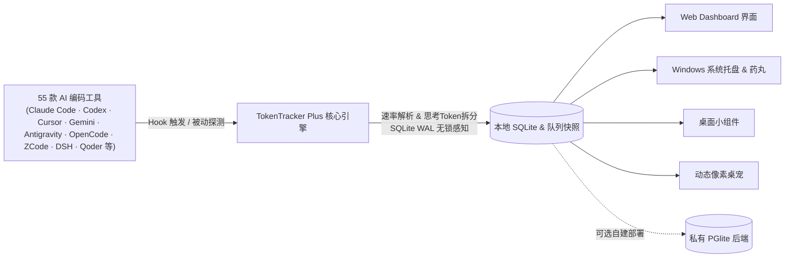

<div align="center">
  
  <h1>TokenTracker Plus (TT-plus)</h1>
  <p><strong>跨 55 款 AI 编码工具与 IDE，看清你到底在 AI 上花了多少钱与实时 Token 速率</strong></p>
  <p>
    <b>简体中文</b> · <a href="./README.zh-TW.md">繁體中文</a> · <a href="./README.en.md">English</a> · <a href="./README.ja.md">日本語</a> · <a href="./README.ko.md">한국어</a> · <a href="./README.pt-BR.md">Português (BR)</a>
  </p>
  <p>
    <a href="./LICENSE"></a>
    <a href="#-支持的-ai-工具列表55-款"></a>
    <a href="#-快速开始"></a>
    <a href="#-数据与隐私准则"></a>
    <a href="#-核心特性"></a>
    <a href="#-热力图色阶与数据分析"></a>
    <a href="https://github.com/01UNCLEDOG01/TokenTracker-plus"></a>
  </p>
</div>

> 💡 **关于本仓库**：TT-plus 是基于原作者 [xiufengsun/TokenTracker](https://github.com/xiufengsun/TokenTracker)（MIT 许可）深度重构的单机与自托管增强版。核心目标是**100% 本地优先**、**真值计费**、**会话拓扑下钻**与**全链路 Token 生成速率实时捕获**。上游版权归原作者所有，本改造同样遵循 MIT 协议开源。上游官方不为此 fork 提供支持或背书。

[✨ 核心特性](#-核心特性) · [🔌 支持的工具](#-支持的-ai-工具列表55-款) · [⚡ 快速开始](#-快速开始) · [💰 计费与热力图](#-费用口径与热力图准则) · [🖼️ 界面预览](#-界面预览) · [🆚 三方对比](#-为什么选-tokentracker-plus) · [🔒 数据与隐私](#-数据与隐私准则) · [📜 使用指南](./docs/getting-started.zh-CN.md) · [❤️ 支持本项目](./SPONSOR.md)

---

## ⚡ 快速开始

> **环境要求**：Node.js **20+**（CLI 为跨平台源码，Windows 上可直接使用；桌面端只提供 Windows 安装包，另需 .NET 8 SDK 与 WebView2 Runtime）。

**Windows 用户免构建**：直接到 [Releases](https://github.com/01UNCLEDOG01/TokenTracker-plus/releases) 下载 `TokenTracker-plus-Setup-v*.exe` 安装即可——安装包内置 Node 运行时，无需账号、无需 API Key、不连任何云服务。第一次使用建议先读《[普通用户上手指南](./docs/getting-started.zh-CN.md)》。

```bash
# 1. 克隆代码仓库并安装依赖
git clone https://github.com/01UNCLEDOG01/TokenTracker-plus.git
cd TokenTracker-plus
npm install

# 2. 首次运行：自动挂接所有 Hook、同步本机用量并打开 Dashboard
node bin/tracker.js

# 常用操作
node bin/tracker.js sync       # 手动增量同步
node bin/tracker.js status     # 查看 55 款工具 hook / 解析器挂接状态
node bin/tracker.js status --json  # 机器可读 JSON 输出（供 AI Agent 管道处理）
node bin/tracker.js doctor     # 运行系统诊断与健康检查
```

**30 秒内你能看到什么：**
- 📊 **本地 Dashboard**（默认 `http://localhost:7680`）—— 总花费、每日趋势、按模型明细、项目归属与会话拓扑。
- ⚡ **毫秒级 Token 速率流** —— 自动接入 Antigravity、DeepSeek Harness、ZCode、OpenCode、Kimi 等客户端的实时生成速率（`tok/s`）。
- 🔌 **全自动扫描挂接** —— 自动识别挂接本地已安装的 55 款 AI 编码工具，零账号绑定、零 API Key 泄露风险。（可选：个别限额卡需要自行刷新本地凭据，如 Qoder 限额卡用仓库根目录的 `Qoder-*-刷新Cookie` 脚本；核心用量统计零配置可用。）
- 🏆 **65 枚成就全量离线判定** —— 100% 按本机本地队列解锁，无需连接公网排行榜服务。

> **想要原生桌面端？**
> - **Windows** —— 运行 `TokenTrackerWin`（C# .NET 8 + WebView2 系统托盘 App），附带动态桌宠、桌面额度小组件与置顶用量药丸。构建方式见 [TokenTrackerWin/README.md](./TokenTrackerWin/README.md)。
> - **其他平台** —— 只提供源码与 CLI（`npx tokentracker`），不提供安装包，也不做兼容性保证；桌面端目前只有 Windows 版本。

---

## ✨ 核心特性

- 🔌 **专为多平台重度开发者打造（支持 55 款工具）** —— 专为日常混合使用多款 AI 客户端的高强度极客设计。无论是终端 CLI、VS Code / Cursor 插件，还是原生桌面 IDE，一键免密挂接全部碎片化账本，无需来回切换 10+ 网站查账。
- 💰 **全网独家：Free 模型真值计费（看清自己到底白嫖赚了多少）** —— 坚决拒绝上游将 `-free` 路由粗暴归零！免费/限免模型一律按官方公开刊例价折算真实算力价值，清清楚楚量化自己薅到了多少真金白银的算力，专属解锁【白嫖之光】勋章与【零元精算巨匠】极客称号。
- ⚡ **纳秒级 Token 生成速率捕获** —— 自研多源速率解析与 SQLite WAL 无锁感知，毫秒级流式分段，独立核算思考模型推理 tokens，精准输出会话级 `tok/s`。
- 🏠 **100% 本地优先与严格隐私保护** —— 跑在本地。直接读取本机日志与数据库，代码正文、Prompt 绝不离开你的电脑，严禁收录或泄漏任何个人敏感账号信息。
- 📊 **Lv0~Lv7 八阶热力图（含 Lv7 宇宙奇点 · Singularity）** —— 告别旧版封顶！针对单日突破 30 亿 Token 的超神极客爆发，专属解锁顶级【宇宙奇点】色阶与 3D 体素突破拔高，支持 2D 阶梯与 3D 体素热力图。
- 🌲 **深度会话拓扑与 Agent 下钻** —— 穿透主会话、工具调用与子代理（Subagent）链路，精准排查高耗会话；Trae CN 完美融合早期 Trae Work 与最新 Trae CN 双轨数据。
- 🏆 **65 枚成就与 17 大 3D 称号殿堂（Steam 原生并发堆叠 Toast）** —— 100% 本地离线判定；搭载 Steam 解锁音效与最多 3 张垂直悬浮并发堆叠 Toast、悬停独立倒计时冻结（Hover-to-Pause）、17 枚极客专属 3D 浮雕 Crest 纹章与全端佩戴点亮，支持一键导出 AAA 级极客 Canvas 战报。
- 🔄 **高频持续维护承诺** —— 站长与开源社区紧跟国内外 AI 编码圈最新动态，高频持续更新热门 AI 工具解析与额度监控卡片，随出随接，常用常新。
- 🐱 **动态桌宠与桌面小组件** —— 悬浮像素桌宠（多套动作轮换与鼠标注视）、4 种桌面小组件、置顶用量药丸。
- 🌍 **全球模型榜（免配置）** —— 直读 Artificial Analysis 官方榜单，把 80+ 模型的智能分、输入/输出/缓存价、上下文与输出速度搬进本地侧栏；无需任何 API Key，本地缓存自动更新，与你的实际用量同屏对照。
- 🎁 **服务商福利指南** —— 32 家可白嫖的 AI 服务商与客户端一览：新户赠送额度、每日免费、长期有效额度与签到福利，每张卡片同时提供「邀请注册」与「官网直达」双链接，按主力推荐/免费/大额额度/客户端分类并可搜索。

---

## 🖼️ 界面预览

<table>
<tr>
<td width="50%">

**Web Dashboard** —— 用量趋势、模型明细、成本分析


</td>
<td width="50%">

**桌面小组件** —— 用量概览、热力图、热门模型与限额卡的实时预览


</td>
</tr>
<tr>
<td width="50%">

**桌面桌宠** —— 7 只陪伴角色（比原版多 2 只），响应 Token 消耗与动作轮换


</td>
<td width="50%">

**离线成就系统** —— 65 枚全量成就离线判定与 17 大称号羁绊体系


</td>
</tr>
<tr>
<td colspan="2">

**全球模型榜** —— 直读 Artificial Analysis 官方榜单：80+ 模型的智能分、输入/输出/缓存价、上下文与输出速度，免配置、本地缓存自动更新


</td>
</tr>
<tr>
<td colspan="2">

**服务商福利指南** —— 32 家服务商的免费额度与新手礼包，邀请注册 / 官网直达双链接


</td>
</tr>
</table>

---

## 🆚 为什么选 TokenTracker Plus？

> **想要一款既有宏观账本、又有实时生成速率与深度拓扑的用量追踪工具？** 下表客观对比 TokenTracker Plus、原版 TokenTracker 与 Token Monitor 的核心能力差异：

| 功能维度 | ⚡ **TokenTracker Plus (本分支)** | 📦 **原版 TokenTracker (上游)** | 🪟 **Token Monitor (TM)** |
|:---|:---:|:---:|:---:|
| **定位与架构** | **宏观全局账本 + 深度拓扑 + 实时速率** | 通用全能看板（含官方云托管） | 极简桌面实时悬浮窗 |
| **支持的 AI 工具数** | **55** 款（覆盖国内外全谱系工具与本地端） | 47 款 | ~15 款（主要覆盖主流模型 API 与常见 CLI） |
| **限额追踪** | **✅ 18 家 provider**（实时限额窗口与重置倒计时） | 10 家 provider | ⚠️ 基础限额展示 |
| **主要交互方式** | **Windows 托盘 + Web Dashboard + 小组件 + CLI** | macOS 菜单栏 + Web Dashboard + 小组件 + CLI | 桌面极简悬浮窗 |
| **数据隐私与存储** | **100% 本地优先**（零强制外传，多端 WAL 感知） | 本地 SQLite + 可选官方云端同步 | 本地 SQLite WAL（无宏观历史报表） |
| **Token 速率 (tok/s)** | **✅ 原生支持**（自研纳秒分段，区分思考 tokens，协同 TM） | ❌ 仅统计总量与花费，无速率计算 | ✅ 支持（悬浮窗主打核心亮点） |
| **会话分析与 Agent 拓扑** | **✅ 深度拓扑**（主代理/子会话下钻、调用链路穿透） | ⚠️ 基础会话列表汇总 | ❌ 仅平铺罗列请求，无层级结构 |
| **活跃度热力图** | **✅ 8 阶尺度 (Lv0~Lv7)**（新增 Lv7 宇宙奇点，容纳单日 30 亿+ 极限爆发） | ⚠️ 传统 4 阶 (Lv0~Lv4，极限量易打满) | ❌ 无热力图功能 |
| **成本计量真值** | **✅ 严谨刊例价核算**（拒绝 `-free` 抹平，算清到底白嫖赚了多少；支持 WorkBuddy 消耗积分） | ⚠️ `-free` 路由强制归 $0（免费算力显示为 $0 空白）；积分未细化 | ⚠️ 基础定价配置，覆盖面有限 |
| **成就与徽章** | **✅ 65 枚离线成就 + 17 大称号羁绊 + Steam 音效与弹窗** | ⚠️ 依赖官方云服务与排行榜下发 | ❌ 无成就系统 |
| **桌面伴侣扩展** | **✅ 动态桌宠 + 额度卡片 + 置顶药丸** | ✅ macOS 菜单栏动画 / 基础小组件 | ⚠️ 基础悬浮窗口 |
| **开源与透明性** | **✅ 100% 源码开源**（可自由审计与二次开发） | ✅ 源码开源 (MIT) | ⚠️ Electron asar 闭源分发 |

---

## 🔌 支持的 AI 工具列表（55 款）

本仓库当前支持 **55 款 AI 编码工具**（以 `src/commands/init.js` 的 `SUPPORTED_PROVIDERS` 为准）：**47 款为 TT 原版支持**（上游共 47 款），**8 款为本 fork 新增**（AutoClaw、Cola、Tuanjie Cowork、Agent2API、Loomy、CodeArts Agent、Magpie、商汤小浣熊），另有小米 MiMo 由原版 Mimo 正名。先列 TT 原版能力，fork 的新增与增强单独说明。

### TT 原版支持（47 款）

| 工具名称 | 识别方式 | 接入方式与机制（TT 原版） |
|---|:---:|---|
| **Claude Code** | ✅ 自动 | 写入 `settings.json` 的 SessionEnd hook |
| **Codex CLI** | ✅ 自动 | 写入 `config.toml` 的 TOML notify hook |
| **AStudio** | ✅ 自动 | 写入 `config.toml` 的 TOML notify hook |
| **Cursor** | ✅ 自动 | API + 本地 SQLite 中的 auth token |
| **Kiro** | ✅ 自动 | SQLite + JSONL 混合读取 |
| **Gemini CLI** | ✅ 自动 | SessionEnd hook |
| **OpenSquilla** | ✅ 自动 | 被动读取本地 SQLite 中已完成的模型用量；只读时间戳、模型与 token 计数，不读对话正文。可用 `TOKENTRACKER_OPENSQUILLA_DB` 覆盖路径 |
| **OpenClaw** | ✅ 自动 | Session 插件（`openclaw-session-sync`） |
| **Every Code** | ✅ 自动 | TOML notify hook |
| **Hermes Agent** | ✅ 自动 | 被动读取 SQLite（`~/.hermes/state.db`） |
| **CodeBuddy** (腾讯) | ✅ 自动 | 写入 `~/.codebuddy/settings.json` SessionEnd hook |
| **Grok Build** (xAI) | ✅ 自动 | SessionEnd hook + 被动扫描 `updates.jsonl` |
| **oh-my-pi** | ✅ 自动 | 被动读取会话日志 + 托管 notify 扩展 |
| **OmO** | ✅ 自动 | 被动读取会话日志 |
| **pi** | ✅ 自动 | 被动读取（`~/.pi/agent/sessions/**/*.jsonl`） |
| **Dots** | ✅ 自动 | 通过 pi provider 拆分路由 |
| **Prime Agent** | ✅ 自动 | 仅元数据被动用量读取 |
| **Craft Agents** | ✅ 自动 | 被动读取 session 日志 |
| **Reasonix** | ✅ 自动 | 被动读取 telemetry 遥测数据 |
| **Muse Code** | ✅ 自动 | 被动读取会话日志（`session.jsonl`） |
| **Kilo CLI** | ✅ 自动 | 被动读取 SQLite（`~/.local/share/kilo/kilo.db`） |
| **Kilo Code** | ✅ 自动 | 被动读取 `ui_messages.json` |
| **Roo Code** | ✅ 自动 | 被动读取 `ui_messages.json` |
| **Zed Agent** | ✅ 自动 | 被动读取 SQLite（`threads.db`） |
| **Goose** | ✅ 自动 | 被动会话日志扫描 |
| **Droid** (Factory) | ✅ 自动 | 被动读取会话轨迹与事件流 |
| **DuMate** (百度) | ✅ 自动 | 被动读取会话日志 |
| **AnythingLLM Desktop** | ✅ 自动 | 被动读取本地 SQLite 数据库 |
| **Claude Science** | ✅ 自动 | 被动读取 SQLite（`operon-cli.db`） |
| **LM Studio** | ✅ 自动 | 被动读取本地日志与活动状态 |
| **Unsloth Studio** | ✅ 自动 | 被动读取 SQLite（`unsloth.db`） |
| **Devin CLI** | ✅ 自动 | 被动读取本地 Devin 数据库 |
| **Cline** | ✅ 自动 | 被动读取 VS Code 全局存储与历史 |
| **MiniMax Code** | ✅ 自动 | 被动读取本地会话日志 |
| **Command Code** | ✅ 自动 | 被动读取会话快照与日志 |

### Fork 增强（本分支）

**新增来源（8 款）：**

| 工具名称 | 接入方式与机制 | 说明 |
|---|:---:|---|
| **Loomy** | ✅ 自动 | 插件系统 + 会话日志 |
| **CodeArts Agent** | ✅ 自动 | 被动读取华为 CodeArts 会话与日志 |
| **AutoClaw** | ✅ 自动 | 自动化 Agent 工作流日志集成 |
| **Cola** | ✅ 自动 | 协作 Agent 日志接入 |
| **Tuanjie Cowork** | ✅ 自动 | 协作工作流日志接入 |
| **Agent2API** | ✅ 自动 | 本地网关与 Agent 映射用量归集 |
| **Magpie** | 被动读取本地网关用量账本（`~/.config/magpie/usage.jsonl`） | 只统计经它转发的请求，不重复计客户端会话 |
| **商汤小浣熊** | 被动读取桌面端 agent 轨迹（`~/.office-raccoon/agent/log/sessions`） | 只取 `llm.response` 的 usage，不碰 agent2api |

**对原版来源的增强：**

| 工具名称 | Fork 增强（本分支） |
|---|---|
| **Antigravity** | 新增 tok/s 速率解析与思考 tokens 独立核算 |
| **OpenCode** | 支持 reasoning_output_tokens 速率修正 |
| **GitHub Copilot** | 协调多源数据，防止重叠请求双计 |
| **Kimi Code** | 实时计算输出与分段 tok/s 生成速率 |
| **WorkBuddy** (腾讯) | 双源拆分：国内标准版；配额卡经桌面端 IPC 读取（套餐 + 奖励额度），需桌面客户端运行 |
| **WorkBuddy AI** (腾讯) | 双源拆分：进阶版与积分对账；配额卡同走桌面端 IPC（国际版客户端账单域可能为 CN 域，已自动兼容） |
| **Xiaomi MiMo** | 接第三方模型也计入（直连厂商黑名单判定）；由原版 Mimo 正名 |
| **ZCode** | 会话层下钻与毫秒级 tok/s 捕获；自加渠道只记 output，按逐请求对账从网关补回输入与缓存 |
| **Qoder** | 支持国际版与国内版细化模型与积分对账 |
| **DeepSeek Harness** | 多帧 zstd 解压与实时 tok/s 流式计算 |
| **TRAE CN** (字节跳动) | 支持国内版最新合并架构解析与会话拓扑下钻 |
| **TRAE** (国际版) | 会话层接入；早期步骤费用按牌价推算 |

---

## 🏗️ 工作原理



1. **正常使用 AI 工具**：你在各 CLI 或 IDE 中正常对话写代码，它们会在本地产生日志、SQLite 记录或触发 hook。
2. **轻量感知与速率提取**：TT-plus 引擎毫秒级感知变动，提取输入、输出、缓存与思考模型 reasoning tokens，计算精准耗时与 `tok/s`。
3. **100% 本地解析落账**：Prompt、回复正文和代码绝不保存或上传，仅将 token 指标写入本地存储。
4. **多端消费展示**：Web Dashboard、Windows 托盘、桌宠、小组件同时读取本地快照，秒级刷新呈现。

---

## 💰 费用口径与热力图准则

### 费用计算公式
$$\text{Cost} = \text{Input} \times P_{\text{in}} + \text{Cached} \times P_{\text{cached}} + \text{CacheWrite} \times P_{\text{cw}} + \text{Output} \times P_{\text{out}} + \text{Reasoning} \times P_{\text{reason}}$$

- **坚决拒绝上游 `-free` 归零规则**：上游将带 `-free` 后缀的模型统一强制归 $0，本 fork 永久拒绝该规则，所有模型严格按照厂商真实刊例单价计费，反映真实的 AI 生产力成本。
- **价格数据源**：聚合 LiteLLM 全量官方价表 + `src/lib/pricing/curated-overrides.json` 本地精选校准；未公开价格的模型只记录 token 数量，绝不胡乱捏造虚假金额。
- **WorkBuddy 积分与双源核算**：独立支持 WorkBuddy 标准版与进阶版，将消耗积分与官方代币严格对账，防止双计。
- **网关（中转）归属**：Agent2API / Magpie 这类本地网关只保留「客户端无法自证」的请求——调用方能对上已独立解析的客户端（DSH、Codex 等）就跳过；客户端账本记不了输入的（Claude Code、ZCode）用网关数据补进它自己的卡（ZCode 只补输入与缓存，Claude Code 保留输出）。所以网关卡上只剩无法归属的流量，不会和客户端卡重复。

### 热力图色阶与数据分析（Lv0 ~ Lv7 八阶色阶 · 含 Lv7 宇宙奇点）
热力图采用全新 **8 阶色阶体系**，在 6 个关键分位点（`P30`, `P55`, `P75`, `P88`, `P95`, `P98.5`）基础上拓展单日突破 30 亿极限爆发的宇宙奇点色阶：
- **Level 0**：0 tokens（无活动）
- **Level 1**：`0 < tokens ≤ P30`（轻度编码）
- **Level 2**：`P30 < tokens ≤ P55`（日常开发）
- **Level 3**：`P55 < tokens ≤ P75`（深度编码）
- **Level 4**：`P75 < tokens ≤ P88`（高强度输出）
- **Level 5**：`P88 < tokens ≤ P95`（极限爆发，翠绿强化）
- **Level 6**：`> P95`（巅峰爆发 / 神级产出，专属暗夜荧光翡翠阶）
- **Level 7【宇宙奇点 · Singularity】**：`tokens ≥ 3,000,000,000`（单日 30 亿+ tokens 超神产出，3D 体素高度突破至 $1.25 \times H_{\text{max}}$ 耸立，专属祖母绿发光星环）

2D 平面热力图与 3D 体素热力图（Lv0~Lv6 按高度线性拔高，Lv7 突破顶峰上限）全面对齐。

---

## 🔒 数据与隐私准则

- **100% 本地优先**：所有数据解析、速率计算与报表汇总都在你的本地设备上完成。
- **纯用量指标记录**：仅记录 input / output / cached / reasoning token 数量、时间戳、模型名与金额；**代码正文、Prompt 绝不保存、绝不上传**。
- **凭据本机隔离**：API Key、Cookie、本地数据库密码仅保存在用户本地目录或 `.env.local` 中，绝不提交至代码仓库或前端构建产物。

---

## 🛠️ 本地配置与自建后端（可选）

```bash
cp .env.example .env.local
```

常用变量：`OPENROUTER_API_KEY`、`TOKENTRACKER_DEVICE_TOKEN`、`VITE_INSFORGE_BASE_URL`。本地覆盖均放 `.env.local`（已纳入 `.gitignore`）。**不要创建 `.dev.vars`**。

### 私有自建后端（技术预览）
若有多台设备需要汇总视图，可将 `scripts/self-host/` 部署到自己的私有 Docker 宿主机上：
- 详见 [docs/self-hosting.md](./docs/self-hosting.md)；
- 注：早期内部测试用 Docker 宿主机已于 2026-10-23 正式退役，项目默认 100% 离线单机运行。

---

## 📄 License 与致谢

- **License**：本项目遵循 [MIT 许可证](./LICENSE)。
- **上游项目**：致敬并感谢原作者 [xiufengsun/TokenTracker](https://github.com/xiufengsun/TokenTracker) 的杰出工作与开源贡献。
- **第三方声明**：详见 [THIRD_PARTY_NOTICES.md](./THIRD_PARTY_NOTICES.md)。Clawd 角色形象归 Anthropic 所有，本项目与 Anthropic 官方无关联。
