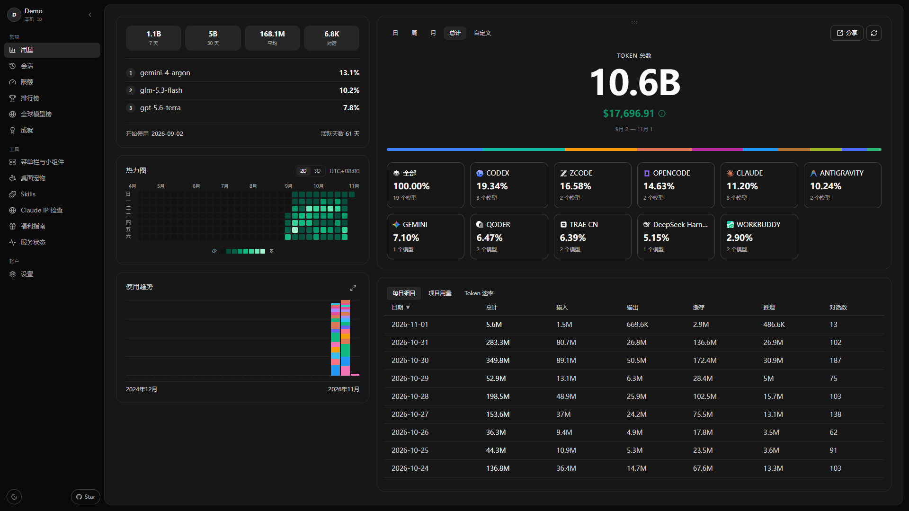
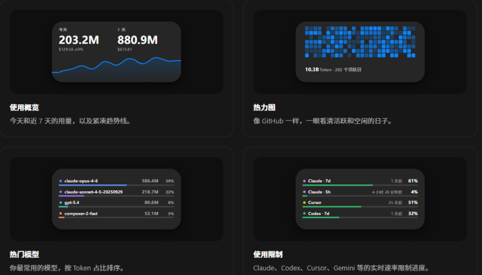
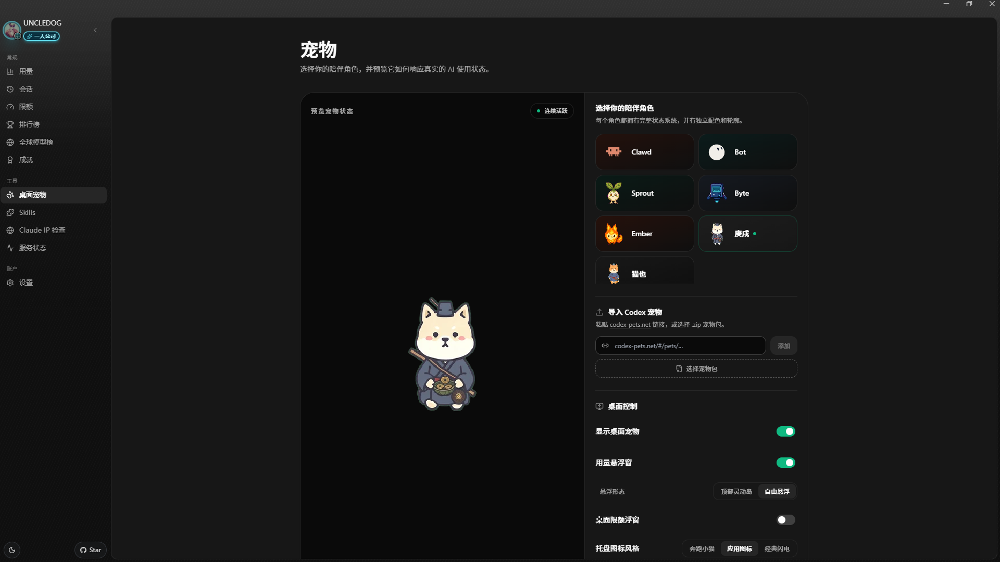
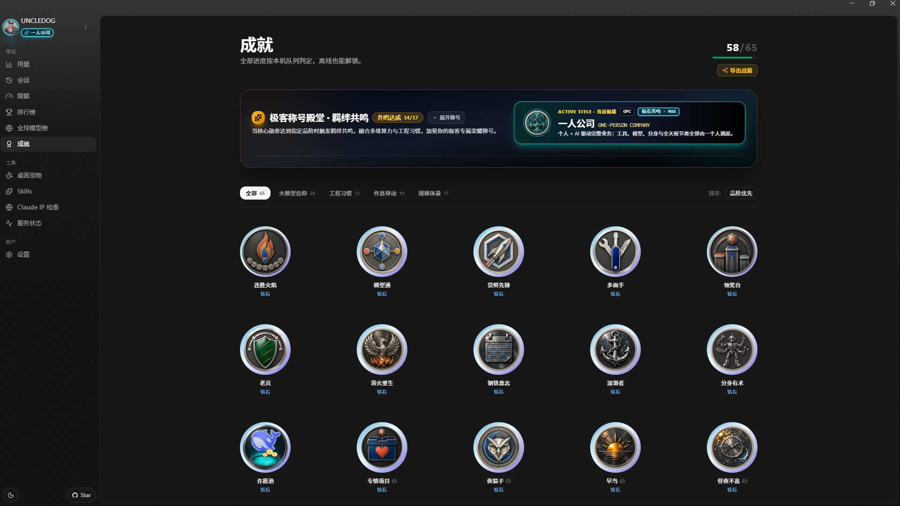
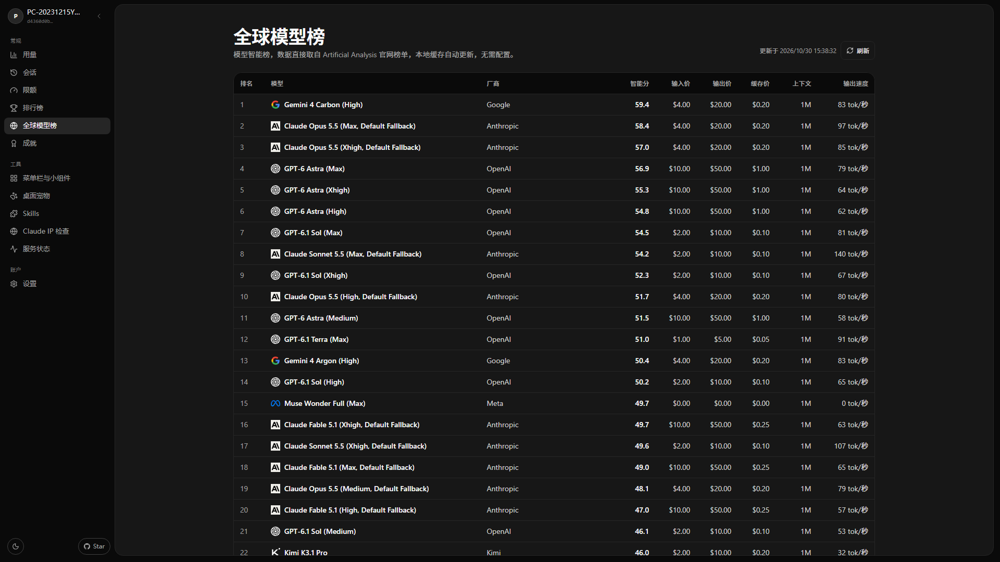
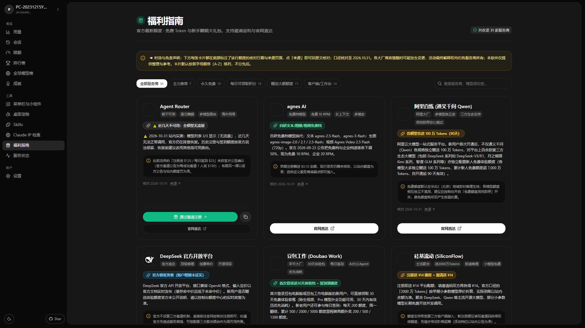
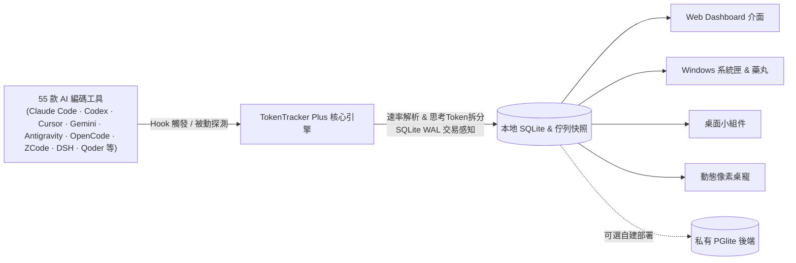

<div align="center">
  
  <h1>TokenTracker Plus (TT-plus)</h1>
  <p><strong>跨 55 款 AI 編碼工具與 IDE，看清你到底在 AI 上花了多少錢與即時 Token 速率</strong></p>
  <p>
    <a href="./README.md">简体中文</a> · <b>繁體中文</b> · <a href="./README.en.md">English</a> · <a href="./README.ja.md">日本語</a> · <a href="./README.ko.md">한국어</a> · <a href="./README.pt-BR.md">Português (BR)</a>
  </p>
  <p>
    <a href="./LICENSE"></a>
    <a href="#-支援的-ai-工具列表55-款"></a>
    <a href="#-快速開始"></a>
    <a href="#-數據與隱私準則"></a>
    <a href="#-核心特性"></a>
    <a href="#-熱力圖色階與數據分析"></a>
    <a href="https://github.com/01UNCLEDOG01/TokenTracker-Plus"></a>
  </p>
</div>

> 💡 **關於本倉庫**：TT-plus 是基於原作者 [xiufengsun/TokenTracker](https://github.com/xiufengsun/TokenTracker)（MIT 許可）深度重構的單機與自託管增強版。核心目標是**100% 本地優先**、**真值計費**、**會話拓撲下鑽**與**全鏈路 Token 生成速率即時捕獲**。上游版權歸原作者所有，本改造同樣遵循 MIT 協議開源。上游官方不為此 fork 提供支援或背書。

[✨ 核心特性](#-核心特性) · [🔌 支援的工具](#-支援的-ai-工具列表55-款) · [⚡ 快速開始](#-快速開始) · [💰 計費與熱力圖](#-費用口徑與熱力圖準則) · [🖼️ 介面預覽](#-介面預覽) · [🆚 三方對比](#-為什麼選-tokentracker-plus) · [🔒 數據與隱私](#-數據與隱私準則) · [📜 使用指南](./docs/getting-started.zh-CN.md) · [❤️ 支持本項目](./SPONSOR.md)

---

## ⚡ 快速開始

> **環境要求**：從原始碼執行需要 Node.js **20+**；SQLite 資料源（opencode/zcode/loomy/trae 等）另需 Node.js **22.5+**（使用內建 `node:sqlite`）或系統安裝 `sqlite3` 命令。Windows 安裝包內建 Node 與 .NET 執行環境，只需 Windows 10/11 與 WebView2 Runtime；macOS 安裝包內建 Node 執行環境（通用二進制，Apple silicon 與 Intel 皆可），只需 macOS 13+；自行構建桌面端才需要 .NET 8 SDK（Windows）或 完整 Xcode（macOS，僅 Command Line Tools 不足）。

**Windows / macOS 使用者免構建**：直接到 [Releases](https://github.com/01UNCLEDOG01/TokenTracker-Plus/releases) 下載安裝即可——Windows 下載 `TokenTracker-Setup.exe`；macOS 下載 `TokenTracker-plus-1.26.0.dmg` 拖進「應用程式」（通用二進制）——安裝包內建 Node 執行時，無需帳號、無需 API Key、不連任何雲端服務。第一次使用建議先讀《[普通使用者上手指南](./docs/getting-started.zh-CN.md)》（簡體）。

> 💡 **關於 Windows Defender / SmartScreen 提示**：本軟體為個人開源作品，尚未購買企業數位簽章憑證，初次安裝時 Windows SmartScreen 可能會提示「已保護你的電腦（未知發佈者）」。此為正常安全機制，點擊「更多資訊」→「仍要執行」即可完成安裝；程式碼 100% 開源，資料 100% 留在本機，請放心使用。
> 🍎 **macOS 原生用戶端（1.26.0 起為 TT-Plus 自己的版本）**：保留原生 SwiftUI 選單列形態（通用二進制，Apple silicon / Intel 皆可），介面 6 語言（簡中 / 繁中 / 英 / 日 / 韓 / 德）；**本機優先**——不連接雲端，也沒有帳號 / 登入 / OAuth 介面；頁面選單涵蓋 13 個 fork 頁面並支援 `tokentracker://open?path=` 深鏈，桌面寵物內建 7 個形象（含庚戌 / 貓也）；「檢查更新」只讀本儲存庫 Releases（資產名 `TokenTracker-plus-<版本>.dmg`）。WidgetKit 桌面小工具隨套件發布（4 個：彙總 / 熱力圖 / 頂級模型 / 限額；ad-hoc 簽章 + 沙箱，無需 App Group）；桌面額度浮窗與限額頁 35 個 provider 的窗口口徑已隨本版本包含。

> 💡 **關於 macOS Gatekeeper 提示**：macOS 版同為未簽名發行，首次開啟若提示「無法驗證開發者」，在應用程式上**右鍵 → 打開**，或執行 `xattr -cr /Applications/TokenTracker-plus.app` 後再開啟即可。

```bash
# 1. 複製代碼倉庫並安裝依賴
git clone https://github.com/01UNCLEDOG01/TokenTracker-Plus.git
cd TokenTracker-Plus
npm install

# 2. 首次運行：自動掛接所有 Hook、同步本機用量並開啟 Dashboard
node bin/tracker.js

# 常用操作
node bin/tracker.js sync       # 手動增量同步
node bin/tracker.js status     # 查看 55 款工具 hook / 解析器掛接狀態
node bin/tracker.js status --json  # 機器可讀 JSON 輸出（供 AI Agent 管道處理）
node bin/tracker.js doctor     # 運行系統診斷與健康檢查
```

**30 秒內你能看到什麼：**
- 📊 **本地 Dashboard**（Windows / macOS 桌面版預設 `http://localhost:17680`；CLI `node bin/tracker.js serve` 預設 `7680`）—— 總花費、每日趨勢、按模型明細、項目歸屬與會話拓撲。
- ⚡ **多來源 Token 生成速率捕獲** —— 根據各來源的時間戳與輸出 token 計算會話級 `tok/s`，思考 token 單獨記錄。
- 🔌 **全自動掃描掛接** —— 自動識別掛接本地已安裝的 55 款 AI 編碼工具，零帳號綁定、零 API Key 洩漏風險。（可選：個別限額卡需自行重新整理本地憑證，如 Qoder 限額卡用倉庫根目錄的 `Qoder-*-刷新Cookie` 指令碼；核心用量統計零設定可用。）
- 🏆 **65 枚成就全量離線判定** —— 100% 按本機本地佇列解鎖，無需連接公網排行榜服務。同一瀏覽器保留已觀察到的最高階位，首次載入舊快取也不會退階；用量與占比仍顯示真實現值。

> **想要原生桌面端？**
> - **Windows** —— 運行 `TokenTrackerWin`（C# .NET 8 + WebView2 系統匣 App），附帶動態桌寵、桌面額度小組件與置頂用量藥丸。構建方式見 [TokenTrackerWin/README.md](./TokenTrackerWin/README.md)。
> - **macOS（Apple silicon / Intel 通用二進制）** —— 運行 `TokenTrackerMac`（**TT-Plus 自維護的原生 Swift 選單列 App**）：選單列 ⚡ 額度面板、頁面選單（13 個 fork 頁面）與 `tokentracker://open?path=` 深鏈、桌面寵物懸浮窗（7 個內建形象，含庚戌 / 貓也）、面板窗，內嵌伺服器零依賴；介面 6 語言、本機優先（無雲端帳號 / 登入 / OAuth），檢查更新指向本儲存庫 Releases。WidgetKit 小工具隨套件發布。構建方式見 [TokenTrackerMac/README.md](./TokenTrackerMac/README.md)。
> - **其他平台** —— 僅提供源碼運行（`git clone` 後執行 `node bin/tracker.js`），不提供安裝包，也不做相容性保證；桌面端目前覆蓋 Windows 與 macOS。

---

## ✨ 核心特性

- 🔌 **專為多平台重度開發者打造（支援 55 款工具）** —— 專為日常混合使用多款 AI 客戶端的高強度極客設計。無論是終端 CLI、VS Code / Cursor 插件，還是原生桌面 IDE，一鍵免密掛接全部碎片化帳本，無需來回切換 10+ 網站查帳。
- 💰 **全網獨家：Free 模型真值計費（看清自己到底白嫖賺了多少）** —— 堅決拒絕上游將 -free 路由粗暴歸零！免費/限免模型一律按官方公開刊例價折算真實算力價值，清清楚楚量化自己薅到了多少真金白銀的算力，專屬解鎖【白嫖之光】勳章與【零元精算巨匠】極客稱號。
- ⚡ **多來源 Token 生成速率捕獲** —— 自研多源速率解析與 SQLite WAL 交易感知，毫秒級流式分段，獨立核算思考模型推理 tokens，精準輸出會話級 	ok/s。
- 🏠 **100% 本地優先與嚴格隱私保護** —— 跑在本地。直接讀取本機日誌與資料庫，程式碼正文、Prompt 絕不離開你的電腦，嚴禁收錄或洩漏任何個人敏感帳號資訊。
- 📊 **Lv0~Lv7 八階熱力圖（含 Lv7 宇宙奇點 · Singularity）** —— 告别舊版封頂！針對單日突破 30 億 Token 的超神極客爆發，專屬解鎖頂級【宇宙奇點】色階與 3D 體素突破拔高，支援 2D 階梯與 3D 體素熱力圖。活躍樣本至少 8 天時，達到 P98.5 且超過 P95 也會進入 Lv7。
- 🌲 **深度會話拓撲與 Agent 下鑽** —— 穿透主會話、工具調用與子代理（Subagent）鏈路，精準排查高耗會話；Trae CN 完美融合早期 Trae Work 與最新 Trae CN 雙軌數據。
- 🏆 **65 枚成就與 17 大 3D 稱號殿堂（Steam 原生並發堆疊 Toast）** —— 100% 本地離線判定；搭載 Steam 解鎖音效與最多 3 張垂直懸浮並發堆疊 Toast、懸停獨立倒計時凍結（Hover-to-Pause）、17 枚極客專屬 3D 浮雕 Crest 紋章與全端佩戴點亮，支援一鍵匯出 AAA 級極客 Canvas 戰報。
- 🔄 **高頻持續維護承諾** —— 站長與開源社群緊跟國內外 AI 編碼圈最新動態，高頻持續更新熱門 AI 工具解析與額度監控卡片，隨出隨接，常用常新。
- 🐱 **動態桌寵與桌面小組件** —— 懸浮像素桌寵（多套動作輪換與滑鼠注視、0.70–2.20× 自由尺寸滑桿）、4 種桌面小組件、置頂用量藥丸。
- 🌍 **全球模型雙榜（免設定）** —— Artificial Analysis 智能榜與 AIHOT 綜合榜同頁切換，可查看評分、輸入/輸出/快取價、上下文與輸出速度。各榜獨立快取，失敗時回退快照並標示狀態；缺少指標顯示「—」，實測零值保留。AIHOT 榜資料取自數字生命卡茲克的開源專案 AIHOT（aihot.news），特此致謝。
- 🎁 **服務商福利指南** —— 79 家服務商與客戶端，以 AIHOT 式卡冊呈現（統計頭 + 常駐翻頁卡牌帶 + 藍銅銀金閃五檔稀有度 + 絕版玻璃櫃），提供新戶額度、每日/每月福利、長期免費與簽到積分；有邀請活動的卡片提供邀請註冊，全部卡片提供官網、核對日期與來源。比較中文名全拼與英文品牌名，取較靠前的名稱統一按 A–Z 排序；支援分類、搜尋與領取標記。 領取標記按北京時間每日 00:00、每月 1 日重設提醒，雙週期卡片分開標記；一次性標記保留，跨日或休眠返回自動更新，舊記錄按日期遷移。
- **限額與服務狀態** —— Cursor 短暫斷網時回退同帳戶有效快取，憑證到期仍提示重新登入；OpenCode 顯示官方服務狀態；WorkBuddy 國內/國際版分別顯示方案與獎勵積分，在原有懸浮明細提示北京時間最早到期日與當日將到期積分，保留小數。
- **Codex 檔位明細** —— 展開模型後可查看 Standard / Fast / Ultrafast 的實測 token 與完整檔位費用，包含快取與長上下文；來源卡及全部模型視圖使用同一口徑，總費用計算保持一致。
- **用量範圍與唯讀比較** —— 明確顯示本機/帳戶範圍，預設看本機資料。只有自行設定雲端實例、登入並啟用同步且雲端讀取可用後，才可暫時比較兩個範圍，不改上傳偏好；切換帳戶或關閉同步時會重設選擇。
- **會話留存與本機備份** —— 可下鑽 Qoder 雙版、MiniMax、Devin 等本機會話；輕量 gzip 快照只保留已採集的會話統計，刪除來源檔後仍可查看，不能恢復未採集的對話。設定頁可匯出 `.ttbackup`，異機匯入先預覽、只補缺失資料。

- **頁面載入與深色可讀性** —— 本機會話回應按需 gzip 壓縮，重建期間重用清單；磁碟快取非同步讀寫、附版本且有效期最多 24 小時，舊格式自動重建。顯示快照時間並嘗試背景更新；福利頁加強文字、控制項邊界及鍵盤焦點對比。 啟動先提供頁面再複製執行檔與修復整合，共用 JS/CSS 預壓縮傳輸。
- **背景用量採集** —— 桌面更新會採集 TRAE CN 本機資料庫與 WAL、未觸發外掛訊號的 OpenClaw 會話及 Prime Agent。Windows 下 TRAE 持續寫入時使用短暫共享讀取保護；舊列補填或修正用量按差額入帳，未完成的列不阻塞新用量。重複更新不重複計數，TRAE CN 雲端用量讀取仍需另行授權。Trae 用戶端自 2026-09 更新後不再於本機請求紀錄寫入快取欄位，TRAE CN 的快取命中率依你在其他來源使用同一機型的實測中位數**估算**（Token 總量仍為實測，費用依同一估算折算）。

---

## 🖼️ 介面預覽

<table>
<tr>
<td width="50%">

**Web Dashboard** —— 用量趨勢、模型明細、成本分析



</td>
<td width="50%">

**桌面小組件** —— 用量概覽、熱力圖、熱門模型與限額卡的即時預覽



</td>
</tr>
<tr>
<td width="50%">

**桌面桌寵** —— 7 隻陪伴角色（比原版多 2 隻），響應 Token 消耗與動作輪換



</td>
<td width="50%">

**離線成就系統** —— 65 枚全量成就離線判定與 17 大稱號羈絆體系



</td>
</tr>
<tr>
<td colspan="2">

**全球模型雙榜** —— Artificial Analysis 與 AIHOT 同頁切換，並列指標與價格；各自快取，缺失值顯示「—」



</td>
</tr>
<tr>
<td colspan="2">

**服務商福利指南** —— 79 家服務商的免費額度與新手禮包，卡冊式翻頁瀏覽（五檔稀有度 + 絕版玻璃櫃），有邀請活動的卡片配邀請註冊、全部卡片配官網直達



</td>
</tr>
</table>

---

## 🆚 為什麼選 TokenTracker Plus？

> **想要一款既有宏觀帳本、又有即時生成速率與深度拓撲的用量追蹤工具？** 下表客觀對比 TokenTracker Plus、原版 TokenTracker 與 Token Monitor 的核心能力差異：

| 功能維度 | ⚡ **TokenTracker Plus (本分支)** | 📦 **原版 TokenTracker (上游)** | 🪟 **Token Monitor (TM)** |
|:---|:---:|:---:|:---:|
| **定位與架構** | **宏觀全局帳本 + 深度拓撲 + 即時速率** | 通用全能看板（含官方雲託管） | 極簡桌面即時懸浮窗 |
| **支援的 AI 工具數** | **55 款**（覆蓋國內外全譜系工具與本地端） | 47 款 | ~15 款（主要覆蓋主流模型 API 與常見 CLI） |
| **限額追蹤** | **✅ 35 項配額/餘額來源**（即時限額窗口與重置倒數計時） | 10 家 provider | ⚠️ 基礎限額展示 |
| **主要交互方式** | **Windows 系統匣 + macOS 選單列 + Web Dashboard + 小組件（Windows）+ CLI** | macOS 選單列 + Web Dashboard + 小組件 + CLI | 桌面極簡懸浮窗 |
| **數據隱私與存儲** | **100% 本地優先**（零強制外傳，多端 WAL 感知） | 本地 SQLite + 可選官方雲端同步 | 本地 SQLite WAL（無宏觀歷史報表） |
| **Token 速率 (tok/s)** | **✅ 原生支援**（多來源時序解析，區分思考 tokens，協同 TM） | ❌ 僅統計總量與花費，無速率計算 | ✅ 支援（懸浮窗主打核心亮點） |
| **會話分析與 Agent 拓撲** | **✅ 深度拓撲**（主代理/子會話下鑽、調用鏈路穿透） | ⚠️ 基礎會話列表彙總 | ❌ 僅平鋪羅列請求，無層級結構 |
| **活躍度熱力圖** | **✅ 8 階尺度 (Lv0~Lv7)**（新增 Lv7 宇宙奇點，容納單日 30 億+ 極限爆發） | ⚠️ 傳統 4 階 (Lv0~Lv4，極限量易打滿) | ❌ 無熱力圖功能 |
| **成本計量真值** | **✅ 嚴謹刊例價核算**（拒絕 `-free` 抹平；支援 WorkBuddy 消耗積分） | ⚠️ `-free` 路由強制歸 $0；積分未細化 | ⚠️ 基礎定價配置，覆蓋面有限 |
| **成就與徽章** | **✅ 65 枚全量成就離線解鎖**（本地佇列與首發日核算，17 大稱號殿堂） | ⚠️ 依賴官方雲服務與排行榜下發 | ❌ 無成就系統 |
| **桌面伴侶擴展** | **✅ 動態桌寵 + 額度卡片 + 置頂藥丸** | ✅ macOS 選單列動畫 / 基礎小組件 | ⚠️ 基礎懸浮窗口 |
| **開源與透明性** | **✅ 100% 原始碼開源**（可自由審計與二次開發） | ✅ 原始碼開源 (MIT) | ⚠️ Electron asar 閉源分發 |

---

## 🔌 支援的 AI 工具列表（55 款）

本倉庫當前支援 **55 款 AI 編碼工具**（以 `src/commands/init.js` 的 `SUPPORTED_PROVIDERS` 為準）：**47 款為 TT 原版支援**（上游共 47 款），**8 款為本 fork 新增**（AutoClaw、Cola、Tuanjie Cowork、Agent2API、Loomy、CodeArts Agent、Magpie、商湯小浣熊），另有小米 MiMo 由原版 Mimo 正名。先列 TT 原版能力，fork 的新增與增強單獨說明。

### TT 原版支援（47 款）

| 工具名稱 | 識別方式 | 接入方式與機制（TT 原版） |
|---|:---:|---|
| **Claude Code** | ✅ 自動 | 寫入 `settings.json` 的 SessionEnd hook |
| **Codex CLI** | ✅ 自動 | 寫入 `config.toml` 的 TOML notify hook |
| **AStudio** | ✅ 自動 | 寫入 `config.toml` 的 TOML notify hook；支援 `TOKENTRACKER_ACODE_HOME` 目錄覆蓋 |
| **Cursor** | ✅ 自動 | API + 本地 SQLite 中的 auth token |
| **Kiro** | ✅ 自動 | SQLite + JSONL 混合讀取 |
| **Gemini CLI** | ✅ 自動 | SessionEnd hook |
| **OpenSquilla** | ✅ 自動 | 被動讀取本地 SQLite 中已完成的模型用量；只讀時間戳、模型與 token 計數，不讀對話正文。可用 `TOKENTRACKER_OPENSQUILLA_DB` 覆蓋路徑 |
| **OpenClaw** | ✅ 自動 | Session 外掛（`openclaw-session-sync`） |
| **Every Code** | ✅ 自動 | TOML notify hook |
| **Hermes Agent** | ✅ 自動 | 被動讀取 SQLite（`~/.hermes/state.db`） |
| **CodeBuddy** (騰訊) | ✅ 自動 | 寫入 `~/.codebuddy/settings.json` SessionEnd hook |
| **Grok Build** (xAI) | ✅ 自動 | SessionEnd hook + 被動掃描 `updates.jsonl` |
| **oh-my-pi** | ✅ 自動 | 被動讀取會話日誌 + 託管 notify 擴展 |
| **OmO** | ✅ 自動 | 被動讀取會話日誌 |
| **pi** | ✅ 自動 | 被動讀取（`~/.pi/agent/sessions/**/*.jsonl`） |
| **Dots** | ✅ 自動 | 透過 pi provider 拆分路由 |
| **Prime Agent** | ✅ 自動 | 僅元數據被動用量讀取 |
| **Craft Agents** | ✅ 自動 | 被動讀取 session 日誌 |
| **Reasonix** | ✅ 自動 | 被動讀取 telemetry 遙測數據 |
| **Muse Code** | ✅ 自動 | 被动讀取會話日誌（`session.jsonl`） |
| **Kilo CLI** | ✅ 自動 | 被動讀取 SQLite（`~/.local/share/kilo/kilo.db`） |
| **Kilo Code** | ✅ 自動 | 被動讀取 `ui_messages.json` |
| **Roo Code** | ✅ 自動 | 被動讀取 `ui_messages.json` |
| **Zed Agent** | ✅ 自動 | 被動讀取 SQLite（`threads.db`） |
| **Goose** | ✅ 自動 | 被動會話日誌掃描 |
| **Droid** (Factory) | ✅ 自動 | 被動讀取會話軌跡與事件流 |
| **DuMate** (百度) | ✅ 自動 | 被動讀取會話日誌；支援 `TOKENTRACKER_DUMATE_HOME` 覆蓋 |
| **AnythingLLM Desktop** | ✅ 自動 | 被動讀取本地 SQLite 資料庫 |
| **Claude Science** | ✅ 自動 | 被動讀取 SQLite（`operon-cli.db`） |
| **LM Studio** | ✅ 自動 | 被動讀取本地日誌與活動狀態；支援 `TOKENTRACKER_LMSTUDIO_HOME` 覆蓋 |
| **Unsloth Studio** | ✅ 自動 | 被動讀取 SQLite（`unsloth.db`）；支援 `TOKENTRACKER_UNSLOTH_DB` 覆蓋 |
| **Devin CLI** | ✅ 自動 | 被動讀取本地 Devin 資料庫；支援 `TOKENTRACKER_DEVIN_DB` 覆蓋 |
| **Cline** | ✅ 自動 | 被動讀取 VS Code 全域儲存與歷史 |
| **MiniMax Code** | ✅ 自動 | 被動讀取本地會話日誌 |
| **Command Code** | ✅ 自動 | 被動讀取會話快照與日誌 |

### Fork 增强（本分支）

**新增來源（8 款）：**

| 工具名稱 | 接入方式與機制 | 說明 |
|---|:---:|---|
| **Loomy** | ✅ 自動 | 外掛系統 + 會話日誌 |
| **CodeArts Agent** | ✅ 自動 | 被動讀取華為 CodeArts 會話與日誌 |
| **AutoClaw** | ✅ 自動 | 自動化 Agent 工作流日誌整合 |
| **Cola** | ✅ 自動 | 協作 Agent 日誌接入 |
| **Tuanjie Cowork** | ✅ 自動 | 協作工作流日誌接入 |
| **Agent2API** | ✅ 自動 | 本地閘道器與 Agent 映射用量歸集 |
| **Magpie** | 被動讀取本地閘道用量帳本（`~/.config/magpie/usage.jsonl`） | 只統計經它轉發的請求，不重複計客戶端會話 |
| **商湯小浣熊** | 被動讀取桌面端 agent 軌跡（`~/.office-raccoon/agent/log/sessions`） | 只取 `llm.response` 的 usage，不碰 agent2api |

**對原版來源的增強：**

| 工具名稱 | Fork 增强（本分支） |
|---|---|
| **Antigravity** | 新增 tok/s 速率解析與思考 tokens 獨立核算 |
| **OpenCode** | 支援 reasoning_output_tokens 速率修正 |
| **GitHub Copilot** | 協調多源數據，防止重疊請求雙計 |
| **Kimi Code** | 即時計算輸出與分段 tok/s 生成速率 |
| **WorkBuddy** (騰訊) | 國內版獨立帳戶與用量；配額卡經桌面端 IPC 讀取（套餐 + 獎勵額度），需桌面客戶端運行 |
| **WorkBuddy AI** (騰訊) | 國際版獨立帳戶與積分對帳；配額卡同走桌面端 IPC（國際版客戶端賬單域可能為 CN 域，已自動兼容） |
| **Xiaomi MiMo** | 接第三方模型也計入（直連廠商黑名單判定）；由原版 Mimo 正名 |
| **ZCode** | 會話層下鑽與毫秒級 tok/s 擷取；自加渠道只記 output，按逐請求對帳從網關補回輸入與快取 |
| **Qoder** | 支援國際版與國內版細化模型與積分對帳 |
| **DeepSeek Harness** | 多幀 zstd 解壓與即時 tok/s 流式計算 |
| **TRAE CN** (字節跳動) | 逐請求解析合併架構與會話拓撲下鑽；快取命中為估算值（用戶端 2026-09 後不再寫快取欄位） |
| **TRAE** (國際版) | 逐請求解析並讀取精確快取；多安裝副本按請求 id 去重 |

---

## 🏗️ 工作原理



1. **正常使用 AI 工具**：你在各 CLI 或 IDE 中正常對話寫代碼，它們會在本地產生日誌、SQLite 記錄或觸發 hook。
2. **輕量感知與速率提取**：TT-plus 引擎毫秒級感知變動，提取輸入、輸出、快取與思考模型 reasoning tokens，計算精準耗時與 `tok/s`。
3. **100% 本地解析落帳**：Prompt、回覆正文和程式碼絕不保存或上傳，僅將 token 指標寫入本地存儲。
4. **多端消費展示**：Web Dashboard、Windows 系統匣、桌寵、小組件同時讀取本地快照，秒級刷新呈現。

---

## 💰 費用口徑與熱力圖準則

### 費用計算公式
$$\text{Cost} = \text{Input} \times P_{\text{in}} + \text{Cached} \times P_{\text{cached}} + \text{CacheWrite} \times P_{\text{cw}} + \text{Output} \times P_{\text{out}} + \text{Reasoning} \times P_{\text{reason}}$$

- **堅決拒絕上游 `-free` 歸零規則**：上游將帶 `-free` 字尾的模型統一強制歸 $0，本 fork 永久拒絕該規則，所有模型嚴格按照廠商真實刊例單價計費，反映真實的 AI 生產力成本。
- **價格數據源**：聚合 LiteLLM 全量官方價表 + `src/lib/pricing/curated-overrides.json` 本地精選校準；未公開價格的模型只記錄 token 數量，絕不胡亂捏造虛假金額。
- **WorkBuddy 積分與雙源核算**：國內版與國際版的帳戶、用量及配額分開顯示；方案積分與獎勵積分分池記錄，避免跨帳戶合併。
- **閘道（中轉）歸屬**：Agent2API / Magpie 這類本地閘道只保留「客戶端無法自證」的請求——呼叫方能對上已獨立解析的客戶端（DSH、Codex 等）就跳過；客戶端帳本記不了輸入的（Claude Code、ZCode）用閘道資料補進它自己的卡（ZCode 只補輸入與快取，Claude Code 保留輸出）。所以閘道卡上只剩無法歸屬的流量，不會與客戶端卡重複。

### 熱力圖色階與數據分析（Lv0 ~ Lv7 八階色階 · 含 Lv7 宇宙奇點）
熱力圖採用全新 **8 階色階體系**，在 6 個關鍵分位點（`P30`, `P55`, `P75`, `P88`, `P95`, `P98.5`）基礎上拓展單日突破 30 億極限爆發的宇宙奇點色階：
- **Level 0**：0 tokens（無活動）
- **Level 1**：`0 < tokens ≤ P30`（輕度編碼）
- **Level 2**：`P30 < tokens ≤ P55`（日常開發）
- **Level 3**：`P55 < tokens ≤ P75`（深度編碼）
- **Level 4**：`P75 < tokens ≤ P88`（高強度輸出）
- **Level 5**：`P88 < tokens ≤ P95`（極限爆發，翠綠強化）
- **Level 6**：`> P95` 且不符合 Lv7 條件（巔峰爆發 / 神級產出，專屬暗夜熒光翡翠階）
- **Level 7【宇宙奇點 · Singularity】**：`tokens ≥ 3,000,000,000`（單日 30 億+ tokens 超神產出，3D 體素高度突破至 $1.25 \times H_{\text{max}}$ 聳立，專屬祖母綠發光星環）；活躍樣本至少 8 天時，達到 P98.5 且超過 P95 也會進入 Lv7。

2D 平面熱力圖與 3D 體素熱力圖（Lv0~Lv6 按高度線性拔高，Lv7 突破頂峰上限）全面對齊。

---

## 🔒 數據與隱私準則

- **可選連網邊界**：本機用量採集不需要帳戶或雲端。限額與餘額卡向對應服務商讀取資料，全球模型榜和服務狀態頁讀取公開來源；自建雲端同步需明確設定。詳見 [隱私說明](./docs/PRIVACY.md)。
- **100% 本地優先**：所有數據解析、速率計算與報表彙總都在你的本地設備上完成。
- **純用量指標記錄**：僅記錄 input / output / cached / reasoning token 數量、時間戳、模型名與金額；**程式碼正文、Prompt 絕不保存、絕不上傳**。
- **憑證本機隔離**：API Key、Cookie、本地資料庫密碼僅保存在使用者本地目錄或 `.env.local` 中，絕不提交至代碼倉庫或前端構建產物。

---

## 🛠️ 本地配置與自建後端（可選）

```bash
cp .env.example .env.local
```

常用變量：`OPENROUTER_API_KEY`、`TOKENTRACKER_DEVICE_TOKEN`、`VITE_INSFORGE_BASE_URL`。本地覆蓋均放 `.env.local`（已納入 `.gitignore`）。**不要建立 `.dev.vars`**。

### 私有自建後端（技術預覽）
若有多台設備需要彙總視圖，可將 `scripts/self-host/` 部署到自己的私有 Docker 宿主機上：
- 詳見 [docs/self-hosting.md](./docs/self-hosting.md)；
- 註：早期內部測試用的私有 Docker 宿主機已退役，專案預設 100% 離線單機運行。

---

## 📄 License 與致謝

- **License**：本專案遵循 [MIT 許可證](./LICENSE)。
- **上游專案**：致敬並感謝原作者 [xiufengsun/TokenTracker](https://github.com/xiufengsun/TokenTracker) 的傑出工作與開源貢獻。
- **第三方聲明**：詳見 [THIRD_PARTY_NOTICES.md](./THIRD_PARTY_NOTICES.md)。Clawd 角色形象歸 Anthropic 所有，本專案與 Anthropic 官方無關聯。
- **商標免責**：本專案提及的所有產品名稱、商標與廠商標識（包括 `dashboard/public/brand-logos/` 中的品牌圖示）均歸其各自所有者所有，僅用於識別與相容性說明，不代表任何官方贊助、從屬或背書。
- **原創寵物資產**：貓也（Yeacat）與庚戌（Gengxu）為站主原創品牌資產，不隨 MIT 授權——隨軟體正常使用不受影響，未經書面授權不得提取、再分發或二次創作，詳見 [LICENSE-ASSETS.md](./LICENSE-ASSETS.md)。
