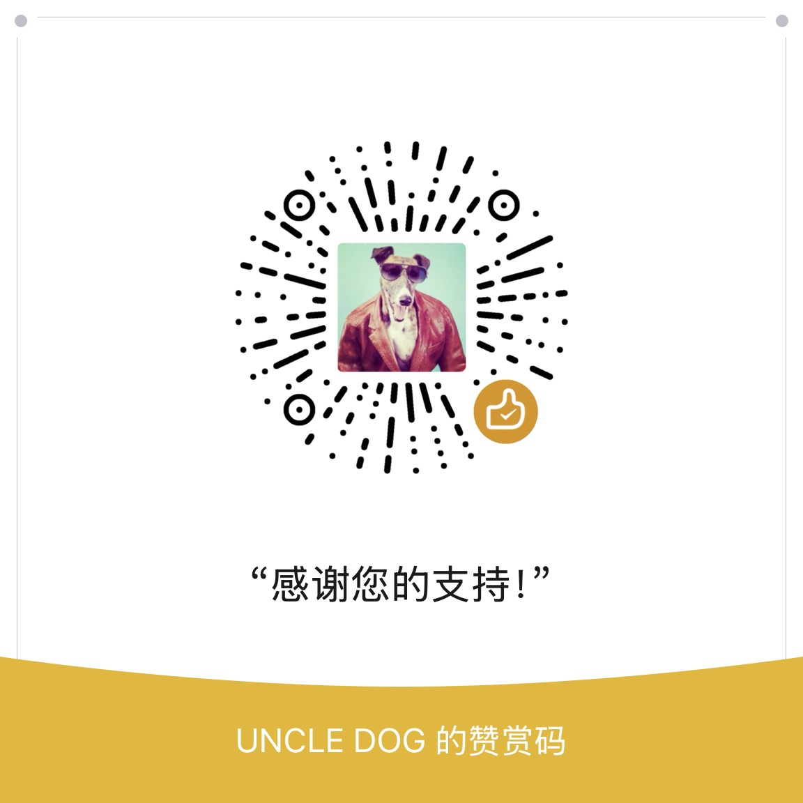

# ❤️ 支持本项目 / Support This Project

**中文**

## 📮 商务合作 / Business Contact

功能定制、企业集成、赞助与合作事宜，欢迎邮件联系：

**gengxutang@agent.qq.com**

（也欢迎直接在 [Issues](https://github.com/01UNCLEDOG01/TokenTracker-Plus/issues) 里公开讨论——通用问题公开问，能让后来者受益。）

---

TokenTracker Plus 完全免费、开源（MIT）：没有会员，也没有付费功能。如果它帮你省下了时间，欢迎请作者喝杯咖啡。

赞赏完全自愿，不解锁任何功能，也不影响项目的任何使用。

  

**同样有用的支持**：给仓库点一个 Star · 在 Issues 里反馈问题与建议 · 提交 Pull Request · 把它分享给需要的朋友。

**关于上游**：本项目基于 [xiufengsun/TokenTracker](https://github.com/xiufengsun/TokenTracker)（MIT）——如果你觉得 TT-plus 有用，也欢迎去给上游点个 Star，那是这一切的起点。

---

**English**

## 📮 Business Contact

For custom development, enterprise integration, sponsorship or partnership, reach me by email:

**gengxutang@agent.qq.com**

(Or just open a public [Issue](https://github.com/01UNCLEDOG01/TokenTracker-Plus/issues) — general questions in public help everyone.)

---

TokenTracker Plus is completely free and open source (MIT) — no memberships, no paid features. If it saves you time, you are welcome to buy the author a coffee.

Donations are entirely voluntary: they unlock nothing and do not change how the project works in any way.

**About upstream**: this project is built on [xiufengsun/TokenTracker](https://github.com/xiufengsun/TokenTracker) (MIT) — if TT-plus is useful to you, a Star on the upstream repository is a great way to say thanks too.
